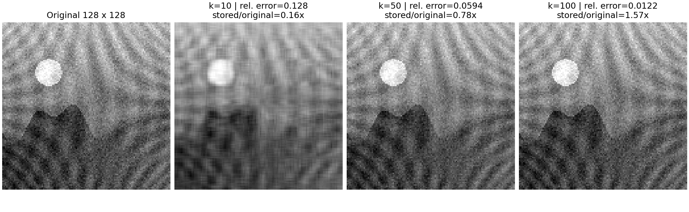
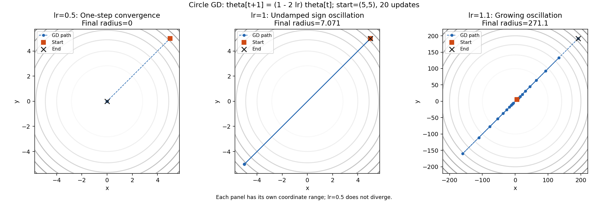
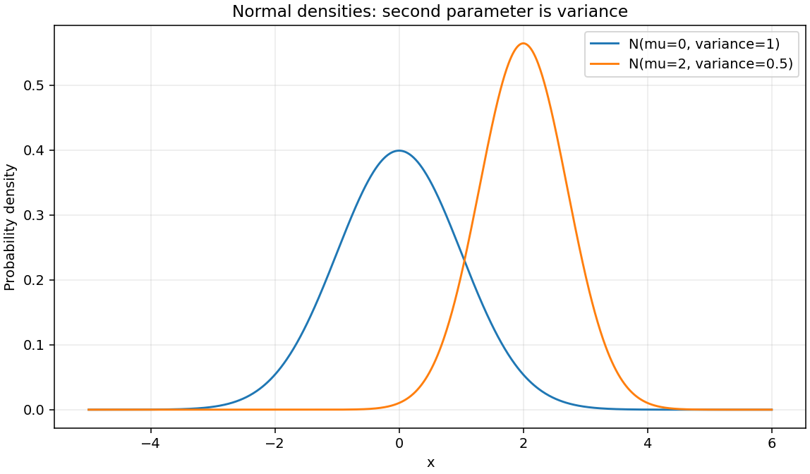
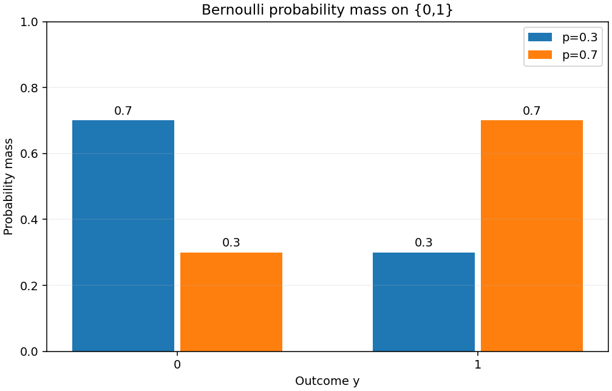

# 미션 15항목 실행 증거

기준 구현: [main d43b076](https://github.com/ntt65/A2_1/tree/d43b076319ac7fcf1bde5f1fecf48188bd00727a). 아래 값은 해당 커밋의 실행된 노트북·JSON·PNG를 대조한 요약이며 새 외부 평가 점수가 아니다. 최신 외부 결과와 과거 결과의 판정 차이는 [평가 분석](Naito_AI_eval_result.md)에 별도로 보존한다.

그림은 [미션 원문](A2_1_mission.md)이 지정한 **outputs/ 폴더의 PNG**다. 노트북은 notebooks/에 있으며, 일반 텍스트로 읽을 수 있는 [전체 수식 유도](docs/MATH_DERIVATIONS.md)도 제공한다. 링크를 따라가지 않아도 핵심 근거를 확인할 수 있도록 수치와 수식을 본문에도 적었다.

## 15항목과 직접 증거

| 항목 | 실행 결과·검증 조건 | 원본 파일 |
|---|---|---|
| #1 변환 | 회전45도·스케일(2,.5)·전단의 세 패널 | [PNG](outputs/linear_transforms.png), [구현](src/linear_algebra.py) |
| #2 면적 | 스케일 det=1/면적비1; 반사 det=−6/면적비5.999999999999997, 상대오차4.44e-16≤.01 | [JSON: transforms](outputs/linear_algebra_metrics.json) |
| #3 고유값 | Power Iteration4.618033988749896, eig4.618033988749895, 상대오차1.923282552410481e-16≤.05 | [비교 보고서](outputs/power_iteration_eig_comparison.md), [JSON](outputs/power_iteration_eig_comparison.json) |
| #4 SVD | 128×128의 k=10/50/100 상대 Frobenius 오차 .1275184713562091/.05938687046053636/.01218300917179587 | [k10/50/100 PNG](outputs/svd_128.png), [JSON: svd](outputs/linear_algebra_metrics.json), [64×64 본실험](outputs/svd_64.png) |
| #5 중심차분 | f=x²,x=3,h=1e-5:6.000000000039306, 해석값6, 오차3.930633596382904e-11≤1e-4 | [JSON](outputs/calculus_metrics.json), [h 탐색 그림](outputs/derivative_error.png) |
| #6 Gradient | ∇f=(2x,2y), 접선과 정규화 내적 최대0≤1e-12 | [PNG](outputs/gradient_geometry.png), [JSON: gradient](outputs/calculus_metrics.json) |
| #7 역전파 유도 | 입력2→은닉2→출력1, BCE·연쇄법칙6개 미분, 아래 고정 예제 | [실행 노트북](notebooks/backprop_derivation.ipynb), [수식 전개](docs/MATH_DERIVATIONS.md) |
| #8 손계산 비교 | 13개 값의 네 자리 표시 일치, 최대 손계산 오차2.220446049250313e-16, 9개 매개변수 중심차분 오차7.842670957103337e-12 | [JSON: hand_reference/four_decimal_match](outputs/backprop_metrics.json), 노트북 셀 backprop-compare |
| #9 GD 수렴 | 시작(5,5),lr=.1,100회, 최종반경1.4404019523870759e-9<.1; .1 최초 진입/유지 시작20회 | [JSON: comparisons.circle](outputs/optimizer_metrics.json) |
| #10 학습률 | 20회 후 lr=.5/1/1.1 최종반경0/7.0710678118654755/271.0877688101304 | [실행 PNG](outputs/optimizer_learning_rates.png), [JSON: learning_rates](outputs/optimizer_metrics.json) |
| #11 Momentum | 원형 GD/Momentum의 같은 시작점·lr=.1·100회 경로/손실/반경 비교 | [비교 PNG](outputs/optimizer_circle.png), [JSON](outputs/optimizer_metrics.json), [여러 초기점 보고서](outputs/optimizer_sensitivity.md) |
| #12 타원형 | f=x²+10y², 시작(5,5),lr=.05·100회 GD/Momentum 비교 | [경로 PNG](outputs/optimizer_ellipse.png), [JSON: comparisons.ellipse](outputs/optimizer_metrics.json) |
| #13 분포 | N(0,1)/N(2,.5)의 PDF 및 Bernoulli(.3)/(.7)의 PMF; 분산 표기 사용 | [정규 PNG](outputs/probability_normal.png), [Bernoulli PNG](outputs/probability_bernoulli.png), [실행 노트북](notebooks/probability_loss.ipynb) |
| #14 Softmax | 행 합 .9999999999999999/1, 행·열 합 최대오차1.1102230246251565e-16≤1e-6 | [JSON: softmax](outputs/probability_metrics.json), [확장 축 검증](outputs/evaluation_evidence.md) |
| #15 MLE | 고정 분산 Gaussian NLL와 MSE의 같은 최소점, Bernoulli BCE와 categorical CE 유도 | [전체 유도6~8절](docs/MATH_DERIVATIONS.md), [노트북](notebooks/probability_loss.ipynb), [JSON](outputs/probability_metrics.json) |

## #4 SVD 실행 그림

128×128은 k=100 비교를 위한 보충 실험이다. 별도의64×64 실험은 k=10/50/64다. 모든 그림을64px로 줄이라는 요구가 아니다. 상세 근거는 [결정 D09](docs/DECISIONS.md#d09--svd-이미지-크기와-rank-충돌을-두-실험으로-해결한다)에 있다.



## #7·#8 역전파 손계산·shape·비교

고정 입력은 x=[1,0], W1=[[.1,.2],[.3,.4]], b1=[0,0], W2=[.5,.6], b2=0, y=1이다. z1=W1@x+b1=[.1,.3], a1=sigmoid(z1)=[.524979187479,.574442516812], z2=W2@a1+b2=.607155103826, p=sigmoid(z2)=.647291569995, L=−ln(p)=.434958436851이다.

shape는 x/b1/W2/z1/a1=(2,), W1=(2,2), b2/y/z2/p/L=()이며 float64를 사용한다. 단일 표본이므로 배치 평균 계수는 없다.

| 단계 | 독립 손계산식 | NumPy와 같은 네 자리 표시 | shape |
|---|---|---|---|
| dL/dp | −1/p | −1.5449 | scalar |
| δ2=dL/dz2 | (−1/p)p(1−p)=p−1 | −.3527 | scalar |
| dL/dW2 | δ2 a1 | [−.1852,−.2026] | (2,) |
| dL/da1 | δ2 W2 | [−.1764,−.2116] | (2,) |
| δ1=dL/dz1 | (δ2 W2)⊙a1⊙(1−a1) | [−.0440,−.0517] | (2,) |
| dL/dW1 | outer(δ1,x) | [[−.0440,0],[−.0517,0]] | (2,2) |

독립 기준값은 계산 코드에서 다시 가져오지 않은 상수이며 마지막 표시에서만 반올림한다. z2=.6072, 최대 손계산 오차2.220446049250313e-16≤5e-5, four_decimal_match=true다. 노트북 셀 backprop-forward-derivation/backprop-chain-rule/backprop-compare에 전개·비교 출력이 있다. 실행 코드8셀의 count는1~8이고 저장 오류 출력은0개다.

## #10 학습률별 실행 결과

원형 함수에서 theta_next=(1−2lr)theta이므로 lr=.5는 즉시 수렴, lr=1은 부호 진동, lr=1.1은 매 단계 반경×1.2로 발산한다. ‘.5 이상이면 모두 발산’으로 해석하지 않는다. 아래 PNG와 JSON은 실제20회 경로를 저장한다.



## #13 정규·Bernoulli 분포

정규 PDF는 exp(−(x−μ)²/(2σ²))/sqrt(2πσ²)다. N(0,1)·N(2,.5)의 μ±8σ 구간10001점 적분 오차는 각각1.1102230246251565e-15/9.992007221626409e-16≤1e-4다. Bernoulli PMF는 [1−p,p]이며 p=.3/.7에서 질량합 오차0이다. 확률 노트북은 코드9셀 count1~9, 저장 오류 출력0개다.





## #15 MLE와 MSE·Cross-Entropy의 연결

Gaussian: 독립 yᵢ=fθ(xᵢ)+εᵢ, εᵢ~N(0,σ²), 고정 σ²>0을 가정한다. 우도는 정규 PDF들의 곱, 로그우도는 합이므로 NLL=n/2 ln(2πσ²)+Σ(yᵢ−fθ(xᵢ))²/(2σ²)다. 첫 항은 θ와 무관하고 두 번째 계수는 양수이므로 argmin NLL=argmin SSE=argmin MSE다. 같은 수치라는 뜻은 아니다. 저장 예제 n=3,σ²=.5,SSE=1.5,MSE=.5,NLL=3.2170948287741004, 항등식 오차4.440892098500626e-16이다.

Bernoulli: 독립 이진 관측의 우도 Πpᵢ^yᵢ(1−pᵢ)^(1−yᵢ)에 −ln을 취하면 Σ[−yᵢ ln pᵢ−(1−yᵢ)ln(1−pᵢ)]로 BCE 합이 된다. p=[.3,.7],y=[0,1]에서 합 .7133498878774649다.

Categorical: one-hot yᵢₖ에 대해 우도 ΠᵢΠₖ pᵢₖ^yᵢₖ의 NLL은 −ΣᵢΣₖ yᵢₖ ln pᵢₖ로 Cross-Entropy 합이다. 확률 [.2,.3,.5]의 정답 클래스 인덱스2(0부터 세므로 세 번째 클래스)에서 CE=−ln(.5)=.6931471805599453이다. 합을 n으로 나눈 평균도 같은 최소점을 갖는다. 자연로그를 사용하며 양의 target에 확률0을 주면 손실은+inf다.

원본 셀 ID: gaussian-mle-derivation, bernoulli-mle-derivation, categorical-mle-derivation. 단계별 식·가정·경계는 [일반 Markdown 유도](docs/MATH_DERIVATIONS.md)에서도 읽을 수 있다.

## 재현과 검증 범위

설치는 [README](README.md)를 따른다. 프로젝트 가상환경의 Python으로 아래 명령을 저장소 루트에서 실행한다.

```text
python -m scripts.run_linear_algebra --no-cache
python -m scripts.run_calculus
python -m scripts.run_optimizer --no-cache
python -m scripts.run_notebooks
python -m unittest discover -s tests -v
python scripts/update_registry.py --check
```

Windows 실행 파일은 .venv/Scripts/python.exe, Linux는 .venv/bin/python이다. run_notebooks는 새 커널을 쓰고 기본 옵션에서 원본 노트북을 수정하지 않는다. 기존 main의 [Windows/Linux CI](https://github.com/ntt65/A2_1/actions/runs/42444593857)는 각각186개 검사·환경·색인 검사를 통과했다. 이 내부 검증은 외부15개 평가 항목의 판정을 대신하지 않는다.
