# A2_1 — AI가 어떻게 학습하는지 수학으로 직접 풀어보기

선형대수·미적분·역전파·최적화·확률의 수식을 직접 유도하고 NumPy로 구현·검증한 프로젝트입니다. 신경망이 **입력을 행렬로 변환하고 → 손실의 변화율을 구하고 → 연쇄 법칙으로 가중치까지 전달하고 → 가중치를 갱신하는 과정**, 그리고 손실을 확률 모형에서 선택하는 이유를 작은 고정 실험으로 설명합니다. 본문은 [미션 원문](A2_1_mission.md) 2절·4절의 기본 미션을 따르며, 실행 조건·계산 결과·수학적 검증·해석·그림을 함께 제공합니다. 5절의 Adam·Newton·정보 이론 보너스는 문서 맨 아래에 별도로 정리했습니다.

**최종 제출·평가 주소:** [https://github.com/ntt65/A2_1/tree/main](https://github.com/ntt65/A2_1/tree/main). 기본 미션, 평가 권고 보완, 보너스 세 항목의 코드는 아래 명령으로 재현합니다. 사용자의 main 제출 지시에 따른 순차 병합·최종 main 검사 기록은 [이슈 #27](https://github.com/ntt65/A2_1/issues/27)에서 확인합니다.

## 기본 미션 — 필수 15항목과 실행 증거

미션에서 지정한 outputs/ 폴더에 기본 PNG 10개를 저장했고, 두 노트북의 실행 출력과 JSON을 함께 제공합니다. 아래 표는 15개 평가 항목의 찾아보기이며, 이어지는 본문에 실험의 목적·입력·수식 전개·실측값·허용오차·결론을 모두 제시합니다. **표에 적힌 내부 검증 통과와 외부 Naito 판정은 구분합니다.** [수식·shape·그림을 모은 증거 본문](MISSION_EVIDENCE.md)도 유지합니다. 항목별 용어·예상 질문·반례까지 자세히 읽으려면 [평가 Q&A 사전](docs/EVALUATION_QA.md)을 참고하세요.

읽는 순서: [선형대수](#mission-linear) → [미적분](#mission-calculus) → [역전파](#mission-backprop) → [최적화](#mission-optimizer) → [확률·MLE](#mission-probability). 실행은 [설치와 재현](#설치와-재현), 선택 과제는 마지막 [보너스 미션](#bonus-missions)에 있습니다. 그림 링크를 열지 않아도 핵심 수치와 결론을 읽을 수 있고, 각 PNG를 열면 실제 축·경로·곡선을 함께 확인할 수 있습니다.

| 항목 | 실행 결과·검증 조건 | 원본 파일 |
|---|---|---|
| #1 변환 | 회전45도·스케일(2,.5)·전단의 세 패널 | [PNG](outputs/linear_transforms.png), [구현](src/linear_algebra.py) |
| #2 면적 | 스케일 det=1/면적비1; 반사 det=−6/면적비5.999999999999997, 상대오차4.44e-16≤.01 | [JSON: transforms](outputs/linear_algebra_metrics.json) |
| #3 고유값 | Power Iteration4.618033988749896, eig4.618033988749895, 상대오차1.923282552410481e-16≤.05 | [비교 보고서](outputs/power_iteration_eig_comparison.md), [JSON](outputs/power_iteration_eig_comparison.json), [검증](tests/test_power_iteration_verification.py) |
| #4 SVD | 128×128의 k=10/50/100 상대 Frobenius 오차 .1275184713562091/.05938687046053636/.01218300917179587; 64/128 완전 rank 오차2.36e-15/1.10e-15≤1e-10 | [k10/50/100 PNG](outputs/svd_128.png), [JSON: svd](outputs/linear_algebra_metrics.json), [64×64 본실험](outputs/svd_64.png) |
| #5 중심차분 | f=x²,x=3,h=1e-5:6.000000000039306, 해석값6, 오차3.930633596382904e-11≤1e-4 | [JSON](outputs/calculus_metrics.json), [h 탐색 그림](outputs/derivative_error.png) |
| #6 Gradient | ∇f=(2x,2y), 중심차분 최대오차3.29634097795406e-11≤1e-8, 접선과 정규화 내적 최대0≤1e-12 | [PNG](outputs/gradient_geometry.png), [JSON: gradient](outputs/calculus_metrics.json) |
| #7 역전파 유도 | 입력2→은닉2→출력1, BCE·연쇄법칙6개 미분, 아래 고정 예제 | [실행 노트북](notebooks/backprop_derivation.ipynb), [수식 전개](docs/MATH_DERIVATIONS.md) |
| #8 손계산 비교 | 13개 값의 네 자리 표시 일치, 최대 손계산 오차2.220446049250313e-16, 9개 매개변수 중심차분 오차7.842670957103337e-12 | [JSON: hand_reference/four_decimal_match](outputs/backprop_metrics.json), 노트북 셀 backprop-compare |
| #9 GD 수렴 | 시작(5,5),lr=.1,100회, 최종반경1.4404019523870759e-9<.1; .1 최초 진입/유지 시작20회 | [JSON: comparisons.circle](outputs/optimizer_metrics.json) |
| #10 학습률 | 20회 후 lr=.5/1/1.1 최종반경0/7.0710678118654755/271.0877688101304 | [실행 PNG](outputs/optimizer_learning_rates.png), [JSON: learning_rates](outputs/optimizer_metrics.json) |
| #11 Momentum | 원형 GD/Momentum의 같은 시작점·lr=.1·100회 경로/손실/반경 비교 | [비교 PNG](outputs/optimizer_circle.png), [JSON](outputs/optimizer_metrics.json), [여러 초기점 보고서](outputs/optimizer_sensitivity.md) |
| #12 타원형 | f=x²+10y², 시작(5,5),lr=.05·100회 GD/Momentum 비교 | [경로 PNG](outputs/optimizer_ellipse.png), [JSON: comparisons.ellipse](outputs/optimizer_metrics.json) |
| #13 분포 | N(0,1)/N(2,.5)의 PDF 적분오차1.11e-15/9.99e-16≤1e-4; Bernoulli(.3)/(.7) PMF 질량오차0; 정규분포는 분산 표기 | [정규 PNG](outputs/probability_normal.png), [Bernoulli PNG](outputs/probability_bernoulli.png), [실행 노트북](notebooks/probability_loss.ipynb) |
| #14 Softmax | 행 합 .9999999999999999/1, 행·열 합 최대오차1.1102230246251565e-16≤1e-6 | [JSON: softmax](outputs/probability_metrics.json), [확장 축 검증](outputs/evaluation_evidence.md), [공통 구현](src/utils/math.py) |
| #15 MLE | 고정 분산 Gaussian NLL와 MSE의 같은 최소점(항등식오차4.44e-16); Bernoulli BCE합 .7133498878774649/categorical CE .6931471805599453 및 유도 | [전체 유도6~8절](docs/MATH_DERIVATIONS.md), [노트북](notebooks/probability_loss.ipynb), [JSON](outputs/probability_metrics.json) |

<!-- BEGIN VERIFIED MISSION RESULTS -->

## 기본 미션 실제 실행 결과

아래 표·수식·판정은 기존 실험을 새로 실행해 생성했습니다. 기존 PNG와 링크를 보존하며 그림을 만드는 원본 수치를 함께 기록합니다. 재생성: `python -m scripts.run_submission_reports --update-readme`.

<a id="mission-linear"></a>

### 선형대수 실행 결과

실행 환경: Python 3.11.4, NumPy 2.2.6, Matplotlib 3.10.3; float64, 독립 실험 시작 시 seed42.

실행 원본: `scripts/run_linear_algebra.py`; source SHA-256 `4579ecaafbd471fc0830cc2d989341922e75739db17c999aa702bbc501f11f62`.

이번 실행 JSON SHA-256 `79d61a1361ab4d3e1142f3bffea7575980f63948fb7ef94f9f4836187ab76d42`. 기존 제출 JSON과 구조·입력·직접 계산값 재현 비교 통과(atol=rtol=1e-12). 중심차분의 플랫폼별 반올림 차이는 저장값의 끝자리 일치 대신 기존 해석값·오차 기준으로 검증했습니다. 각 실험의 수학 수용 기준은 변경하지 않았습니다. PNG와 노트북 원본은 수정하지 않았습니다.

원본: [linear_algebra_metrics.json](outputs/linear_algebra_metrics.json); seed=42, dtype=float64.
전체 재현: `python -m scripts.run_submission_reports`.
개별 실험: `python -m scripts.run_linear_algebra`. 아래 판정은 저장 수치와 고정 허용치를 대조한 결과다.

**미션 연결: #1~#4 — 행렬 변환·면적·고유값·SVD.** 신경망의 선형층은 입력 좌표를 섞고 늘리는 행렬 연산이다. 이 실험은 그 연산이 공간의 모양과 면적을 어떻게 바꾸는지 확인한 뒤, 변환을 대표하는 방향과 이미지 복원에 필요한 성분을 살펴본다. 수치표는 계산의 정확도를, 그림은 변환과 근사의 기하학적 의미를 보여 준다.

#### 행렬 변환과 면적

고정 입력은 `scripts/run_linear_algebra.py:run_experiment`의 설정이다(JSON에는 변환 행렬 미저장). c=cos(π/4), s=sin(π/4); 단위 원 400점 P:(2,400)에 A:(2,2) @ P를 적용한다.

| 변환 | A | det(A) | 면적 전 → 후 | 면적비 | 오차 종류·값 | 허용치 | 판정 |
|---|---|---:|---|---:|---|---:|---|
| rotation | `[[c,-s],[s,c]]` | 1.0000000000000002 | 3.141463462364136 → 3.1414634623641358 | 0.9999999999999999 | relative: 3.330669073875469e-16 | 0.01 | PASS |
| scaling | `[[2,0],[0,0.5]]` | 1 | 3.141463462364136 → 3.141463462364136 | 1 | relative: 0 | 0.01 | PASS |
| shear | `[[1,1],[0,1]]` | 1 | 3.141463462364136 → 3.1414634623641344 | 0.9999999999999994 | relative: 5.551115123125783e-16 | 0.01 | PASS |
| reflection | `[[-2,0],[0,3]]` | -6 | 3.141463462364136 → 18.84878077418481 | 5.999999999999997 | relative: 4.440892098500626e-16 | 0.01 | PASS |
| singular | `[[2,0],[0,0]]` | 0 | 3.141463462364136 → 0 | 0 | absolute: 0 | 1e-10 | PASS |

상대오차 = abs(면적비−abs(det))/abs(det); 특이 행렬은 면적비 절대오차를 사용한다.
[변환 PNG](outputs/linear_transforms.png)

세 패널의 회색 점선은 원본 단위 원, 파란 실선은 변환 결과다. 화살표는 같은 기준점의 이동을 보여 준다. 원은 회전해도 윤곽이 겹치므로 회전 여부는 화살표를 함께 읽어야 한다. 스케일링은 가로를 늘리고 세로를 줄여 타원을 만들지만 배율의 곱이 1이어서 면적은 유지된다. 전단도 이 예제에서는 면적을 보존한다. 표의 음의 행렬식은 방향 반전을 뜻하며 면적 크기는 절댓값과 비교한다.

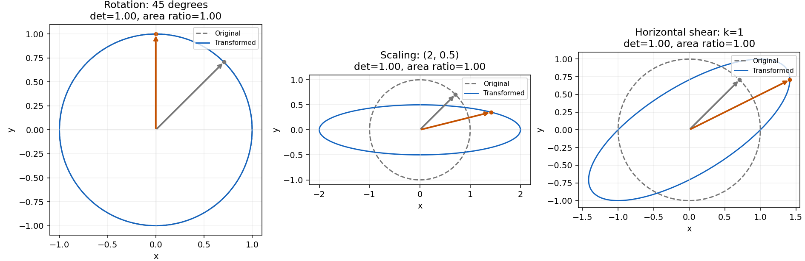

#### Power Iteration과 eig

Power Iteration은 변환을 반복할 때 상대적으로 가장 강하게 남는 방향을 찾는다. 매번 벡터를 정규화해 크기를 제어하고 방향의 변화를 관찰한다. 이 예제는 두 고유값의 절댓값이 분리되고 초기 벡터가 지배 방향의 성분을 가져 수렴한다. 고유값 오차는 기준값과의 일치, 잔차는 Av≈λv의 일치를 점검한다.

반복식은 w=A v_t, v_(t+1)=w/||w||₂이고, 고유값은 Rayleigh quotient λ=(vᵀAv)/(vᵀv)로 추정한다. 고유기저에서 v₀=Σ c_i u_i이면 A^t v₀=Σ c_i λ_i^t u_i이므로 유일하게 절댓값이 큰 고유값과 그 방향의 0이 아닌 초기 성분이 있을 때 다른 성분의 상대 비중이 줄어든다. 일반 행렬에서 이러한 조건 없이 지배값 수렴을 보장하지 않으며, 여기의 양의 대칭 행렬에서는 최대 절댓값과 최대 고유값이 같다. 초기 영벡터는 정규화할 수 없어 거부한다. Av=0이면 길이로 나누지 않고 영 곱 종료를 보고한다.

A=[[4,1],[1,3]], 초기 v=[1,1]; 기준 λ=(7+sqrt(5))/2. 수동 반복에는 eig를 호출하지 않는다.
정규화 고유벡터 v=[0.8506508082738572, 0.5257311122456358], shape=(2,).
λ_power=4.618033988749896, λ_eig=4.618033988749895; 상대오차=1.923282552410481e-16 ≤ 0.05: PASS.
상대 잔차 ||Av−λv||₂/(||A||F·||v||₂)=6.399563856969149e-11 ≤ 1e-6: PASS; 반복=32, converged=True, 종료=residual_tolerance.
작은 잔차만으로 임의 입력의 지배 고유값 도달을 보장하지 않는다. [eig 상세 보고서](outputs/power_iteration_eig_comparison.md)

#### SVD 복원

SVD는 입력과 출력의 직교 기저 사이에서 행렬을 특잇값 성분으로 나누고, 큰 성분부터 남겨 이미지를 근사한다. 정방행렬의 Av=λv를 찾는 고유값 문제와 구분되며 직사각형 행렬에도 적용할 수 있다. rank를 늘릴 때 복원 오차가 얼마나 줄고 저장할 원소가 얼마나 늘어나는지를 함께 비교한다.

A_k=U[:,:k] diag(s[:k]) Vt[:k,:]; 오차=||A−A_k||F/||A||F (표시용 clipping 전). 저장 비율=k(m+n+1)/(mn), 원소 수 기준이며 1보다 크면 저장량 절감이 아니다.

| 원본 shape | k | 상대 Frobenius 오차 | 저장/원본 원소 비율 |
|---|---:|---:|---:|
| 64×64 | 10 | 0.11607845060286695 | 0.31494140625 |
| 64×64 | 50 | 0.013222144059052797 | 1.57470703125 |
| 64×64 | 64 | 2.3605124574215274e-15 | 2.015625 |
| 128×128 | 10 | 0.1275184713562091 | 0.1568603515625 |
| 128×128 | 50 | 0.05938687046053636 | 0.7843017578125 |
| 128×128 | 100 | 0.01218300917179587 | 1.568603515625 |

64×64: 완전 rank 오차=2.3605124574215274e-15 ≤ 1e-10: PASS; k 증가 시 오차 비증가(atol=1e-12): PASS.
128×128: 완전 rank 오차=1.1042954043230347e-15 ≤ 1e-10: PASS; k 증가 시 오차 비증가(atol=1e-12): PASS.
64×64 입력에서 rank 100은 불가능하므로 본 실험은 10/50/64, 별도 128×128 실험은 10/50/100을 사용한다. 배열 크기이며 전체 PNG 크기가 아니다.
[64×64 PNG](outputs/svd_64.png) · [128×128 PNG](outputs/svd_128.png)

각 그림의 왼쪽은 원본, 오른쪽은 세 rank 복원이며 한 그림 안에서는 같은 밝기 기준을 사용한다. 고정 시드로 만든 합성 풍경·원판·질감의 세부가 얼마나 복원되는지와 저장 비율을 함께 읽는다. 가장 선명한 결과가 가장 효율적인 압축이라는 결론은 나오지 않는다. 두 크기는 서로 다른 입력 실험이므로 그림 사이의 차이를 rank 효과 하나로 설명하지 않는다.


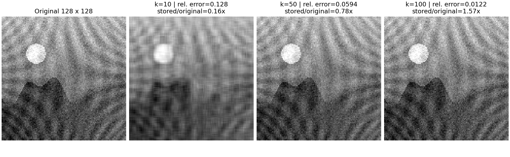

<a id="mission-calculus"></a>

### 미적분 실행 결과

실행 환경: Python 3.11.4, NumPy 2.2.6, Matplotlib 3.10.3; float64, 독립 실험 시작 시 seed42.

실행 원본: `scripts/run_calculus.py`; source SHA-256 `e63347572c173104fdb76543a5754b925432b38d048732c96d4195234df9250c`.

이번 실행 JSON SHA-256 `3c1da3ca1abe047c8bc2b39c3776cfe91829e4c4fd680382fa4ed354761d2fa2`. 기존 제출 JSON과 구조·입력·직접 계산값 재현 비교 통과(atol=rtol=1e-12). 중심차분의 플랫폼별 반올림 차이는 저장값의 끝자리 일치 대신 기존 해석값·오차 기준으로 검증했습니다. 각 실험의 수학 수용 기준은 변경하지 않았습니다. PNG와 노트북 원본은 수정하지 않았습니다.

원본: [calculus_metrics.json](outputs/calculus_metrics.json); seed=42, dtype=float64.
전체 재현: `python -m scripts.run_submission_reports`.
개별 실험: `python -m scripts.run_calculus`. 아래 판정은 저장 수치와 고정 허용치를 대조한 결과다.

**미션 연결: #5~#6 — 중심차분과 Gradient 기하.** 미분은 입력을 조금 바꿀 때 함수가 얼마나 변하는지 알려 준다. 중심차분은 양쪽 함수값으로 이 변화율을 근사하므로 손으로 구한 미분과 이후 역전파를 독립적으로 확인하는 도구가 된다. 여기서는 근사의 오차를 먼저 측정하고, 여러 변수에서 기울기가 가리키는 방향을 등고선과 연결한다.

#### 중심차분과 h 탐색

f(x)=x², x=3, h=1e-5; (f(x+h)−f(x−h))/(2h), 해석값 f′(3)=6.

| 검사 | 측정 | 독립 기대값 | 절대오차 | 허용치 | 판정 |
|---|---:|---:|---:|---:|---|
| 고정 중심차분 | 6.000000000039306 | 6 | 3.930633596382904e-11 | 0.0001 | PASS |

x² 탐색: h=1e-15~1, 61개 표본. 절대오차 ≤ 1e-4: PASS 46/61, FAIL 15/61 (고정 h 검증과 별개).
통과한 인접 표본 묶음: 5.6234132519034904e-12~1 (46표본). 실수 연속 구간 전체의 통과를 보장하지 않는다.
최소 관측오차=0, 해당 표본 h=1; 전체 최대오차=0.6709294817992486.
sin(x), x=3 비교: 최소 관측오차=1.769584478950037e-12, 전체 최대오차=0.15694253553364046.
x²의 중심차분은 정확 연산에서 절단오차가 0이다. sin(x)는 O(h²) 절단오차가 있고 작은 h에서는 반올림 오차가 커질 수 있다. 최소오차를 보인 표본 h를 보편적인 최적 간격으로 일반화하지 않는다.
[h별 오차 PNG](outputs/derivative_error.png)

그림의 가로축은 간격 h, 세로축은 해석값 대비 절대오차다. 두 실선은 x²와 sin(x)의 실제 오차이고 점선은 sin(x)의 2차 절단오차 주도항이다. 큰 h의 근사 오차와 작은 h의 뺄셈·반올림 영향을 구분해 읽는다. x²는 중심차분의 절단오차가 사라지는 특별한 예제이므로 일반 함수의 권장 h를 정하는 근거로 사용하지 않는다. 세로축은 원점 부근을 선형으로 표시해 오차 0도 그대로 보존한다.

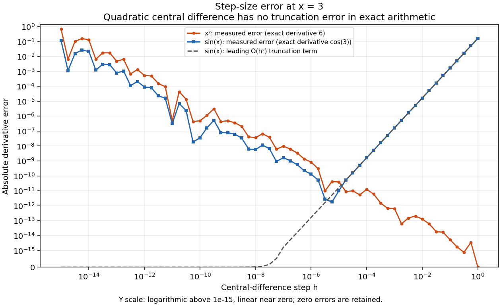

#### Gradient와 등고선 접선

f(x,y)=x²+y², ∇f=(2x,2y), 접선=(-y,x). 반경 2의 8점과 원점; 측정 gradient shape=(9,2), 중심차분 h=1e-5.

| 검사 | 측정 오차 | 허용치 | 판정 |
|---|---:|---:|---|
| 수치/해석 gradient 최대 절대오차 | 3.29634097795406e-11 | 1e-8 | PASS |
| 원점 제외 정규화 내적 최대 절댓값 | 0 | 1e-12 | PASS |
| 원점 수치 gradient [0,0] 일치 | 0 | 0 | PASS |

원점의 해석 gradient=[0,0], 방향 없음(null); 수직성 검사에서 제외한다. 그림의 화살표 길이 정규화와 위 수치의 원래 크기는 구분한다.
[Gradient/등고선 PNG](outputs/gradient_geometry.png)

등고선을 따라 움직이면 함수값이 변하지 않아 그 방향의 변화율은 0이다. 반경 2의 여덟 점에서 주황색 화살표는 가장 빠르게 증가하는 기울기 방향, 파란색은 등고선의 접선 방향을 나타낸다. 둘이 수직이므로 경사하강법은 주황색 화살표의 반대쪽으로 이동한다. 화살표는 방향을 읽기 쉽도록 길이를 각각 일정하게 표시했으며 실제 기울기 크기를 비교하는 그림은 아니다. 표의 내적 검증은 눈으로 본 수직 관계를 수치로 확인한다.

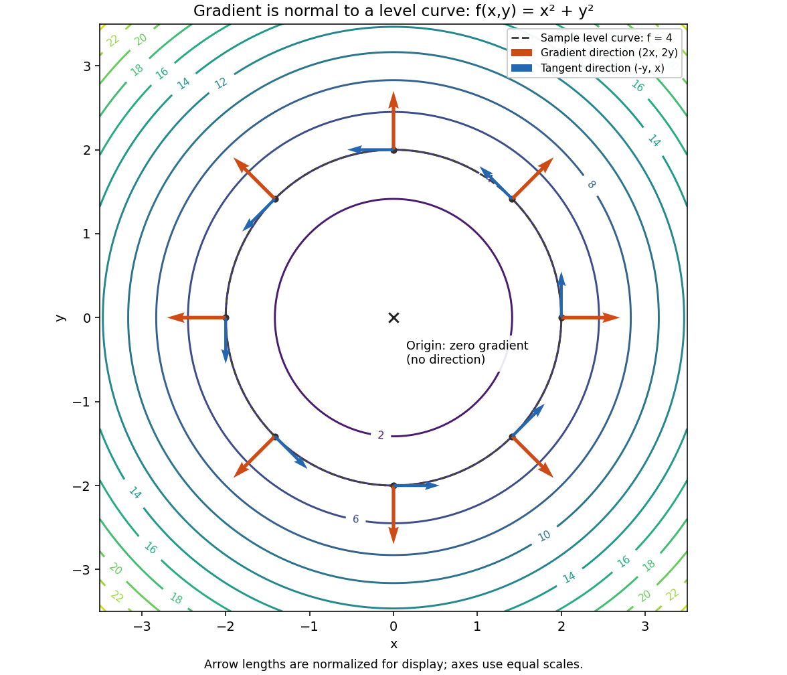

<a id="mission-backprop"></a>

### 역전파: 실행된 손계산·NumPy 비교

실행 환경: Python 3.11.4, NumPy 2.2.6, Matplotlib 3.10.3; float64, 독립 실험 시작 시 seed42.

실행 원본: `notebooks/backprop_derivation.ipynb`; source SHA-256 `825291975d55d618f3e8a91f64161f8d676b7b6c82ebe629c9b49ac24d97277d`.

이번 실행 JSON SHA-256 `111accc7b6e77f4d795323df5789a9cc08d4640b2e5b00d79aa08a474e25aec1`. 기존 제출 JSON과 구조·입력·직접 계산값 재현 비교 통과(atol=rtol=1e-12). 중심차분의 플랫폼별 반올림 차이는 저장값의 끝자리 일치 대신 기존 해석값·오차 기준으로 검증했습니다. 각 실험의 수학 수용 기준은 변경하지 않았습니다. PNG와 노트북 원본은 수정하지 않았습니다.

**미션 연결: #7~#8 — 연쇄 법칙 유도와 손계산 검증.** 이 작은 신경망은 자동 미분 없이 학습의 한 단계를 끝까지 추적하기 위한 예제다. 순전파는 입력에서 예측과 손실을 만들고, 역전파는 그 경로를 거슬러 각 가중치를 조금 바꿀 때 손실이 얼마나 달라지는지 구한다. shape 표기는 스칼라·벡터·행렬을 구분해 원소별 곱과 내적, 외적을 혼동하지 않도록 돕는다.

seed 42 · float64 · NumPy 2.2.6; 코드 8셀을 순서대로 실행했고 오류 출력은 0개다.
재현: `python -m scripts.run_submission_reports`; 개별 실행: `python -m scripts.run_notebooks notebooks/backprop_derivation.ipynb`.
원시 데이터: [backprop_metrics.json](outputs/backprop_metrics.json). 원본: [backprop_derivation.ipynb](notebooks/backprop_derivation.ipynb).

#### 1. 고정 입력과 shape

| 기호 | 값 | shape |
|---|---|---|
| `x` | `[1, 0]` | `(2,)` |
| `W1` | `[[0.1, 0.2],  [0.3, 0.4]]` | `(2, 2)` |
| `b1` | `[0, 0]` | `(2,)` |
| `W2` | `[0.5, 0.6]` | `(2,)` |
| `b2` | `0` | `()` |
| `y_true` | `1` | `()` |

#### 2. 순전파를 직접 계산하기

$$\sigma(z)=\frac{1}{1+e^{-z}},\qquad \sigma'(z)=\sigma(z)(1-\sigma(z)).$$

1. $z_1=W_1x+b_1=[.1,.3]^T$ — `(2,)`.
2. $a_1=\sigma(z_1)=[0.5249791874789399861,\;0.5744425168116589872]^T$ — `(2,)`.
3. $z_2=W_2a_1+b_2=.5a_{1,1}+.6a_{1,2}=0.60715510382646538534$ — `()`.
4. $\hat y=\sigma(z_2)=0.64729156999461775097$ — `()`.
5. $L=-[y\ln\hat y+(1-y)\ln(1-\hat y)]=-\ln\hat y=0.43495843685146062506$ — `()`.

로그는 자연로그다. 현재 표본은 $y=1$이고 $0<\hat y<1$이므로 위 확률 표현이 유효하다. 일반적으로 확률이 float64에서 0 또는 1로 포화되면 `log(0)` 문제가 생긴다. $\hat y=\sigma(z_2)$를 대입하여 정리한 동치식

$$L=\log(1+e^{z_2})-yz_2=\operatorname{logaddexp}(0,z_2)-yz_2$$

을 실제 손실 계산에 사용한다. 확률을 임의로 clipping한 다른 함수를 만들지 않는다.

아래 기준 상수는 위 스칼라 식을 독립적으로 고정밀 계산해 옮긴 값이다. NumPy 순전파 결과를 복사하여 기대값을 만드는 방식이 아니다.

#### 3. 연쇄 법칙으로 역전파 유도

출력층에서 입력층 순서로 진행한다. $\odot$는 원소별 곱이다.

**① 예측값에 대한 손실 미분 — scalar `()`**

$$\frac{\partial L}{\partial\hat y}=-\frac{y}{\hat y}+\frac{1-y}{1-\hat y}=-\frac{1}{\hat y}=-1.5448988467566710784.$$

**② 출력 logit에 대한 미분 — scalar `()`**

$$\delta_2=\frac{\partial L}{\partial z_2}
=\frac{\partial L}{\partial\hat y}\hat y(1-\hat y)
=\hat y-y=-0.35270843000538224903.$$

**③ 출력 가중치에 대한 미분 — `(2,)`**

$$\frac{\partial L}{\partial W_2}=\delta_2 a_1
=[-0.18516458500119814929,-0.20261071823298063973].$$

**④ 은닉 활성값에 대한 미분 — `(2,)`**

$$\frac{\partial L}{\partial a_1}=\delta_2 W_2
=[-0.17635421500269112452,-0.21162505800322934942].$$

**⑤ 은닉 logit에 대한 미분 — `(2,)`**

$$\delta_1=\frac{\partial L}{\partial z_1}
=(\delta_2 W_2)\odot a_1\odot(1-a_1)
=[-0.04397851580869701354,-0.05173350439092561391].$$

**⑥ 첫 층 가중치에 대한 미분 — `(2,2)`**

$$\frac{\partial L}{\partial W_{1,ij}}=\delta_{1,i}x_j,\qquad
\frac{\partial L}{\partial W_1}=\delta_1x^T
=\begin{bmatrix}-0.04397851580869701354&0\\-0.05173350439092561391&0\end{bmatrix}.$$

따라서 NumPy에서는 **`np.outer(delta1, x)`**다. 이 고정 입력의 두 번째 성분이0이므로 두 번째 열은0이다.

편향은 덧셈의 미분이1이므로 $\partial L/\partial b_2=\delta_2$ — `()`, $\partial L/\partial b_1=\delta_1$ — `(2,)`다.

`z2`의 네 자리 표시는 **0.6072**, 두 번째 `delta1`은 **−0.0517**이다. 원문 참고 예시의 0.6071/−0.0513을 정답으로 복사하지 않는다([D12](docs/DECISIONS.md)).

출력 예측이 약 0.6473이고 정답은 1이므로 출력 logit에 대한 손실 기울기는 음수다. 이 지점에서 logit을 증가시키는 방향은 손실을 줄이며, 연쇄 법칙은 그 변화의 몫을 각 층의 매개변수에 전달한다. 입력의 두 번째 성분이 0이라 첫 가중치 행렬의 두 번째 열은 이 표본의 예측에 영향을 주지 않고 그 기울기도 0이다. 이는 해당 표본의 특성이며 모든 데이터에서 그 가중치가 학습되지 않는다는 뜻은 아니다.

#### 4. 13개 체크포인트의 독립 기준·실측 비교

표의 손계산·실측값은 12개 유효자리로 표시하고 오차는 원시 값에서 다시 계산했다. 손계산 허용치는 atol=5e-5, rtol=0이며 네 자리 표시도 각각 일치한다.

| 체크포인트 | shape | 독립 손계산 | NumPy 실측 | 공통 네 자리 표시 | 최대 절대오차 |
|---|---|---|---|---|---:|
| `z1` | `(2,)` | `[0.1, 0.3]` | `[0.1, 0.3]` | `[0.1000, 0.3000]` | 0.000e+00 |
| `a1` | `(2,)` | `[0.524979187479, 0.574442516812]` | `[0.524979187479, 0.574442516812]` | `[0.5250, 0.5744]` | 0.000e+00 |
| `z2` | `()` | `0.607155103826` | `0.607155103826` | `0.6072` | 0.000e+00 |
| `y_pred` | `()` | `0.647291569995` | `0.647291569995` | `0.6473` | 0.000e+00 |
| `L` | `()` | `0.434958436851` | `0.434958436851` | `0.4350` | 0.000e+00 |
| `dL_dy_pred` | `()` | `-1.54489884676` | `-1.54489884676` | `-1.5449` | 2.220e-16 |
| `dL_dz2` | `()` | `-0.352708430005` | `-0.352708430005` | `-0.3527` | 5.551e-17 |
| `dL_dW2` | `(2,)` | `[-0.185164585001, -0.202610718233]` | `[-0.185164585001, -0.202610718233]` | `[-0.1852, -0.2026]` | 0.000e+00 |
| `dL_da1` | `(2,)` | `[-0.176354215003, -0.211625058003]` | `[-0.176354215003, -0.211625058003]` | `[-0.1764, -0.2116]` | 2.776e-17 |
| `dL_dz1` | `(2,)` | `[-0.0439785158087, -0.0517335043909]` | `[-0.0439785158087, -0.0517335043909]` | `[-0.0440, -0.0517]` | 6.939e-18 |
| `dL_dW1` | `(2, 2)` | `[[-0.0439785158087, 0],  [-0.0517335043909, 0]]` | `[[-0.0439785158087, -0],  [-0.0517335043909, -0]]` | `[[-0.0440, 0.0000],  [-0.0517, 0.0000]]` | 6.939e-18 |
| `dL_db1` | `(2,)` | `[-0.0439785158087, -0.0517335043909]` | `[-0.0439785158087, -0.0517335043909]` | `[-0.0440, -0.0517]` | 6.939e-18 |
| `dL_db2` | `()` | `-0.352708430005` | `-0.352708430005` | `-0.3527` | 5.551e-17 |

#### 5. 독립 중심차분과 판정

13개 손계산 비교는 어느 중간 단계에서 계산이 어긋나는지 찾게 해 준다. 별도의 중심차분 검사는 순전파 손실만으로 최종 기울기를 확인하므로 같은 잘못된 역전파 식을 손계산과 코드에 반복하는 실수를 줄인다. 중간값은 충분한 정밀도로 계산하고 네 자리 반올림은 마지막 표시에만 적용한다.

9개 매개변수 순서: `W1[0,0], W1[0,1], W1[1,0], W1[1,1], b1[0], b1[1], W2[0], W2[1], b2`.
순전파 손실만 사용하는 `(L(theta+h e_i)-L(theta-h e_i))/(2h)`, h=1e-5, gradient shape `(9,)`, atol=1e-6, rtol=0으로 교차 검증했다.
손계산 최대 절대오차 **2.220446049250313e-16 ≤ 5e-5**, 중심차분 최대오차 **7.842670957103337e-12 ≤ 1e-6**: **PASS**.
원시 계산은 반올림하지 않는다. 이 결과는 고정 예제에 대한 것이며 임의 입력의 정확도를 보장하지 않는다.

#### 실제 실행 출력

아래는 실행된 노트북의 필수 검증 셀에서 저장한 stdout 원문이다. 선택한 셀의 출력은 생략하지 않았으며 환경 소개·중간 확인·파일 저장 등 다른 셀의 출력은 제외했다. 위 표는 JSON 수치를 정리한 결과이고, 아래 블록은 재구성한 예시가 아닌 실제 출력이다.

##### `backprop-compare`

```text
z1           shape=(2,)   hand=['0.1000' '0.3000'] NumPy=['0.1000' '0.3000']
a1           shape=(2,)   hand=['0.5250' '0.5744'] NumPy=['0.5250' '0.5744']
z2           shape=()     hand=0.6072 NumPy=0.6072
y_pred       shape=()     hand=0.6473 NumPy=0.6473
L            shape=()     hand=0.4350 NumPy=0.4350
dL_dy_pred   shape=()     hand=-1.5449 NumPy=-1.5449
dL_dz2       shape=()     hand=-0.3527 NumPy=-0.3527
dL_dW2       shape=(2,)   hand=['-0.1852' '-0.2026'] NumPy=['-0.1852' '-0.2026']
dL_da1       shape=(2,)   hand=['-0.1764' '-0.2116'] NumPy=['-0.1764' '-0.2116']
dL_dz1       shape=(2,)   hand=['-0.0440' '-0.0517'] NumPy=['-0.0440' '-0.0517']
dL_dW1       shape=(2, 2) hand=[['-0.0440' '0.0000']
 ['-0.0517' '0.0000']] NumPy=[['-0.0440' '0.0000']
 ['-0.0517' '0.0000']]
dL_db1       shape=(2,)   hand=['-0.0440' '-0.0517'] NumPy=['-0.0440' '-0.0517']
dL_db2       shape=()     hand=-0.3527 NumPy=-0.3527
All 13 hand-reference checkpoints agree; maximum absolute error=2.220e-16
```

##### `backprop-gradient-check`

```text
W1[0,0]   analytic=-0.043978515809 numerical=-0.043978515812 abs_error=3.696e-12
W1[0,1]   analytic=-0.000000000000 numerical= 0.000000000000 abs_error=0.000e+00
W1[1,0]   analytic=-0.051733504391 numerical=-0.051733504391 abs_error=5.457e-13
W1[1,1]   analytic=-0.000000000000 numerical= 0.000000000000 abs_error=0.000e+00
b1[0]     analytic=-0.043978515809 numerical=-0.043978515812 abs_error=3.696e-12
b1[1]     analytic=-0.051733504391 numerical=-0.051733504391 abs_error=5.457e-13
W2[0]     analytic=-0.185164585001 numerical=-0.185164584998 abs_error=3.022e-12
W2[1]     analytic=-0.202610718233 numerical=-0.202610718225 abs_error=7.843e-12
b2        analytic=-0.352708430005 numerical=-0.352708430007 abs_error=1.627e-12
All 9 parameter gradients pass; maximum absolute error=7.843e-12
```

<a id="mission-optimizer"></a>

### 기본 최적화 실험 결과

실행 환경: Python 3.11.4, NumPy 2.2.6, Matplotlib 3.10.3; float64, 독립 실험 시작 시 seed42.

실행 원본: `scripts/run_optimizer.py`; source SHA-256 `4b309b3725f34d7224e1c9a987bdb1324ddc97ae04ff29006d1b15a8e441c311`.

이번 실행 JSON SHA-256 `aadc65a63689cfaaec4f5d829e8f3f5ad84ee7e373ec087519fe8d35e6b83562`. 기존 제출 JSON과 구조·입력·직접 계산값 재현 비교 통과(atol=rtol=1e-12). 중심차분의 플랫폼별 반올림 차이는 저장값의 끝자리 일치 대신 기존 해석값·오차 기준으로 검증했습니다. 각 실험의 수학 수용 기준은 변경하지 않았습니다. PNG와 노트북 원본은 수정하지 않았습니다.

**미션 연결: #9~#12 — GD 수렴·학습률·Momentum·타원형 비교.** 최적화는 앞에서 구한 기울기를 매개변수의 이동으로 바꾸는 과정이다. 원형 함수는 모든 방향의 곡률이 같고 타원형 함수는 y 방향의 곡률이 x 방향보다 열 배 크므로 같은 학습률에도 방향별 이동이 달라진다. 경로·손실·기울기를 함께 관찰하며 함수의 곡률, 학습률, 이전 상태의 누적이 수렴 양상을 어떻게 바꾸는지 확인한다.

원시 수치: [optimizer_metrics.json](outputs/optimizer_metrics.json). seed=42, dtype=float64; 초기점=(5,5).
수치·그림 재생성: `python -m scripts.run_optimizer --no-cache`; 보고서 생성: `python -m scripts.run_submission_reports`.
원형은 f=x²+y², 타원형은 f=x²+10y². GD: θ←θ−lr·g; Momentum: v←0.9v+g, θ←θ−lr·v, v₀=0.

#### GD·Momentum: 같은 초기점과 100회 업데이트

각 경로 shape=(101,2), 손실·gradient norm shape=(101,). 초기점은 0회이며 표의 최종값은 100회다.
반경은 ||θ||₂. 최초 진입은 반경≤0.1인 첫 시점, 유지 시작은 그 뒤 **100회까지** 계속 만족한 첫 시점이다. 무한히 유지한다는 보장은 아니다.

| 함수·방법 | lr | 최종 좌표 | 최종 손실 | 최종 반경 | 최종 gradient norm | 최초 진입 | 유지 시작 |
|---|---:|---|---:|---:|---:|---:|---:|
| 원형 GD | 0.1 | (1.018518e-09, 1.018518e-09) | 2.074758e-18 | 1.440402e-09 | 2.880804e-09 | 20 | 20 |
| 원형 Momentum | 0.1 | (-1.425706e-02, -1.425706e-02) | 4.065273e-04 | 2.016252e-02 | 4.032504e-02 | 10 | 77 |
| 타원형 GD | 0.05 | (1.328070e-04, 0.000000e+00) | 1.763770e-08 | 1.328070e-04 | 2.656140e-04 | 38 | 38 |
| 타원형 Momentum | 0.05 | (1.869367e-02, 6.750231e-03) | 8.051093e-04 | 1.987508e-02 | 1.400859e-01 | 65 | 80 |

원형 GD의 최종 반경 1.440402e-09은 기준 0.1 이내다. 최초 진입이 빠르더라도 이후 진동으로 다시 벗어날 수 있으므로 유지 시작과 함께 비교한다. 결과는 표시한 설정의 관측값이며 Momentum의 보편적인 우월성을 의미하지 않는다.

Momentum은 이전 기울기의 영향을 누적해 한 방향의 이동을 가속할 수 있지만 최소점을 지나친 뒤에도 관성이 남아 진동할 수 있다. 위 원형 실험에서는 최초 진입은 Momentum이 빠르고, 기록된 100회까지 계속 반경 안에 머무는 시점은 GD가 빠르다. 타원형의 이 설정에서도 GD의 최초 진입이 더 빠르다. 따라서 어느 수렴 지표를 비교하는지 먼저 정해야 결과를 올바르게 해석할 수 있다.

##### 대표 경로 수치

| 함수·방법 | 업데이트 | 좌표 (x,y) | 손실 | 반경 |
|---|---:|---|---:|---:|
| 원형 GD | 0 | (5.000000e+00, 5.000000e+00) | 5.000000e+01 | 7.071068e+00 |
| 원형 GD | 1 | (4.000000e+00, 4.000000e+00) | 3.200000e+01 | 5.656854e+00 |
| 원형 GD | 2 | (3.200000e+00, 3.200000e+00) | 2.048000e+01 | 4.525483e+00 |
| 원형 GD | 5 | (1.638400e+00, 1.638400e+00) | 5.368709e+00 | 2.317048e+00 |
| 원형 GD | 10 | (5.368709e-01, 5.368709e-01) | 5.764608e-01 | 7.592501e-01 |
| 원형 GD | 20 | (5.764608e-02, 5.764608e-02) | 6.646140e-03 | 8.152386e-02 |
| 원형 GD | 50 | (7.136238e-05, 7.136238e-05) | 1.018518e-08 | 1.009217e-04 |
| 원형 GD | 100 | (1.018518e-09, 1.018518e-09) | 2.074758e-18 | 1.440402e-09 |
| 원형 Momentum | 0 | (5.000000e+00, 5.000000e+00) | 5.000000e+01 | 7.071068e+00 |
| 원형 Momentum | 1 | (4.000000e+00, 4.000000e+00) | 3.200000e+01 | 5.656854e+00 |
| 원형 Momentum | 2 | (2.300000e+00, 2.300000e+00) | 1.058000e+01 | 3.252691e+00 |
| 원형 Momentum | 5 | (-2.902100e+00, -2.902100e+00) | 1.684437e+01 | 4.104189e+00 |
| 원형 Momentum | 10 | (2.199935e-02, 2.199935e-02) | 9.679431e-04 | 3.111178e-02 |
| 원형 Momentum | 20 | (-1.746263e+00, -1.746263e+00) | 6.098870e+00 | 2.469589e+00 |
| 원형 Momentum | 50 | (-1.524921e-01, -1.524921e-01) | 4.650771e-02 | 2.156565e-01 |
| 원형 Momentum | 100 | (-1.425706e-02, -1.425706e-02) | 4.065273e-04 | 2.016252e-02 |
| 타원형 GD | 0 | (5.000000e+00, 5.000000e+00) | 2.750000e+02 | 7.071068e+00 |
| 타원형 GD | 1 | (4.500000e+00, 0.000000e+00) | 2.025000e+01 | 4.500000e+00 |
| 타원형 GD | 2 | (4.050000e+00, 0.000000e+00) | 1.640250e+01 | 4.050000e+00 |
| 타원형 GD | 5 | (2.952450e+00, 0.000000e+00) | 8.716961e+00 | 2.952450e+00 |
| 타원형 GD | 10 | (1.743392e+00, 0.000000e+00) | 3.039416e+00 | 1.743392e+00 |
| 타원형 GD | 20 | (6.078833e-01, 0.000000e+00) | 3.695221e-01 | 6.078833e-01 |
| 타원형 GD | 50 | (2.576888e-02, 0.000000e+00) | 6.640350e-04 | 2.576888e-02 |
| 타원형 GD | 100 | (1.328070e-04, 0.000000e+00) | 1.763770e-08 | 1.328070e-04 |
| 타원형 Momentum | 0 | (5.000000e+00, 5.000000e+00) | 2.750000e+02 | 7.071068e+00 |
| 타원형 Momentum | 1 | (4.500000e+00, 0.000000e+00) | 2.025000e+01 | 4.500000e+00 |
| 타원형 Momentum | 2 | (3.600000e+00, -4.500000e+00) | 2.154600e+02 | 5.762812e+00 |
| 타원형 Momentum | 5 | (-1.458000e-01, 4.009500e+00) | 1.607822e+02 | 4.012150e+00 |
| 타원형 Momentum | 10 | (-2.943947e+00, 8.765824e-01) | 1.635079e+01 | 3.071680e+00 |
| 타원형 Momentum | 20 | (1.723337e+00, -1.979170e+00) | 4.214104e+01 | 2.624311e+00 |
| 타원형 Momentum | 50 | (-3.334012e-01, -2.482618e-01) | 7.274954e-01 | 4.156805e-01 |
| 타원형 Momentum | 100 | (1.869367e-02, 6.750231e-03) | 8.051093e-04 | 1.987508e-02 |

#### 학습률 0.5·1.0·1.1: 20회 관측

원형 GD는 θₜ=(1−2lr)ᵗθ₀이고 손실 배율은 (1−2lr)²다. 0<lr<1에서 수렴, lr=0.5는 1회 만에 원점, lr=1은 진동, lr>1은 비영 초기점에서 발산한다.
각 경로 shape=(21,2), 손실·gradient norm shape=(21,). 유한한 20회 관측과 이론적 분류를 구분한다.

| lr | 좌표 배율 | 손실 배율 | 최종 좌표 | 최종 손실 | 최종 반경 | 해석 |
|---:|---:|---:|---|---:|---:|---|
| 0.5 | 0 | 0 | (0.000000e+00, 0.000000e+00) | 0.000000e+00 | 0.000000e+00 | 1회 만에 원점 |
| 1 | -1 | 1 | (5.000000e+00, 5.000000e+00) | 5.000000e+01 | 7.071068e+00 | 반경 일정·부호 진동 |
| 1.1 | -1.2 | 1.44 | (1.916880e+02, 1.916880e+02) | 7.348858e+04 | 2.710878e+02 | 반경·손실 증가 |

| lr | 업데이트 | 좌표 (x,y) | 손실 | 반경 |
|---:|---:|---|---:|---:|
| 0.5 | 0 | (5.000000e+00, 5.000000e+00) | 5.000000e+01 | 7.071068e+00 |
| 0.5 | 1 | (0.000000e+00, 0.000000e+00) | 0.000000e+00 | 0.000000e+00 |
| 0.5 | 5 | (0.000000e+00, 0.000000e+00) | 0.000000e+00 | 0.000000e+00 |
| 0.5 | 10 | (0.000000e+00, 0.000000e+00) | 0.000000e+00 | 0.000000e+00 |
| 0.5 | 20 | (0.000000e+00, 0.000000e+00) | 0.000000e+00 | 0.000000e+00 |
| 1 | 0 | (5.000000e+00, 5.000000e+00) | 5.000000e+01 | 7.071068e+00 |
| 1 | 1 | (-5.000000e+00, -5.000000e+00) | 5.000000e+01 | 7.071068e+00 |
| 1 | 5 | (-5.000000e+00, -5.000000e+00) | 5.000000e+01 | 7.071068e+00 |
| 1 | 10 | (5.000000e+00, 5.000000e+00) | 5.000000e+01 | 7.071068e+00 |
| 1 | 20 | (5.000000e+00, 5.000000e+00) | 5.000000e+01 | 7.071068e+00 |
| 1.1 | 0 | (5.000000e+00, 5.000000e+00) | 5.000000e+01 | 7.071068e+00 |
| 1.1 | 1 | (-6.000000e+00, -6.000000e+00) | 7.200000e+01 | 8.485281e+00 |
| 1.1 | 5 | (-1.244160e+01, -1.244160e+01) | 3.095868e+02 | 1.759508e+01 |
| 1.1 | 10 | (3.095868e+01, 3.095868e+01) | 1.916880e+03 | 4.378219e+01 |
| 1.1 | 20 | (1.916880e+02, 1.916880e+02) | 7.348858e+04 | 2.710878e+02 |

기존 그림: [원형 경로·손실·gradient](outputs/optimizer_circle.png) · [타원형 경로·손실·gradient](outputs/optimizer_ellipse.png) · [학습률별 경로](outputs/optimizer_learning_rates.png).

원형 비교 그림은 왼쪽에서 등고선 위 경로, 가운데에서 손실, 오른쪽에서 기울기 norm을 보여 준다. 사각형은 시작점, x 표시는 마지막 점이며 점선으로 연결한 점은 각 업데이트다. 경로가 원점을 지나갔다는 사실만으로 안정적으로 수렴했다고 볼 수 없어 손실과 기울기 그래프를 함께 읽는다. 두 세로축은 0 근처를 선형으로 표시해 정확한 0도 보존한다.

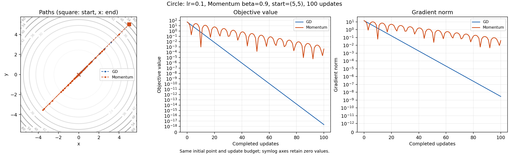

타원형 그림도 같은 세 패널로 두 방법을 비교한다. 지정한 lr=0.05에서는 GD의 y 성분이 첫 갱신에 0이 되어 이후 x축을 따라 이동한다. 이 조건에서 지속적인 지그재그를 기대하거나 그림을 근거로 Momentum이 언제나 더 부드럽다고 해석하지 않는다.

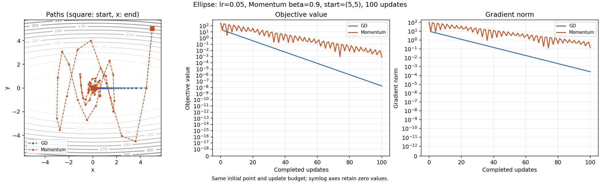

학습률 그림은 한 번에 도착·크기가 일정한 진동·커지는 진동을 분리해 보여 준다. 각 패널이 자기 좌표 범위를 사용하므로 화면의 선 길이만 비교하지 말고 축 눈금과 최종 반경을 읽어야 한다. 유한한 20회 관측은 위 점화식의 수렴·진동·발산 분류와 함께 해석한다.

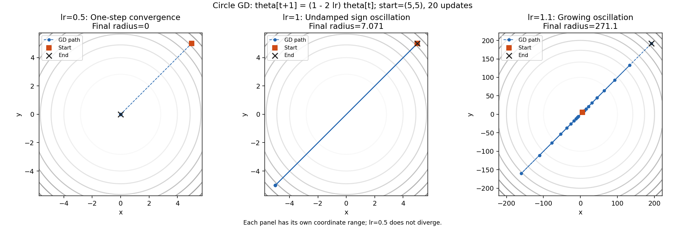

<a id="mission-probability"></a>

### 확률·손실: 실행된 분포와 MLE 유도

실행 환경: Python 3.11.4, NumPy 2.2.6, Matplotlib 3.10.3; float64, 독립 실험 시작 시 seed42.

실행 원본: `notebooks/probability_loss.ipynb`; source SHA-256 `b31883f9b1e3fed3c71be84e068d03e5db6f3a205ed567533f2c60d9fc968d8e`.

이번 실행 JSON SHA-256 `d37506805875734180601ff6522d417e42e233589c182c5628161b125d012f5b`. 기존 제출 JSON과 구조·입력·직접 계산값 재현 비교 통과(atol=rtol=1e-12). 중심차분의 플랫폼별 반올림 차이는 저장값의 끝자리 일치 대신 기존 해석값·오차 기준으로 검증했습니다. 각 실험의 수학 수용 기준은 변경하지 않았습니다. PNG와 노트북 원본은 수정하지 않았습니다.

**미션 연결: #13~#15 — 확률 분포·Softmax·MLE와 손실.** 손실 함수는 관측이 어떤 확률 모형에서 나왔다고 가정하는지와 연결된다. Gaussian 오차를 가정한 연속값 예측, Bernoulli를 가정한 이진 관측, categorical을 가정한 여러 클래스 중 하나의 관측을 구분하고, 데이터를 더 그럴듯하게 만드는 최대우도가 각각 어떤 손실의 최소화가 되는지 확인한다.

seed 42 · float64 · NumPy 2.2.6; 코드 9셀을 순서대로 실행했고 오류 출력은 0개다.
재현: `python -m scripts.run_submission_reports`; 개별 실행: `python -m scripts.run_notebooks notebooks/probability_loss.ipynb`.
원시 데이터: [probability_metrics.json](outputs/probability_metrics.json). 원본: [probability_loss.ipynb](notebooks/probability_loss.ipynb).

#### 1. 정규 PDF와 Bernoulli PMF

정규분포는 유한한 mu와 variance>0에서 N(mu,variance), PDF=exp(-(x-mu)²/(2*variance))/sqrt(2*pi*variance)다. 각 mu±8*sigma 구간의 10,001점에서 적분한다.
Bernoulli는 0≤p≤1, k∈{0,1}에서 PMF(0)=1-p, PMF(1)=p이며 지지집합 밖은 0이다.

| 분포 | 매개변수 | 실측값 | 오차·기준 |
|---|---|---|---|
| Normal | mu=0, variance=1, sigma=1 | integral=0.9999999999999989, peak=0.398942280401 | 1.110e-15 ≤ 1e-4 |
| Normal | mu=2, variance=0.5, sigma=0.707106781187 | integral=0.999999999999999, peak=0.564189583548 | 9.992e-16 ≤ 1e-4 |
| Bernoulli | p=0.3, support=[0,1] | PMF=`[0.7, 0.3]` | sum error=0.000e+00 ≤ 1e-12 |
| Bernoulli | p=0.7, support=[0,1] | PMF=`[0.3, 0.7]` | sum error=0.000e+00 ≤ 1e-12 |

정규 PDF 그림에서 평균은 곡선의 중심을 옮기고 분산은 퍼짐을 바꾼다. 분산 0.5인 곡선은 더 좁고 높지만 전체 면적은 여전히 1이다. PDF 높이 자체는 한 점의 확률이 아니며 구간 확률은 면적으로 읽는다.

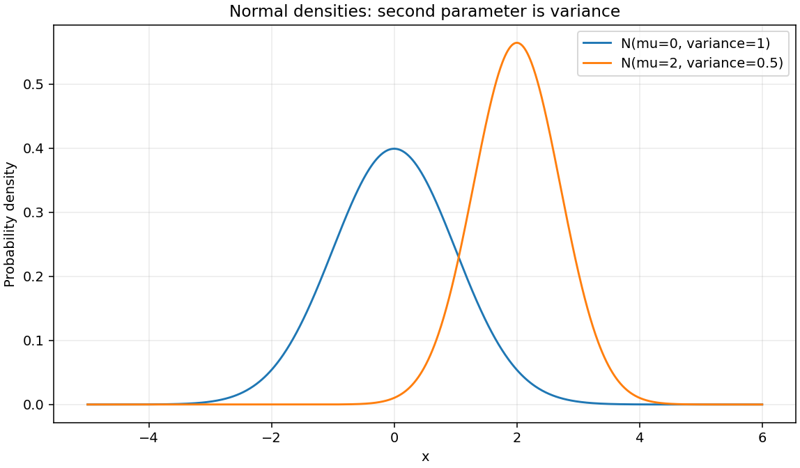

Bernoulli 그림의 막대 높이는 0과 1이라는 각 결과의 확률이다. 같은 p에 속한 두 막대의 높이를 더하면 1이 되며, p=0.3과 0.7에서는 두 결과의 확률이 서로 바뀐다. 연속 분포의 밀도와 이산 분포의 질량을 구분해 읽어야 한다.

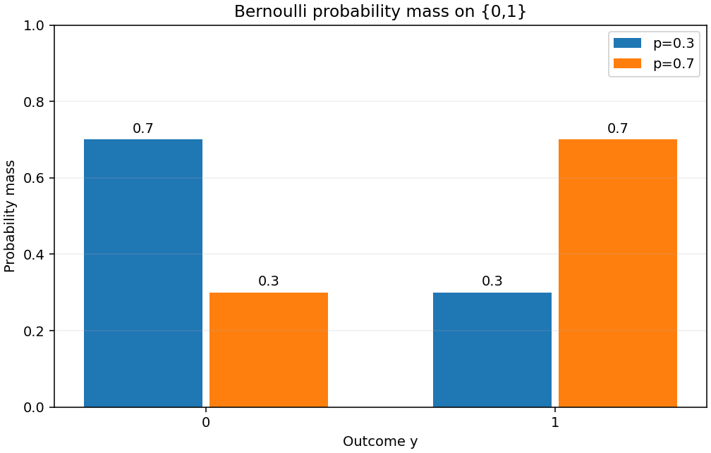

#### 2. Softmax의 실제 합 검증

유한한 logits에서 선택 축의 최댓값 m을 빼고 p_j=exp(z_j-m)/sum_k exp(z_k-m)로 계산한다. 확률은 비음수이고 선택 축을 따라 합이 1이다.
logits=`[[1000, 1001, 1002],  [-1000, 0, 1000]]`, shape `(2,3)`, axis=-1. 확률=`[[0.0900305731704, 0.244728471055, 0.665240955775],  [0, 0, 1]]`.
행 합=`[0.9999999999999999, 1.0]`, 최대 합 오차 **1.110223024625157e-16 ≤ 1e-6**. axis=0 재검증의 열 합 오차도 **1.110223024625157e-16 ≤ 1e-6**: PASS.

Softmax는 여러 logit을 한 분포로 묶으므로 클래스 축을 어디로 선택했는지가 중요하다. 같은 최댓값을 빼는 계산은 확률을 바꾸지 않고 overflow를 피한다. 극단 logit의 작은 확률은 float64에서 0으로 표시될 수 있어, 아래 손실 검증은 확률의 로그를 우회 계산하는 대신 안정적인 logit 식도 함께 확인한다.

#### 3. 손실의 독립 수치 검증

Gaussian NLL과 MSE는 아래 표에서 값이 다르지만 매개변수에 무관한 상수와 양의 배율 차이여서 같은 최소점을 갖는다. 이 연결에는 독립 관측과 고정 공통 분산 가정이 필요하다. 분산까지 학습하거나 관측마다 다른 분산을 사용하면 이 단순한 관계를 그대로 적용할 수 없다.

| 예제 | 입력·조건 | 실측 결과 | 오차·기준 |
|---|---|---|---|
| Gaussian | observed=[0,1,2], predicted=[1,.5,1.5], n=3, variance=.5 | SSE=1.5, MSE=0.5, NLL=3.2170948287741, mean NLL=1.0723649429247 | density/NLL identity error=4.441e-16 ≤ 1e-14 |
| Bernoulli BCE | y=[0,1], p=[.3,.7] | sum=0.7133498878774649, mean=0.3566749439387324, logit sum=0.7133498878774649 | gradient max error=8.627e-12 ≤ 1e-8 |
| Categorical CE | p=[.2,.3,.5], target index=2 (third class) | probability CE=0.6931471805599453, logit CE=0.6931471805599453 | agreement ≤ 1e-15 |

#### 4. Gaussian MLE가 MSE 최소화와 연결되는 조건

관측 $y_i=f_\theta(x_i)+\epsilon_i$에서 오차는 서로 독립이며 $\epsilon_i\sim N(0,\sigma^2)$라고 가정한다.
모든 표본에 같은 양의 분산 $\sigma^2$를 사용하며, 여기서는 그 분산을 **알려진 상수**로 고정한다.

$$\mathcal L(\theta)=\prod_{i=1}^n\frac{1}{\sqrt{2\pi\sigma^2}}
\exp\!\left[-\frac{(y_i-f_\theta(x_i))^2}{2\sigma^2}\right].$$

곱의 자연로그를 합으로 바꾸고 부호를 반전하면

$$\operatorname{NLL}(\theta)
=\frac n2\ln(2\pi\sigma^2)+\frac{1}{2\sigma^2}\sum_{i=1}^n(y_i-f_\theta(x_i))^2
=\frac n2\ln(2\pi\sigma^2)+\frac{n}{2\sigma^2}\operatorname{MSE}(\theta).$$

첫 항은 $\theta$와 무관하고 MSE의 계수는 양수이므로 같은 허용 매개변수 집합에서 MLE, SSE 최소화, MSE 최소화가 **같은 최적해 집합**을 갖는다.
NLL과 MSE가 항상 같은 숫자라는 뜻은 아니다. 평균 NLL은 위 식을 n으로 나눈 값이며, 양의 상수 배율은 최적해를 바꾸지 않는다.

분산이 입력 또는 $\theta$에 따라 달라지면 로그 분산 항과 오차별 가중치를 버릴 수 없다. 분산까지 추정하는 문제는 위 고정분산 유도와 구분해야 한다.
연속 확률의 밀도는1보다 클 수 있으므로 Gaussian NLL이 음수일 수도 있다. 일반적인 비음수 assertion을 두지 않는다.

#### 5. Bernoulli likelihood에서 BCE 유도

$y_i\in\{0,1\}$, $p_i=\sigma(z_i)$인 독립 표본의 likelihood는
$$\mathcal L=\prod_i p_i^{y_i}(1-p_i)^{1-y_i}.$$
따라서 음의 로그우도는
$$L_{\mathrm{sum}}=-\sum_i\left[y_i\ln p_i+(1-y_i)\ln(1-p_i)\right],\qquad
L_{\mathrm{mean}}=L_{\mathrm{sum}}/n.$$

한 표본에서 $p=\sigma(z)$를 대입하면
$$\ell(z,y)=\log(1+e^z)-yz=\operatorname{logaddexp}(0,z)-yz,\qquad
\frac{\partial\ell}{\partial z}=\sigma(z)-y.$$
sum 손실의 각 logit 미분은 위 식이고 mean 손실의 각 미분은 n으로 나눈다. 앞 역전파 노트북은 단일 표본이어서 평균 계수가 없었다.

`logaddexp`는 exp의 overflow를 피하지만 큰 양수 z와 y=1에서는 마지막 뺄셈이 작은 양의 손실을0으로 상쇄할 수 있다.
아래 binary-label 계산은 수학적으로 같은 $\operatorname{logaddexp}(0,(1-2y)z)$를 사용해 그 작은 값을 보존한다.
미분식도 float64에서 sigmoid가 포화되면 작은 꼬리값을 표현하지 못할 수 있으므로, 충분히 중간인 logit에서 중심차분과 비교한다.

**경계 확률:** $0\log0=0$은 해당 항의 연속 극한이다. p=0,y=0 또는 p=1,y=1의 손실은0이다.
불가능한 사건(p=0,y=1 또는 p=1,y=0)은 손실 $+\infty$다. `0*log(0)`으로 NaN을 만든 뒤 숨기거나 임의 clipping으로 다른 손실을 만들지 않는다.

#### 6. 다중 클래스 likelihood에서 Cross-Entropy 유도

각 표본의 one-hot 벡터 $y_{ij}$는 실제 클래스 하나에서만1이며 $\sum_j y_{ij}=1$이다.
$p_{ij}=\operatorname{softmax}(z_i)_j$이면 독립 표본 likelihood와 음의 로그는

$$\mathcal L=\prod_i\prod_j p_{ij}^{y_{ij}},\qquad
L_{\mathrm{sum}}=-\sum_i\sum_j y_{ij}\ln p_{ij}=-\sum_i\ln p_{i,c_i}.$$

이는 categorical Cross-Entropy이고, 표본 평균은 n으로 나눈다. 이진 Bernoulli의 두 결과 항에서 나온 BCE와 유도 출발점을 구분한다.
target가0인 클래스의 $0\log0$ 항은0이고 실제 클래스의 확률이0이면 손실은 $+\infty$다.

logit에서 직접 계산할 때 $s=z-\max(z)$로 이동시켜
$$\ell(z,c)=\ln\sum_j e^{s_j}-s_c$$
를 사용한다. 큰 공통 offset을 더한 logsumexp와 target logit을 마지막에 빼는 취소 오차도 줄인다.
한 표본의 logit 미분은 $p-y_{\mathrm{onehot}}$이며, 평균 손실이면 n으로 나눈다.

#### 7. 경계·수치 안정성의 실행 결과

BCE의 (y,p)=(0,0)/(1,1)은 0, (1,0)/(0,1)은 +inf임을 검증했다. 극단 logit [-1000,1000,-1000,1000]의 손실은 `[0, 0, 1000, 1000]`이며 모두 유한하다.
z=40,y=1의 안정식 손실은 4.248354255291589e-18>0이고 subtractive logaddexp(0,z)-z는 0으로 상쇄된다.
Categorical에서 p=[0,0,1]의 정답 index=2는 0, index=0은 +inf다. logits=[-1000,0,1000], target=0의 CE는 2000다. 불가능 사건을 clipping하지 않으며 JSON에는 경계 검증 여부를 기록한다.
유한 logit에서 극소확률이 0으로 표시되는 표현 한계와, 확률 모형이 불가능 사건에 0을 직접 부여한 경우의 무한 손실은 구분한다.
분포·합/평균·독립 손실값·수치 gradient·경계 assertion: **PASS**. 이는 명시한 고정 예제의 결과이며 모든 모델의 통계 가정을 보장하지 않는다.

#### 실제 실행 출력

아래는 실행된 노트북의 필수 검증 셀에서 저장한 stdout 원문이다. 선택한 셀의 출력은 생략하지 않았으며 환경 소개·중간 확인·파일 저장 등 다른 셀의 출력은 제외했다. 위 표는 JSON 수치를 정리한 결과이고, 아래 블록은 재구성한 예시가 아닌 실제 출력이다.

##### `normal-density-check`

```text
{'mu': 0.0, 'variance': 1.0, 'sigma': 1.0, 'grid_points': 10001, 'integral': 0.9999999999999989, 'integral_absolute_error': 1.1102230246251565e-15, 'peak': 0.3989422804014327, 'minimum_pdf': 5.052271083536893e-15}
{'mu': 2.0, 'variance': 0.5, 'sigma': 0.7071067811865476, 'grid_points': 10001, 'integral': 0.999999999999999, 'integral_absolute_error': 9.992007221626409e-16, 'peak': 0.5641895835477563, 'minimum_pdf': 7.144990287123286e-15}
```

##### `bernoulli-check`

```text
[{'p': 0.3, 'support': [0, 1], 'pmf': [0.7, 0.3], 'mass_error': 0.0}, {'p': 0.7, 'support': [0, 1], 'pmf': [0.30000000000000004, 0.7], 'mass_error': 0.0}]
```

##### `softmax-check`

```text
{'logits': [[1000.0, 1001.0, 1002.0], [-1000.0, 0.0, 1000.0]], 'probabilities': [[0.09003057317038046, 0.24472847105479764, 0.6652409557748218], [0.0, 0.0, 1.0]], 'axis': -1, 'row_sums': [0.9999999999999999, 1.0], 'max_sum_error': 1.1102230246251565e-16, 'column_sum_error': 1.1102230246251565e-16}
```

##### `gaussian-mle-check`

```text
{'n': 3, 'variance': 0.5, 'sse': 1.5, 'mse': 0.5, 'nll': 3.2170948287741004, 'independent_reference': 3.2170948287741004, 'identity_error': 4.440892098500626e-16, 'mean_nll': 1.0723649429247002}
```

##### `bce-check`

```text
{'y': [0.0, 1.0], 'probabilities': [0.3, 0.7], 'sum_loss': 0.7133498878774649, 'mean_loss': 0.35667494393873245, 'logits': [-0.8472978603872036, 0.8472978603872034], 'logit_sum_loss': 0.7133498878774649, 'max_gradient_error': 8.626654945942391e-12, 'analytic_sum_gradient': [0.3, -0.30000000000000004], 'numerical_sum_gradient': [0.3000000000030756, -0.3000000000086267], 'extreme_losses': [0.0, 0.0, 1000.0, 1000.0], 'positive_tail_at_40': 4.248354255291589e-18, 'subtractive_formula_at_40': 0.0, 'boundary_policy_verified': True}
```

##### `categorical-check`

```text
{'probabilities': [0.2, 0.3, 0.5], 'target': 2, 'probability_ce': 0.6931471805599453, 'logit_ce': 0.6931471805599453, 'extreme_ce': 2000.0, 'boundary_policy_verified': True}
```

<!-- END VERIFIED MISSION RESULTS -->

## 검증 현황

최신 외부 평가와 내부 검증은 구분합니다. Naito_AI의 최신 결과는 **2026-11-09 06:05:14, 40%(6/15)**이며, 93%(14/15) → 60%(9/15) → 40%(6/15)로 하락했습니다. 세 번의 기회가 소진되어 이번 보완본의 외부 점수는 없습니다. [평가 원문과 분석](Naito_AI_eval_result.md)에 파일 보존 확인, 실행 결과가 없다는 지적, 실제 평가 입력은 확인하지 못했다는 한계를 함께 기록했습니다.

이번 보완은 세 실험과 두 노트북을 새로 실행하고, 그 실행에서 얻은 수치·연쇄 법칙·MLE 유도를 다섯 Markdown 보고서와 이 README 본문에 함께 싣습니다. 단순히 그림을 문장으로 바꾼 것이 아니라 **그림을 만든 실험의 입력과 출력, 독립 검증, 해석을 제출 가능한 본문으로 공개**한 것입니다. [이슈 #31](https://github.com/ntt65/A2_1/issues/31)과 [작업 기록](docs/worklogs/issue-31.md)에서 실행·보존 감사·최종 검증·병합 상태를 확인합니다.

**이번 보완의 로컬 검증:** 전체 **210개 테스트(30.826초)**, 중심차분 플랫폼 차이와 독립 검산의 추가 검사, 의존성 검사와 레지스트리57파일/78개념 검사를 통과했습니다. 기존 산출물30개와 노트북2개의 SHA-256이 모두 같고, README의 기존93개 고유 링크와 PNG15개 경로를 보존했습니다. 아래129·132·144·186개 검증 기록은 각 이전 단계의 이력입니다.

**기본 미션 통합 검증:** 2026-11-08 새 Python 3.11.4 가상환경에서 잠금 의존성 설치, `pip check`, 전체 **129개 테스트(20.417초)**, 레지스트리 검사를 통과했습니다. 세 실험과 두 노트북을 재실행해 생성한 **PNG 10개·JSON 5개는 제출 산출물과 바이트 단위로 일치**했고 노트북 원본은 변경되지 않았습니다. [최종 구현 PR #18](https://github.com/ntt65/A2_1/pull/18)까지 병합했으며, 병합 전 최종 커밋의 Windows·Linux 검사도 통과했습니다. 병합 후 기본 브랜치 검사와 제출 마무리 기록은 [이슈 #19](https://github.com/ntt65/A2_1/issues/19)에서 확인할 수 있습니다. 명령·환경·감사 결과는 [최종 재현 기록](docs/worklogs/step-7.md)에 있습니다.

## 설치와 재현

Python **3.11**과 Git이 필요합니다. 아래 명령은 새 작업 폴더에서 기본 브랜치의 완성본을 내려받고, 저장소 루트에서 실행합니다. 전체 의존성은 [requirements-lock.txt](requirements-lock.txt)로 고정했습니다. 구현·시각화 직접 의존성은 [requirements.txt](requirements.txt), 노트북 실행 도구는 [requirements-dev.txt](requirements-dev.txt)에 구분합니다.

### Windows PowerShell

```powershell
git clone --branch main --single-branch https://github.com/ntt65/A2_1.git
cd A2_1
py -3.11 -m venv .venv
.\.venv\Scripts\python.exe -m pip install -r requirements-lock.txt
.\.venv\Scripts\python.exe -m pip check
.\.venv\Scripts\python.exe -m unittest discover -s tests -v
.\.venv\Scripts\python.exe scripts/update_registry.py --check
.\.venv\Scripts\python.exe -m scripts.run_linear_algebra --no-cache
.\.venv\Scripts\python.exe -m scripts.run_calculus
.\.venv\Scripts\python.exe -m scripts.run_optimizer --no-cache
.\.venv\Scripts\python.exe -m scripts.run_notebooks
.\.venv\Scripts\python.exe -m scripts.run_submission_reports --update-readme
.\.venv\Scripts\python.exe scripts/update_registry.py --check
```

### Linux / macOS

```sh
git clone --branch main --single-branch https://github.com/ntt65/A2_1.git
cd A2_1
python3.11 -m venv .venv
.venv/bin/python -m pip install -r requirements-lock.txt
.venv/bin/python -m pip check
.venv/bin/python -m unittest discover -s tests -v
.venv/bin/python scripts/update_registry.py --check
.venv/bin/python -m scripts.run_linear_algebra --no-cache
.venv/bin/python -m scripts.run_calculus
.venv/bin/python -m scripts.run_optimizer --no-cache
.venv/bin/python -m scripts.run_notebooks
.venv/bin/python -m scripts.run_submission_reports --update-readme
.venv/bin/python scripts/update_registry.py --check
```

가상환경 활성화는 필요하지 않습니다. `python -O`는 assert를 제거하므로 사용하지 않습니다. 기본 실험 세 개와 노트북 두 개가 기본 PNG·JSON과 eig 비교 보고서를 재생성합니다. 뒤쪽의 평가 보완·보너스 명령과 이번 보고서 명령까지 실행하면 전체 제출 산출물은 **PNG 15개·JSON 10개·Markdown 보고서 10개**입니다. 선형대수·최적화의 `--no-cache`는 캐시 읽기와 쓰기를 모두 생략합니다. 미적분 CLI에는 이 옵션이 없습니다. 외부 데이터 다운로드 없이 seed 42의 합성 grayscale 이미지를 사용합니다.

**기존 제출물을 보존하면서 보고서를 다시 만드는 명령:** `python -m scripts.run_submission_reports --update-readme`. 이 명령은 캐시 없이 세 실험을, 새 커널에서 두 노트북을 임시 폴더에 실행합니다. 수학 assertion, 기존 JSON의 구조·입력·직접 계산값 비교(atol=rtol=1e-12), 중심차분의 독립 정확도 검사를 통과한 뒤에만 아래 다섯 보고서와 README의 결과 본문을 갱신합니다. 기존 PNG·JSON·노트북은 덮어쓰지 않습니다. 각 보고서에는 실행 환경, 원본 파일 및 이번 JSON의 SHA-256을 남깁니다. `--update-readme`를 생략하면 보고서만 갱신하고, `--output-dir .cache/readable-results`로 보고서 위치를 바꿀 수 있습니다.

| 미션 | 독립적으로 읽을 수 있는 실행 보고서 | README의 본문 |
|---|---|---|
| #1~#4 선형대수 | [변환·eig·SVD](outputs/linear_algebra_report.md) | [실측과 해석](#mission-linear) |
| #5~#6 미적분 | [중심차분·Gradient](outputs/calculus_report.md) | [실측과 해석](#mission-calculus) |
| #7~#8 역전파 | [손계산·NumPy 비교](outputs/backprop_report.md) | [유도와 13개 비교](#mission-backprop) |
| #9~#12 최적화 | [경로·손실·학습률](outputs/optimizer_report.md) | [100회·20회 실행 결과](#mission-optimizer) |
| #13~#15 확률·손실 | [분포·Softmax·MLE](outputs/probability_report.md) | [분포 결과와 전체 유도](#mission-probability) |

`run_notebooks`에 경로를 생략하면 두 노트북을 각각 **현재 가상환경의 새 커널**에서 처음부터 실행합니다. 기본 실행은 `.ipynb` 원본을 변경하지 않으며, 기존 셀 출력의 성공 여부에 의존하지 않습니다. 재현 명령에는 `--write`를 사용하지 않습니다. 개발자가 실행 결과를 노트북에 다시 저장하려면 `--write` 후 `scripts/update_registry.py --update`로 파일 해시를 갱신해야 합니다.

세 실험과 노트북 실행 도구는 모두 `--output-dir`을 지원합니다. 예를 들어 Windows에서 다음 명령은 기존 제출 PNG·JSON을 덮어쓰지 않고 별도 폴더에 결과를 만듭니다.

```powershell
.\.venv\Scripts\python.exe -m scripts.run_linear_algebra --no-cache --output-dir .cache/reproduce
.\.venv\Scripts\python.exe -m scripts.run_calculus --output-dir .cache/reproduce
.\.venv\Scripts\python.exe -m scripts.run_optimizer --no-cache --output-dir .cache/reproduce
.\.venv\Scripts\python.exe -m scripts.run_notebooks --output-dir .cache/reproduce
```

### 실제 실행 화면 — 텍스트 원문

2026-11-09, Python 3.11.4·NumPy 2.2.6·Matplotlib 3.10.3에서 아래 네 명령을 실행했습니다. 기존 제출 파일 보호를 위해 별도 폴더에 저장했으며, 아래는 성공한 실행의 표준 출력을 그대로 옮긴 것입니다. 표시된 저장 경로의 역슬래시는 Windows 출력입니다. 노트북 커널의 Windows 이벤트 루프 호환 경고는 별도 표준 오류 로그에 남았으며 실행 오류는 없었습니다. 각 노트북의 실제 계산 셀 출력은 앞의 역전파·확률 본문에도 그대로 실었습니다.

```text
$ python -m scripts.run_linear_algebra --no-cache --output-dir .cache/issue31-cli-results
Power Iteration: lambda=4.618033988750, relative error=1.923e-16, residual=6.400e-11
np.linalg.eig: lambda=4.618033988749895; relative error=1.923283e-16 <= 0.05 (5%): PASS
Figures and metrics saved in .cache\issue31-cli-results

$ python -m scripts.run_calculus --output-dir .cache/issue31-cli-results
Derivative error: 3.931e-11; gradient error: 3.296e-11; orthogonality: 0.000e+00
Figures and metrics saved in .cache\issue31-cli-results

$ python -m scripts.run_optimizer --no-cache --output-dir .cache/issue31-cli-results
circle: GD radius=1.440402e-09, loss=2.074758e-18; Momentum radius=2.016252e-02, loss=4.065273e-04
ellipse: GD radius=1.328070e-04, loss=1.763770e-08; Momentum radius=1.987508e-02, loss=8.051093e-04
Figures and metrics saved in .cache\issue31-cli-results

$ python -m scripts.run_notebooks --output-dir .cache/issue31-cli-results
Executed backprop_derivation.ipynb: 8 code cells passed; source unchanged
Executed probability_loss.ipynb: 9 code cells passed; source unchanged
```

보고서 생성 명령도 새 실험과 두 새 커널을 완료했습니다.

```text
$ python -m scripts.run_submission_reports --update-readme
Published 5 verified Markdown reports; original PNG/JSON/notebooks unchanged.
```

콘솔의 최종 요약만으로 수렴 경로나 수식 유도가 증명되는 것은 아니므로, 앞의 본문에는 전체 조건·대표 경로·오차표·유도를 함께 실었습니다. 실행·보존 감사의 세부 기록은 [이슈 #31 작업 기록](docs/worklogs/issue-31.md)에 있습니다.

## 역전파 고정 예제

단일 표본을 사용하며 `z1=W1@x+b1`, `a1=sigmoid(z1)`, `z2=W2@a1+b2`, `p=sigmoid(z2)`입니다. 손실은 자연로그의 BCE `L=−y log(p)−(1−y)log(1−p)`입니다. 중간값은 반올림하지 않고 계산하고, 아래 표만 소수점 네 자리로 표시합니다.

| 입력·매개변수 | 고정값 | shape |
|---|---|---|
| x | [1,0] | (2,) |
| W1 | [[0.1,0.2],[0.3,0.4]] | (2,2) |
| b1 | [0,0] | (2,) |
| W2 | [0.5,0.6] | (2,) |
| b2 / y_true | 0 / 1 | 각각 scalar () |

| 순전파·필수 미분 | 식 | NumPy 결과(4자리) | shape |
|---|---|---|---|
| z1 | W1@x+b1 | [0.1000,0.3000] | (2,) |
| a1 | sigmoid(z1) | [0.5250,0.5744] | (2,) |
| z2 | W2@a1+b2 | 0.6072 | () |
| p=y_pred | sigmoid(z2) | 0.6473 | () |
| L | BCE(y,p) | 0.4350 | () |
| dL/dp | (p−y)/(p(1−p)) | −1.5449 | () |
| δ2=dL/dz2 | p−y | −0.3527 | () |
| dL/dW2 | δ2·a1 | [−0.1852,−0.2026] | (2,) |
| dL/da1 | δ2·W2 | [−0.1764,−0.2116] | (2,) |
| δ1=dL/dz1 | (δ2·W2)·a1·(1−a1) | [−0.0440,−0.0517] | (2,) |
| dL/dW1 | outer(δ1,x) | [[−0.0440,0.0000],[−0.0517,0.0000]] | (2,2) |
| dL/db1 / dL/db2 | δ1 / δ2 | [−0.0440,−0.0517] / −0.3527 | (2,) / () |

곱 `·`는 해당 벡터식의 원소별 곱입니다. 두 번째 입력이 0이므로 `dL/dW1`의 두 번째 열은 0입니다. 수식별 손계산 과정과 독립 기준값, 9개 매개변수의 중심차분 비교는 [실행된 역전파 노트북](notebooks/backprop_derivation.ipynb)과 [상세 설명](docs/BACKPROP.md)에 있습니다.

## 원문과의 차이 및 결과 해석

**SVD 크기와 rank:** 64×64 이하 이미지에서는 k=100을 유효한 rank로 지정할 수 없습니다. 본 실험은 64×64의 k=10,50,64, 보충 실험은 128×128의 k=10,50,100으로 분리했습니다. 두 조건을 하나의 실험으로 동시에 만족한다고 해석하지 않습니다. 저장 원소 수는 `k(m+n+1)`이므로 원본 `mn`보다 커질 수 있습니다. 128×128의 k=100은 복원 오차가 약 1.22%지만 저장 원소 비율은 약 1.5686배여서 저장 공간 절감이 아닙니다. PNG 파일 크기와 SVD 인자 원소 수를 혼동하지 않습니다. [D09](docs/DECISIONS.md#d09--svd-이미지-크기와-rank-충돌을-두-실험으로-해결한다)

**학습률 0.5:** 원형 함수의 GD는 `θ_next=(1−2lr)θ`이므로 수렴 범위는 `0<lr<1`입니다. lr=0.5는 한 번에 원점 도착, lr=1은 일정 크기의 진동, lr=1.1은 발산입니다. 원문의 “0.5 이상 발산”을 구현 결과로 주장하지 않습니다. lr=0.1의 100회 후 각 좌표는 `5×0.8^100≈1.0185e-9`이며 참고 예시의 0.08과 다릅니다. [D10](docs/DECISIONS.md#d10--원형-함수의-학습률-발산-조건을-정정한다)

**Momentum의 이점과 한계:** `v_next=βv+gradient(θ)`, `θ_next=θ−lr·v_next`, `v0=0`을 사용합니다. 원형에서 반경 0.1에 처음 들어가는 시점은 Momentum 10회, GD 20회로 Momentum이 빠르지만, 이후 다시 밖으로 진동합니다. 기록된 100회까지 계속 반경 안에 머무르기 시작하는 시점은 각각 77회와 20회입니다. 두 지정 함수 모두 100회 후 loss는 GD가 더 작습니다. 타원형 lr=0.05에서는 GD의 y가 한 번에 0이 되므로 지속적인 지그재그를 기대하지 않습니다. “항상 더 빠르고 부드럽다”는 결론 대신 동일 조건의 측정 결과를 제시합니다. [D11](docs/DECISIONS.md#d11--momentum-비교는-실측-결과로-판단한다)

**역전파 참고 수치:** 고정 입력과 `W1@x` 방향을 유지하여 다시 계산하면 z2는 0.6072, 두 번째 은닉 기울기는 −0.0517입니다. 원문의 0.6071, −0.0513을 정답으로 복사하지 않았습니다. `dL/dW1` 두 번째 행 첫 원소도 −0.0517로 같습니다. [D12](docs/DECISIONS.md#d12--역전파는-고정-예제를-유지하고-참고-수치를-재계산한다)

**확률과 MLE:** N(μ,σ²)의 두 번째 인자는 분산입니다. iid Gaussian 오차와 고정 양의 공통 분산이면 `NLL=n/2·log(2πσ²)+SSE/(2σ²)`이므로 MSE와 최적해가 같습니다. 두 손실의 수치가 같은 것은 아니며 연속분포의 NLL은 음수일 수도 있습니다. Bernoulli BCE와 categorical CE는 각각 유도하고 합 손실과 평균 손실을 구분합니다. 확률 경계는 `0 log 0=0`, 불가능 사건은 `+∞`로 다루며 임의 clipping을 하지 않습니다. 큰 logit은 안정적 식을 쓰고, BCE의 큰 양수 logit에서 생길 수 있는 뺄셈 상쇄도 검증합니다. [D13](docs/DECISIONS.md#d13--확률-표기와-mle의-가정을-고정한다)

## 파일과 실행 규칙

| 필수 산출물 | 구현·본문 | 결과·상세 문서 |
|---|---|---|
| 선형대수 | [src/linear_algebra.py](src/linear_algebra.py) | [선형대수 설명](docs/LINEAR_ALGEBRA.md), [측정 JSON](outputs/linear_algebra_metrics.json) |
| 미적분 | [src/calculus.py](src/calculus.py) | [미적분 설명](docs/CALCULUS.md), [측정 JSON](outputs/calculus_metrics.json) |
| 역전파 유도 | [notebooks/backprop_derivation.ipynb](notebooks/backprop_derivation.ipynb) | [역전파 설명](docs/BACKPROP.md), [측정 JSON](outputs/backprop_metrics.json) |
| GD·Momentum | [src/optimizer.py](src/optimizer.py) | [최적화 설명](docs/OPTIMIZATION.md), [측정 JSON](outputs/optimizer_metrics.json) |
| 확률·MLE 유도 | [notebooks/probability_loss.ipynb](notebooks/probability_loss.ipynb) | [확률·손실 설명](docs/PROBABILITY_LOSS.md), [측정 JSON](outputs/probability_metrics.json) |

알고리즘과 수학 계산은 **NumPy만** 사용합니다. Matplotlib·Seaborn은 시각화용이며 PyTorch·TensorFlow·JAX·scikit-learn·SciPy 알고리즘은 사용하지 않습니다. `np.linalg.svd`는 SVD 복원에 사용하고, `np.linalg.eig`는 Power Iteration 비교 검증 코드(테스트와 전용 검증 스크립트)에서만 사용합니다. 파일·JSON·해시·테스트에는 Python 표준 라이브러리를 사용하며 노트북 실행 도구는 개발 의존성입니다.

각 독립 실험·노트북 시작점에서 공통 `set_seed(42)`로 `np.random.seed(42)`를 한 번 설정합니다. import나 수학 함수 호출마다 seed를 초기화하지 않습니다. 공통 함수와 캐시는 [src/utils/](src/utils/)에 있고, 캐시는 Redis 서버 없이 `.cache/`에 저장합니다. [레지스트리](.agent/registry.json)는 파일·심볼·개념·의존성·해시와 노트북 셀 ID를 연결합니다. 상세 사용법은 [공통 기반 문서](docs/UTILITIES.md)에 있습니다.

## 단계별 이슈·PR·검증 기록

작업은 **이슈 → 전용 브랜치 → 기초·상세·실행계획 → 구현 → 점검·보완 → 검증 → push·PR → 이슈 기록** 순서로 진행했습니다. 아래 PR #11~#18은 사용자의 병합 지시에 따라 선행 단계부터 순서대로 `main`에 병합했습니다. 각 이슈와 작업 기록에 계획·검증·보완·병합 이력을 남겼습니다. 제출 안내의 최종 정리는 [이슈 #19](https://github.com/ntt65/A2_1/issues/19)에서 추적합니다.

| 단계 | 이슈 | PR | 실행·보완 기록 |
|---|---|---|---|
| 0 환경·운영 준비 | [#3](https://github.com/ntt65/A2_1/issues/3) | [#11](https://github.com/ntt65/A2_1/pull/11) | [Step 0](docs/worklogs/step-0.md) |
| 1 공통 기반 | [#4](https://github.com/ntt65/A2_1/issues/4) | [#12](https://github.com/ntt65/A2_1/pull/12) | [Step 1](docs/worklogs/step-1.md) |
| 2 선형대수 | [#5](https://github.com/ntt65/A2_1/issues/5) | [#13](https://github.com/ntt65/A2_1/pull/13) | [Step 2](docs/worklogs/step-2.md) |
| 3 미적분 | [#6](https://github.com/ntt65/A2_1/issues/6) | [#14](https://github.com/ntt65/A2_1/pull/14) | [Step 3](docs/worklogs/step-3.md) |
| 4 최적화 | [#7](https://github.com/ntt65/A2_1/issues/7) | [#15](https://github.com/ntt65/A2_1/pull/15) | [Step 4](docs/worklogs/step-4.md) |
| 5 역전파 | [#8](https://github.com/ntt65/A2_1/issues/8) | [#16](https://github.com/ntt65/A2_1/pull/16) | [Step 5](docs/worklogs/step-5.md) |
| 6 확률·손실 | [#9](https://github.com/ntt65/A2_1/issues/9) | [#17](https://github.com/ntt65/A2_1/pull/17) | [Step 6](docs/worklogs/step-6.md) |
| 7 통합·최종 제출 | [#10](https://github.com/ntt65/A2_1/issues/10) | [#18](https://github.com/ntt65/A2_1/pull/18) | [Step 7](docs/worklogs/step-7.md) |

[전체 추적 이슈 #2](https://github.com/ntt65/A2_1/issues/2) · [전체 계획·체크리스트](docs/PROJECT_PLAN.md) · [수용 기준](docs/ACCEPTANCE.md) · [결정 기록](docs/DECISIONS.md) · [운영 규칙](AGENTS.md) · [원문 PDF](docs/A2_1_mission.pdf)

## 최신 Naito_AI 평가와 고유값 비교 증거

**최신 외부 평가는 2026-11-09 06:05:14의 40%(6/15)**입니다. 2차에서 #4·#7(원문 번호 누락)·#8·#10·#13·#15가, 3차에서는 추가로 #9·#11·#12가 ‘실행 결과·유도 증거 없음’으로 FAIL이 됐습니다. 3차가 인용한 새 근거는 #3의 eig Markdown 보고서입니다. 핵심 노트북·PNG·기존 측정값은 보존돼 있지만, 평가기가 실제로 받은 파일 목록은 확인하지 못했습니다. 화면 안내상 PNG·PDF·오피스 문서는 평가 대상에서 제외되므로, 이 README와 실험별 Markdown에 **실행 결과 자체**를 싣습니다. JSON·노트북이 실제로 수집됐는지, README 분량·배치나 보너스가 하락을 유발했는지는 미확인입니다.

[세 평가 원문·변화표·원인 분석·대책](Naito_AI_eval_result.md)과 [15항목 실행 증거](MISSION_EVIDENCE.md)를 제공합니다. 이전 분석은 [이슈 #29](https://github.com/ntt65/A2_1/issues/29), 이번 보완은 이슈 #31에서 추적합니다. [AI심화 1-1과의 비교](docs/worklogs/a1-comparison.md)는 100점 이전의 실제 보완과 이후 후속 작업을 구분합니다. 과거 성공 경험은 참고 근거이며 이 보완본의 점수 보장은 아닙니다.

아래는 [이슈 #23](https://github.com/ntt65/A2_1/issues/23)에서 보완해 이번 평가에 인정된 Power Iteration 비교입니다.

앞의 설치를 마친 프로젝트 환경에서 `.\.venv\Scripts\python.exe -m scripts.verify_power_iteration`을 실행합니다(Linux: `.venv/bin/python -m scripts.verify_power_iteration`). 선형대수 기본 실행 명령도 같은 비교 증거를 생성합니다.

| 비교 항목 | 실제 실행 결과 |
|---|---:|
| 직접 구현한 Power Iteration λ | 4.618033988749896 |
| `np.linalg.eig` 기준 λ | 4.618033988749895 |
| 상대오차 `abs(λ_manual−λ_numpy)/abs(λ_numpy)` | 1.923282552410481e-16 ≤ 0.05(5%): PASS |
| 업데이트 횟수 / 상대 잔차 | 32 / 6.399563856969149e-11 |

입력 행렬은 `[[4,1],[1,3]]`, 초기 벡터는 `[1,1]`, dtype은 float64입니다. 두 고유벡터·부호 정렬·독립 닫힌 해 교차 검증은 [실행 보고서](outputs/power_iteration_eig_comparison.md)와 [전체 JSON](outputs/power_iteration_eig_comparison.json)에 있습니다. 검증 코드는 [scripts/verify_power_iteration.py](scripts/verify_power_iteration.py)에 있으며 알고리즘 본체는 그대로입니다. 1차 보완 후 **132개 테스트(26.959초)**를 통과했습니다. [작업 기록](docs/worklogs/issue-23.md)에 명령·보완 과정을 기록합니다.

기존 유도 증거도 함께 안내합니다. [역전파 노트북](notebooks/backprop_derivation.ipynb)의 `backprop-forward-derivation`, `backprop-chain-rule` 셀과 [확률 노트북](notebooks/probability_loss.ipynb)의 `gaussian-mle-derivation`, `bernoulli-mle-derivation`, `categorical-mle-derivation` 셀에 단계별 수식 전개가 있습니다. 같은 유도를 [일반 Markdown 수식 문서](docs/MATH_DERIVATIONS.md)에서도 읽을 수 있습니다.

### 나머지 평가 권고 재현

[이슈 #25](https://github.com/ntt65/A2_1/issues/25)는 출력 이미지의 실제 크기·DPI, 수치 미분 h와 Softmax 축별 오차, 의도적 불일치 진단 및 여러 초기점의 최적화 결과를 추가합니다.

```powershell
.\.venv\Scripts\python.exe -m scripts.run_evaluation_evidence
.\.venv\Scripts\python.exe -m scripts.run_optimizer_sensitivity --no-cache
```

Linux에서는 실행 파일을 `.venv/bin/python`으로 바꿉니다. 기본 실험 산출물이 있는 저장소 루트에서 실행합니다. [수치·이미지 증거 보고서](outputs/evaluation_evidence.md)와 [최적화 민감도 보고서](outputs/optimizer_sensitivity.md)에 재현 조건·실패 진단·집계 모집단을 기록합니다. PNG 캔버스 크기는 SVD 입력의 64×64 조건과 구분하고, 여러 초기점의 결과는 동일 입력 반복실행의 평균으로 해석하지 않습니다. 이 단계에서 **144개 테스트(24.250초)**와 환경·색인 검사를 통과했으며 [검증 기록](docs/worklogs/issue-25.md)에 결과를 남겼습니다.

#### 추가 검증의 실제 수치와 의미

Softmax가 클래스 축을 제대로 정규화하는지 1·2·3차원 입력에서 확인했습니다. 아래 각 행은 별도 입력이며, 기본 확률 실험의 두 행과는 다릅니다. 모든 표본의 합 오차는 1e-6 이내였습니다.

| 입력 shape | 클래스 축 | 합 오차 최대 | 합 오차 평균 |
|---|---:|---:|---:|
| (3,) | -1 | 1.110223e-16 | 1.110223e-16 |
| (2,3) | 0 | 2.220446e-16 | 2.220446e-16 |
| (2,3) | 1 | 1.110223e-16 | 1.110223e-16 |
| (2,3,4) | -1 / 0 / 1 각각 | 0 | 0 |

검증기가 잘못된 값도 통과시키는지 확인하기 위해 두 오류를 의도적으로 주입했습니다. 스케일 행렬 diag(2,.5)의 면적비 1에 .02를 더하면 상대오차 2%로 1% 기준을 넘고, 역전파 `dL/dW1[0,0]`에 .001을 더하면 5e-5 기준을 넘습니다. **두 경우 모두 거부됐습니다.** 실제 알고리즘이 실패했다는 기록이 아니라 오류 검출 기능의 확인입니다.

초기점 (5,5), (-5,5), (1,-3), (-2,-1), (0,0)을 미리 고정해 GD와 Momentum을 각각 100회 실행했습니다. 원형 lr=.1, 타원형 lr=.05, Momentum β=.9, 반경 기준=.1입니다. 같은 입력을 반복한 시간 통계가 아니라 초기점 민감도이며, 시작부터 최적인 (0,0)도 모집단에 포함합니다. 아래 평균·모분산(ddof=0)은 해당 기준을 충족한 5개 초기점의 값입니다.

| 함수·방법 | 성공/전체 | 최초 진입 평균(회) / 분산(회²) | 기록 끝까지 유지 시작 평균 / 분산 |
|---|---:|---:|---:|
| 원형 GD | 5/5 | 14 / 54.4 | 14 / 54.4 |
| 원형 Momentum | 5/5 | 8 / 16 | 54.6 / 811.44 |
| 타원형 GD | 5/5 | 25.4 / 197.44 | 25.4 / 197.44 |
| 타원형 Momentum | 5/5 | 41.4 / 581.04 | 56.8 / 874.96 |

원형에서 Momentum은 최초 진입은 빠르지만 다시 경계 밖으로 나가므로 유지 시작은 늦습니다. 이 유한 관측 결과를 모든 초기점이나 무한 시간에 대한 보장으로 확대하지 않습니다. 개별 20개 경로와 입력·최종 반경은 [원시 JSON](outputs/optimizer_sensitivity.json)에 있습니다.

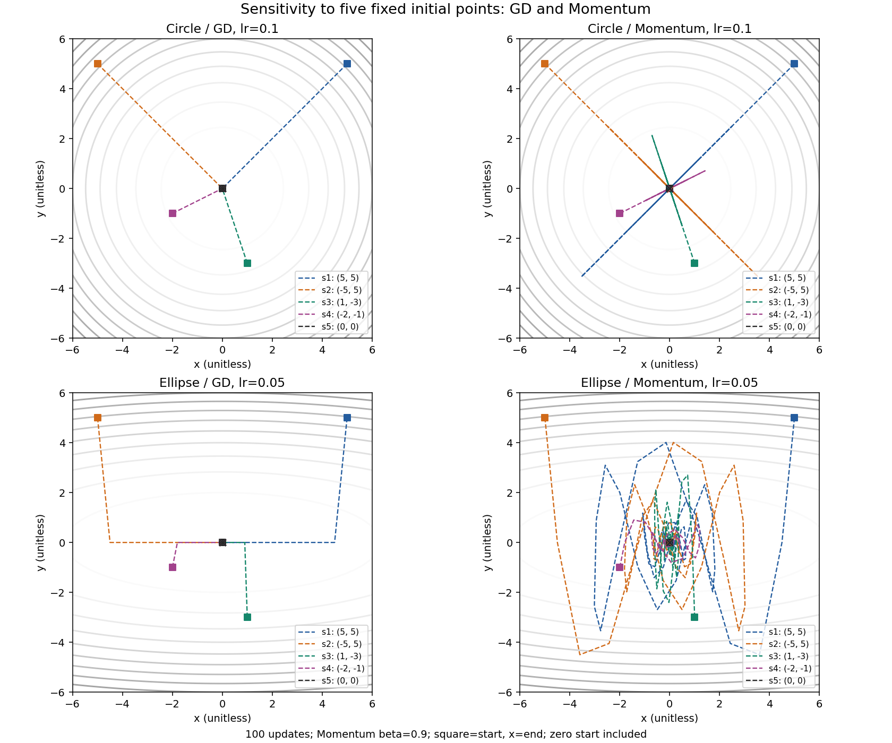

#### PNG 파일은 무엇을 담고 있는가

기존 PNG 15개는 모두 실험 결과입니다. 아래는 실제 저장 캔버스 크기이며 데이터 배열 크기와 다릅니다. 기본 10개 그림의 저장 DPI는 약 140.0048입니다. 64×64 가이드는 SVD 본 실험 입력 배열에 적용했으며 축·범례까지 포함한 Figure를 64px로 축소하지 않았습니다. 위 본문에는 각 그림을 만든 실제 측정표를 함께 두었습니다.

| 그림 파일 | 내용 | 가로×세로(px) |
|---|---|---:|
| linear_transforms.png | 회전·스케일·전단의 원본/변환 비교 | 1890×616 |
| svd_64.png / svd_128.png | 각 입력의 원본과 세 rank 복원 | 각각 1904×588 |
| derivative_error.png | x²·sin의 h별 미분오차 | 1260×770 |
| gradient_geometry.png | 등고선·gradient·접선 | 1176×1008 |
| optimizer_circle.png / optimizer_ellipse.png | GD·Momentum 경로·손실·gradient norm | 각각 2100×644 |
| optimizer_learning_rates.png | .5/1/1.1의 수렴·진동·발산 | 2016×672 |
| probability_normal.png | N(0,1)·N(2,.5)의 PDF | 1148×672 |
| probability_bernoulli.png | B(.3)·B(.7)의 PMF | 1008×644 |
| optimizer_sensitivity.png | 다섯 초기점의 경로·반경 | 1680×1400 |
| bonus_adam_circle.png / bonus_adam_ellipse.png | GD·Momentum·Adam 비교 | 각각 2100×644 |
| bonus_newton_ellipse.png | GD·Newton의 이차함수 비교 | 2100×644 |
| information_theory.png | Bernoulli 엔트로피·CE·KL 곡선 | 1792×686 |

<a id="bonus-missions"></a>

## 보너스 미션 — 기본 미션 이후의 추가 구현

이 절은 원문 5절의 선택 과제를 별도로 정리합니다. 앞의 기본 15항목과 구분하며 동일한 환경에서 실행합니다.

**보너스 포함 로컬 검증:** Python 3.11.4/NumPy 2.2.6에서 전체 **186개 테스트(32.927초)**, 환경·레지스트리 검사 및 새 PNG 4개의 시각 검토를 통과했습니다. Adam/Newton의 극소값 반례를 보완했고, 캐시를 끈 재실행의 최적화 PNG 3개·JSON·Markdown이 저장된 산출물과 바이트 단위로 일치했습니다. [보너스 검증 기록](docs/worklogs/issue-27.md)에 명령·환경·수식·실패 보완을 기록했습니다.

| 요구 | 구현·검증·결과 |
|---|---|
| Adam + GD/Momentum 비교 | [편향 보정 Adam](src/adam.py), [200회 비교 보고서](outputs/bonus_optimizer_report.md) |
| Hessian Newton + GD 비교 | [NewtonMethod](src/newton.py), [Newton/GD 비교 그림](outputs/bonus_newton_ellipse.png) |
| 엔트로피·KL·Cross-Entropy 직접 구현 | [정보 이론 API](src/information_theory.py), [수치·경계·항등식 보고서](outputs/information_theory.md) |

```powershell
.\.venv\Scripts\python.exe -m scripts.run_bonus_optimizers --no-cache
.\.venv\Scripts\python.exe -m scripts.run_information_theory
```

[보너스 수식·API·shape·비교 조건](docs/BONUS.md)과 [작업 기록](docs/worklogs/issue-27.md)에 독립 검증과 한계를 설명합니다. 같은 타원형 조건에서 Adam은 200회 후 반경 `0.1101141`로 .1 기준 미도달이며, 결과를 성공으로 바꾸지 않았습니다. Newton은 이차함수의 동일 기울기 종료 기준에서 **1회**, GD는 **197회**였으며 Hessian 계산 비용은 별도입니다. 정보 이론의 `CE=H+KL` 최대 오차는 **6.661338e-16**이며, 양의 target에 모델 확률 0을 주면 +infinity를 보존합니다.

### Adam — 방향 누적과 크기 보정의 효과

Momentum은 과거 기울기를 누적하고, Adam은 여기에 기울기 제곱의 이동평균을 사용해 좌표별 갱신 크기를 조절합니다. 초기 모멘트가 0이어서 생기는 편향은 반복 번호 t를 사용해 보정합니다. 이번 구현의 식은 다음과 같습니다. 모든 벡터 연산은 shape `(2,)`의 원소별 연산이며 epsilon은 제곱근 밖에 있습니다.

```text
g_t = gradient(theta_(t-1))
m_t = beta1*m_(t-1) + (1-beta1)*g_t
v_t = beta2*v_(t-1) + (1-beta2)*g_t**2
mhat_t = m_t / (1-beta1**t)
vhat_t = v_t / (1-beta2**t)
theta_t = theta_(t-1) - lr*mhat_t/(sqrt(vhat_t)+epsilon)
beta1=.9, beta2=.999, epsilon=1e-8, m_0=v_0=0
```

float64·seed42·시작점 (5,5), 200회, 원형 lr=.1/타원형 lr=.05를 세 방법에 동일하게 적용했습니다. Momentum β=.9입니다. 아래는 저장된 실제 실행 결과이며, 첫 진입과 유지 시작은 반경 .1 기준입니다. `미도달`을 성공으로 바꾸지 않았습니다.

| 함수 | 방법 | lr | 최종 반경 | 최종 손실 | 첫 진입 / 유지 시작(회) |
|---|---|---:|---:|---:|---:|
| 원형 | GD | .1 | 2.934151e-19 | 8.609240e-38 | 20 / 20 |
| 원형 | Momentum | .1 | 9.489598e-5 | 9.005246e-9 | 10 / 77 |
| 원형 | Adam | .1 | 1.549128e-4 | 2.399799e-8 | 79 / 79 |
| 타원형 | GD | .05 | 3.527540e-9 | 1.244354e-17 | 38 / 38 |
| 타원형 | Momentum | .05 | 8.684780e-5 | 7.498763e-8 | 65 / 80 |
| 타원형 | Adam | .05 | .1101141 | .06668812 | 미도달 / 미도달 |

Adam의 적응성이 모든 함수와 설정에서 빠른 도달을 뜻하지는 않습니다. 같은 lr라도 Adam은 기울기 크기로 정규화한 갱신을 사용하므로 GD와 실효 이동량이 다릅니다. 이 실험에서는 원형·타원형 모두 GD의 최종 손실이 더 작았으며, 이 조건만으로 알고리즘의 보편적 순위를 정하지 않습니다. 각 그림은 왼쪽 경로, 가운데 손실, 오른쪽 gradient norm을 보여 줍니다. 전체 경로와 매개변수는 [실행 JSON](outputs/bonus_optimizer_metrics.json), 재현 설명은 [독립 보고서](outputs/bonus_optimizer_report.md)에 있습니다.

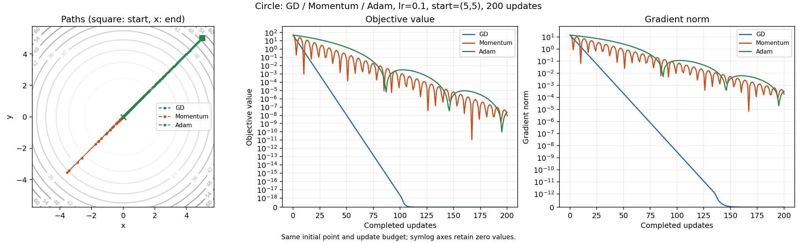

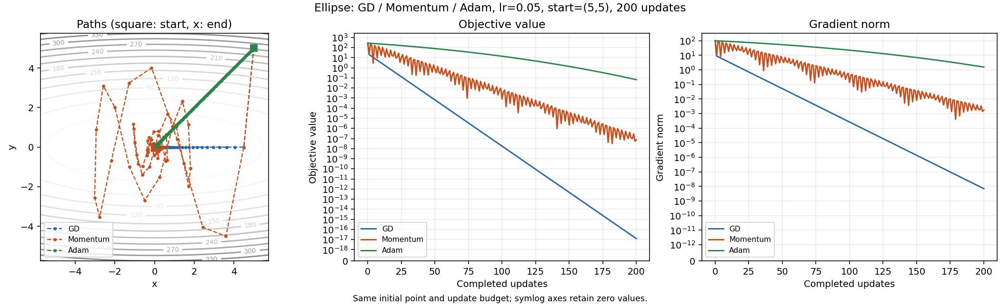

### Newton — 곡률을 사용하면 무엇이 달라지는가

GD는 기울기만으로 방향과 이동량을 정하지만 Newton은 Hessian으로 방향별 곡률을 보정합니다. 현재 점에서 변위 s에 대한 2차 근사는 `f(theta+s)≈f(theta)+gᵀs+(1/2)sᵀHs`입니다. 이를 s로 미분해 `g+Hs=0`을 풀면 최소화 방향 `s=-H⁻¹g`를 얻습니다. H가 양의 정부호이면 이 근사식의 최소점이며, 실제 구현은 `H*d=g`를 풀어 `s=-d`로 사용합니다. `f=x²+10y²`, `g=(2x,20y)`, `H=diag(2,20)`에서 `H*d=g`를 풀면 `d=(x,y)`입니다. 따라서 lr=1의 갱신 `theta_next=theta-d`는 원점에 도달합니다. 구현은 역행렬을 만들지 않고 `np.linalg.solve`를 사용합니다.

시작 (5,5), 최대 200회, 같은 종료 기준 `||gradient||₂<=1e-8`로 비교했습니다. GD lr=.05, Newton lr=1이며 반복 수가 서로 다른 이유는 같은 종료 기준을 만족하면 멈췄기 때문입니다.

| 방법 | 실제 수락한 업데이트 | 최종 gradient norm | 최종 손실 | 종료 이유 |
|---|---:|---:|---:|---|
| GD | 197 | 9.677749e-9 | 2.341471e-17 | gradient_tolerance |
| Newton | 1 | 0 | 0 | gradient_tolerance |

이 결과는 이차함수의 정확한 Hessian에 대한 반복 수 이점입니다. 일반적인 n차원에서는 Hessian 저장에 O(n²), 조밀 선형계 풀이에 O(n³) 비용이 들므로 실행 시간까지 197배 빠르다는 뜻은 아닙니다. 이 구현은 유한·대칭·양의 정부호 Hessian을 요구하고 특이·부정부호 입력을 거부합니다. 고정 damping만 제공하므로 임의 비선형 함수의 전역 수렴은 보장하지 않습니다. [Newton 구현과 계약](src/newton.py)

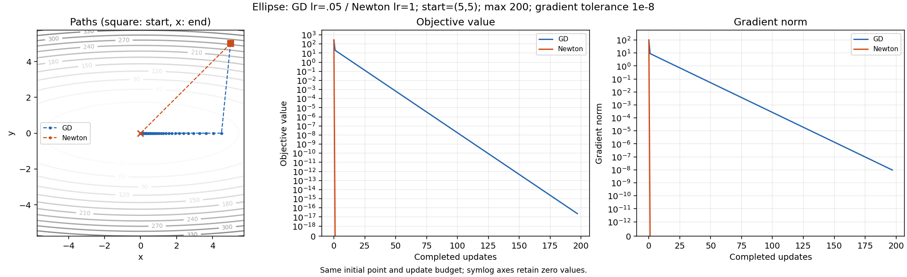

### 정보 이론 — Cross-Entropy와 KL의 관계

확률분포 p와 모델 분포 q의 클래스 합은 1이며 자연로그를 써 단위는 nats입니다. entropy는 p 자체의 불확실성, cross-entropy는 p의 사건을 q로 설명할 때의 평균 손실, KL은 그 손실과 p 자체의 entropy 차이입니다.

```text
H(p)    = -sum_i p_i*ln(p_i)
CE(p,q) = -sum_i p_i*ln(q_i)
KL(p||q)=  sum_i p_i*(ln(p_i)-ln(q_i))
CE(p,q) = H(p) + KL(p||q)
```

마지막 식은 KL의 두 합을 분리해 얻습니다. 고정된 p에서 H(p)는 상수이므로 CE를 줄이는 것은 KL을 줄이는 것과 같습니다. 입력 `(n,)`은 scalar, `(batch,n)`의 axis=-1은 `(batch,)`를 반환합니다. 합 허용오차는 1e-12이고 임의 재정규화·clipping·broadcasting은 하지 않습니다.

| 독립 예제 | H(p) | CE(p,q) | KL(p‖q) |
|---|---:|---:|---:|
| p=q=(.25,.25,.25,.25) | 1.3862943611198906 | 1.3862943611198906 | 0 |
| p=q인 점질량 | 0 | 0 | 0 |
| p=(.25,.75), q=(.5,.5) | .5623351446188083 | .6931471805599453 | .13081203594113697 |
| 위 p와 q의 순서 반전 | .6931471805599453 | .8369882167858358 | .14384103622589045 |
| p>0인 사건에 q=0 | 0(점질량 예제) | +∞ | +∞ |
| 점질량 사건의 q가 최소 양수 float64 | 0 | 744.4400719213812 | 744.4400719213812 |

KL은 위 순서 반전에서도 값이 달라지므로 거리 함수가 아닙니다. p=0인 항은 0으로 처리하지만 p>0,q=0인 불가능 사건의 손실은 +∞로 남깁니다. 최소 양수 q에서는 확률 비율을 먼저 만들지 않고 로그 차이로 계산해 overflow를 피했습니다. JSON의 `"+inf"`는 무한대를 기록한 문자열입니다.

Bernoulli p를 [0,1]에서 501점으로 바꿨을 때 entropy 최대는 p=.5의 **.693147180559945 nats**였습니다. P=(.7,.3)을 고정하고 Q=(1-q,q)를 바꾸면 KL 최소는 q=.3의 **0**이었습니다. CE·KL이 유한한 내부 499개 표본에서 `CE-(H+KL)` 최대 절대오차 **6.661338e-16<=1e-12**, `H(p)-H(1-p)` 최대오차 **2.775558e-16<=1e-14**를 확인했습니다. q=0/1에서 CE·KL은 +∞이므로 그림의 유한 곡선에서는 그 끝점을 제외합니다. 실제 수치·경계 검증은 [정보 이론 JSON](outputs/information_theory.json), 세부 재현은 [보고서](outputs/information_theory.md)에 있습니다.

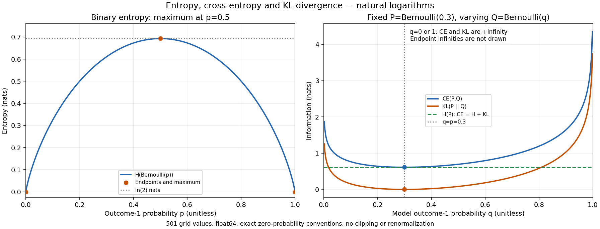
