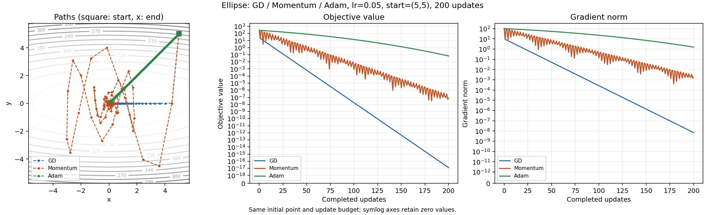
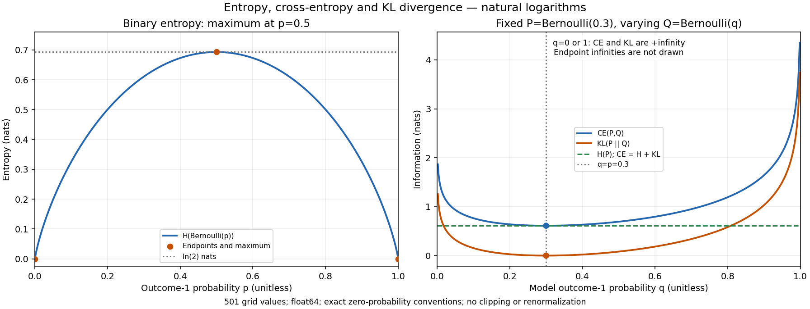

# 보너스 미션: Adam·Newton·정보 이론

[미션 원문 5절](../A2_1_mission.md#5-보너스-과제-선택)의 세 항목을 [이슈 #27](https://github.com/ntt65/A2_1/issues/27)에서 구현한다. 수치 계산은 NumPy, 그림은 Matplotlib, 파일·테스트는 표준 라이브러리를 사용한다. 기본 dtype은 float64이고 두 독립 실행 진입점은 공통 seed 42를 한 번 설정한다.

## 원문 요구와 실행 증거

| 보너스 | API | 독립 검증 | 실행 결과 |
|---|---|---|---|
| Adam 구현과 GD/Momentum 수렴 비교 | [Adam](../src/adam.py), 공통 [runner](../src/optimizer.py) | [Adam 테스트](../tests/test_adam.py), [실험 테스트](../tests/test_bonus_optimizer_experiment.py) | [비교 보고서](../outputs/bonus_optimizer_report.md), [전체 경로 JSON](../outputs/bonus_optimizer_metrics.json) |
| Hessian Newton과 GD 비교 | [NewtonMethod·Hessian](../src/newton.py) | [Newton 테스트](../tests/test_newton.py) | 위 비교 보고서의 Newton 표와 [그림](../outputs/bonus_newton_ellipse.png) |
| 엔트로피·KL·Cross-Entropy 직접 구현 | [정보 이론 API](../src/information_theory.py) | [수학 테스트](../tests/test_information_theory.py), [실험 테스트](../tests/test_information_theory_experiment.py) | [정보 이론 보고서](../outputs/information_theory.md), [전체 JSON](../outputs/information_theory.json) |

Windows에서 기존 프로젝트 환경으로 실행한다.

```powershell
.\.venv\Scripts\python.exe -m scripts.run_bonus_optimizers --no-cache
.\.venv\Scripts\python.exe -m scripts.run_information_theory
.\.venv\Scripts\python.exe -m unittest discover -s tests -v
.\.venv\Scripts\python.exe -m pip check
.\.venv\Scripts\python.exe scripts/update_registry.py --check
```

Linux에서는 Python 경로를 `.venv/bin/python`으로 바꾼다. `--output-dir`로 별도 출력 디렉터리를 지정할 수 있다. 최적화 반복 경로는 공통 로컬 캐시를 사용하며 `--no-cache`는 읽기·쓰기 모두 생략한다. 키에는 전체 초기값·shape/dtype·알고리즘/목적함수 버전·학습률·모멘트 계수·epsilon·종료 조건·예산·seed·NumPy 버전이 들어간다. 작은 정보 이론 합 연산은 캐시하지 않는다.

## 1. Adam: 두 모멘트와 편향 보정

매개변수와 기울기는 `theta, g: (n,)`, 모멘트는 `m, v: (n,)`, 횟수 `t`는 정수다. 매 실행은 `m_0=v_0=0`, `t=0`으로 시작한다.

$$
\begin{aligned}
m_t&=\beta_1m_{t-1}+(1-\beta_1)g_t,\\
v_t&=\beta_2v_{t-1}+(1-\beta_2)g_t^2,\\
\hat m_t&=m_t/(1-\beta_1^t),\qquad
\hat v_t=v_t/(1-\beta_2^t),\\
\theta_t&=\theta_{t-1}-\alpha\frac{\hat m_t}{\sqrt{\hat v_t}+\epsilon}.
\end{aligned}
$$

곱·제곱·나눗셈은 원소별이다. 0 초기화된 지수 이동평균은 초기 단계에서 0 방향으로 편향되므로 보정 분모를 사용한다. 일정한 gradient라면 보정 후 `mhat=g`, `vhat=g²`가 된다. epsilon은 제곱근 밖이다. 이 갱신 관례는 [Kingma·Ba의 Adam Algorithm 1](https://arxiv.org/pdf/1412.6980)을 따른다.

```python
from src.adam import Adam
optimizer = Adam(lr=0.001, beta1=0.9, beta2=0.999, epsilon=1e-8)
theta_next = optimizer.step([1.0, -2.0], [2.0, -4.0])
```

`lr,epsilon>0`, `0<=beta1,beta2<1`이며 모두 유한한 실수 scalar다. 입력은 비어 있지 않은 유한 실수 벡터이며 shape가 같아야 한다. 상태가 만들어진 뒤 shape를 바꾸려면 `reset()`이 필요하다. `m`, `v` 속성은 복사본, `t`는 수락된 갱신 횟수다. 타입·shape·범위 오류는 TypeError/ValueError, 표현할 수 없는 중간 계산은 FloatingPointError로 구분한다.

한 step의 모든 계산이 유효할 때만 상태를 저장한다. 모멘트 계산의 underflow가 값을 0으로 잃거나 부정확한 subnormal을 만들면 잘못된 큰 갱신을 반환하지 않고 FloatingPointError로 거부한다. 정확히 표현 가능한 subnormal은 허용한다. 공통 `run_optimization`도 후보의 목적함수·기울기 평가가 실패하면 마지막 수락 상태로 복원한다. 비유한 후보와 이처럼 검출된 표현 정밀도 손실은 `status='nonfinite'`로 종료하며, 잘못된 callback 계약이나 사용자 예외는 원래 예외를 전달한다. 기존 Momentum의 속도도 같은 복원 경로를 사용한다.

### 고정 조건의 실제 비교

시작점 `(5,5)`, 200회, Momentum beta=.9, Adam beta1=.9/beta2=.999/epsilon=1e-8이다. 원형은 모두 lr=.1, 타원형은 모두 lr=.05다. 원형 `f=x²+y²`와 타원형 `f=x²+10y²`의 gradient는 각각 `(2x,2y)`, `(2x,20y)`이다.

| 함수 | 방법 | 최종 반경 | 반경 .1 첫 진입 | 예산 끝까지 유지 시작 |
|---|---|---:|---:|---:|
| 원형 | GD | 2.934151e-19 | 20 | 20 |
| 원형 | Momentum | 9.489598e-05 | 10 | 77 |
| 원형 | Adam | 1.549128e-04 | 79 | 79 |
| 타원형 | GD | 3.527540e-09 | 38 | 38 |
| 타원형 | Momentum | 8.684780e-05 | 65 | 80 |
| 타원형 | Adam | 1.101141e-01 | 미도달 | 미도달 |

Adam은 좌표별 gradient 제곱의 크기로 갱신을 조절한다. 초기 두 좌표 크기가 같은 이 예제에서는 gradient 배율이 달라도 정규화된 이동 크기가 비슷해질 수 있다. 그러나 **적응적 학습률이 이 고정 조건에서 항상 더 빠르다는 뜻은 아니다.** 타원형에서 Adam이 200회에 반경 .1에 도달하지 않은 결과도 그대로 저장했다. 같은 숫자의 lr가 각 알고리즘에서 같은 이동량을 뜻하지 않으며 최적 lr 탐색을 수행한 결과도 아니다. 모든 경로는 초기점을 포함한 `(201,2)`이고 손실·gradient norm은 `(201,)`이다.



## 2. Newton: 이차 근사와 선형계

현재점 주변 Taylor 이차 근사는 `f(theta+d) ≈ f(theta)+gᵀd+1/2 dᵀHd`다. 이를 d에 대해 미분해 0으로 두면 `g+Hd=0`이므로 Newton 방향은 `-H⁻¹g`다. 구현은 역행렬 대신 `H*direction=g`를 풀고 `theta_next=theta-lr*direction`으로 갱신한다. 이는 [Convex Optimization 9.5.1](https://web.stanford.edu/~boyd/cvxbook/bv_cvxbook.pdf)의 이차 근사 해석과 같다.

```python
from src.newton import NewtonMethod, elliptic_hessian
from src.optimizer import elliptic, elliptic_gradient, run_optimization
result = run_optimization(
    elliptic, elliptic_gradient, [5.0, 5.0],
    NewtonMethod(elliptic_hessian, lr=1.0),
    steps=200, gradient_tolerance=1e-8,
)
```

`theta,g: (n,)`, `H: (n,n)`, 결과 방향 `(n,)`다. `H` callback은 격리된 입력 복사본을 받는다. Hessian은 유한 실수·대칭(atol=rtol=1e-12)·양의 정부호여야 한다. 정확히 대칭인 행렬은 그대로 보존하고, 허용된 미세한 비대칭만 안전한 원소별 평균으로 `(H+H.T)/2`의 대칭 성분을 만든다. 전체가 subnormal인 H는 H와 g를 같은 양수 배율로 나눠 동치 선형계를 푼다. Cholesky로 양의 정부호를 검사하며 singular/indefinite 행렬이나 잘못된 shape를 조용히 보정하지 않는다. `lr=1`은 순수 Newton, `0<lr<1`은 고정 damping이다.

원형의 Hessian은 `2I`, 타원형은 `diag(2,20)`이므로 타원형에서 `H⁻¹g=(x,y)`다. 순수 Newton은 한 번에 원점에 도달한다. 실제 같은 시작점·최대 200회·`||gradient||<=1e-8` 종료 조건에서 GD(lr=.05)는 **197회**, Newton(lr=1)은 **1회**였고 gradient norm은 각각 `9.677749e-9`, `0`이다. 각 경로는 수락된 갱신 수+1 길이다.

Newton은 매번 Hessian과 선형계 풀이를 요구한다. 일반 밀집 n차 문제에서 행렬 저장은 O(n²), 직접 선형계 풀이는 O(n³)이며 반복 횟수만으로 실행 시간을 비교할 수 없다. 순수/고정 감쇠 Newton은 임의 비선형 함수에서 전역 수렴하지 않을 수 있다. Cholesky 성공과 유한한 해만으로 정확한 Newton 방향이 보장되는 것은 아니며, 조건수가 큰 Hessian의 전방오차 보장도 제공하지 않는다. 이 구현은 backtracking·특이 Hessian regularization·일반 비볼록 최소화를 제공하지 않는다.

## 3. 정보 이론: H, CE, KL

분포 p와 q는 같은 shape이며 클래스 축은 `axis=-1`이 기본이다. 클래스 축을 제거한 shape의 결과를 반환하고 1차원 분포이면 scalar가 된다. 각 확률은 [0,1]의 유한 실수, 각 분포의 합은 1(atol=1e-12, rtol=0)이어야 한다. 자동 정규화·확률 clipping·암묵적 broadcasting은 하지 않는다. 정확히 정규화된 분포의 KL 비음수 성질과 입력 합의 수치 허용오차는 구분한다. 허용 오차 안의 질량 차이로 작은 음의 KL이 나올 수 있으며 이를 임의로 0으로 보정하지 않는다.

$$
H(p)=-\sum_i p_i\ln p_i,\qquad
CE(p,q)=-\sum_i p_i\ln q_i,\qquad
D_{KL}(p\Vert q)=\sum_i p_i(\ln p_i-\ln q_i).
$$

모든 로그는 자연로그이며 단위는 nats다. 균등 K개 분포는 `H=ln K`, 점질량은 `H=0`이다. p=q이면 KL=0이지만 일반적으로 `KL(p||q) != KL(q||p)`이므로 거리 metric은 아니다. `p_i>0`인 모든 위치에서 `q_i>0`이면 각 합을 빼서 직접

$$CE(p,q)=H(p)+D_{KL}(p\Vert q)$$

를 얻는다. 따라서 고정 target 분포 p에서 CE를 최소화하는 것은 KL을 최소화하는 것과 같은 문제다. one-hot p이면 H(p)=0이어서 CE는 실제 클래스의 음의 로그확률로 연결된다. 기존 [MLE 유도](MATH_DERIVATIONS.md#8-categorical-likelihood에서-cross-entropy까지)와 보너스의 일반 분포 구현을 구분한다.

`p_i=0`인 항은 연속적 확장으로 0이며 log를 계산하기 전에 제외한다. `p_i>0,q_i=0`이면 CE/KL은 +infinity다. 0확률을 epsilon으로 올려 유한한 값으로 바꾸지 않는다. KL은 p/q 대신 로그 차이로 계산해 극단적인 비율의 overflow를 피한다. 보고서 JSON의 무한 결과는 `+inf` 문자열과 설명으로 표현하며 비표준 JSON Infinity/NaN을 쓰지 않는다.

```python
from src.information_theory import entropy, cross_entropy, kl_divergence
p, q = [0.25, 0.75], [0.5, 0.5]
print(entropy(p), cross_entropy(p, q), kl_divergence(p, q))
```

위 예제의 독립 기준은 `H=0.5623351446188083`, `CE=0.6931471805599453`, `KL=0.1308120359411370`이다. 보고서에는 균등·점질량·비대칭·경계 사례와 Bernoulli 곡선, CE=H+KL의 실제 오차를 함께 제공한다.



## 검증과 전달 상태

수치 기준의 단일 기준은 [ACCEPTANCE.md](ACCEPTANCE.md)다. API별 독립 상수·실패/경계 검증과 전체 186개 회귀 검사(32.927초), 기존 노트북의 새 커널 실행, 캐시 동일성, PNG 시각 검토, 레지스트리를 통과했다. 최종 명령·실측·보완 결과는 [작업 기록](worklogs/issue-27.md), 게시 커밋·PR·CI와 사용자 승인에 따른 main 병합 상태는 [이슈 #27](https://github.com/ntt65/A2_1/issues/27)에 기록한다. 외부 Naito_AI 재평가 결과를 자체 검증으로 대신하지 않는다.
