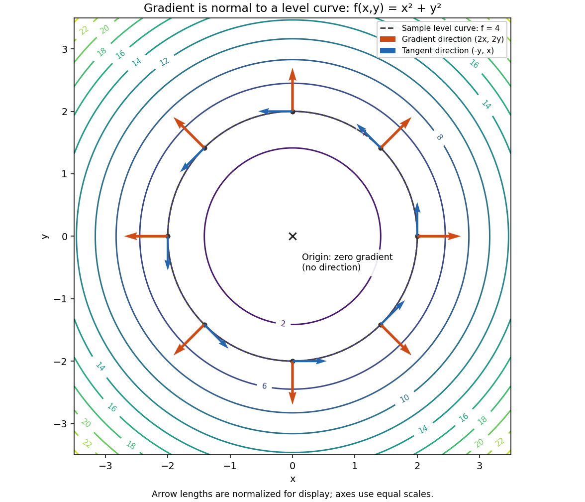
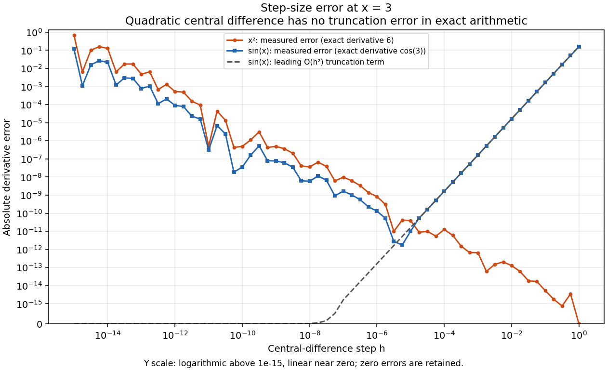

# Step 3 미적분: 수치 미분과 Gradient

작업 [이슈 #6](https://github.com/ntt65/A2_1/issues/6), 구현 [src/calculus.py](../src/calculus.py), [작업 기록](worklogs/step-3.md).

## 재현

저장소 루트에서 Python 3.11 가상환경으로 실행한다.

```powershell
.\.venv\Scripts\python.exe -m scripts.run_calculus
.\.venv\Scripts\python.exe -m unittest discover -s tests -v
.\.venv\Scripts\python.exe -m pip check
.\.venv\Scripts\python.exe scripts/update_registry.py --check
```

Linux/macOS에서는 실행 파일을 `.venv/bin/python`으로 바꾼다. `--output-dir <경로>`로 출력 위치를 변경한다.
실행 진입점에서 `set_seed(42)`를 한 번 호출한다. 이번 실험 자체는 고정 표본으로 계산하며 난수를 소비하지 않는다.
작은 순수 계산에는 캐시를 추가하지 않았고, 공통 `central_difference`와 `contour_base`를 재사용한다.

## 수식과 API

중심차분은 `D_h f(x) = (f(x+h)-f(x-h))/(2h)`이다. 세 번 연속 미분 가능한 함수에서 Taylor 전개를 빼면
`f(x+h)-f(x-h) = 2h f'(x) + h³ f'''(x)/3 + o(h³)`이므로 `D_h f(x)-f'(x) = h² f'''(x)/6 + o(h²)`다.
부동소수점에서는 함수 평가와 뺄셈의 반올림 오차도 있으므로 작은 h가 항상 더 정확한 것은 아니다.

| API | 입력·출력 및 역할 |
|---|---|
| `numerical_derivative(function,x,h=1e-5)` | scalar→scalar 함수, x/h shape `()`, 결과 float. 공통 중심차분에 위임 |
| `numerical_gradient(function,point,h=1e-5)` | scalar 목적함수, point `(n,)`→gradient `(n,)`, n≥1 |
| `quadratic(x,y)` | `x²+y²`, NumPy broadcast shape; scalar 결과 shape `()` |
| `quadratic_gradient(points)` | `(...,2)`→`(...,2)`, 해석 gradient `(2x,2y)` |
| `gradient_figure()` | 고정 원형 등고선·gradient·접선 Figure와 Axes |
| `derivative_error_study()` | h 61개와 x²/sin 수치 미분·원시 절대오차의 dictionary, 각 배열 `(61,)` |
| `derivative_error_figure()` | h별 오차 비교 Figure와 Axes |

수치 gradient의 각 성분은 `∂f/∂p_i ≈ [f(p+h e_i)-f(p-h e_i)]/(2h)`다. 한 좌표씩 바꾸고 각 평가에 독립 복사를 전달한다.
입력 point나 다른 평가 표본을 변경하지 않는다. 그림 함수는 저장하거나 화면을 열지 않으며 호출자가 Figure를 닫는다.

실수 유한 float64 입력만 허용한다. 잘못된 자료형은 TypeError, 잘못된 shape·h·비유한 값이나 표현 범위를 넘는 결과는 ValueError다.
h는 양의 유한 scalar이고 `x±h`를 x와 구별할 수 있어야 한다. 사용자 함수의 예외는 숨기지 않는다.
수치 gradient는 비어 있지 않은 1차원 입력과 scalar 함수 출력만 받으며, 해석 gradient의 마지막 축은 길이 2여야 한다.
일반 목적함수의 정확도를 보장하지 않으며 충분한 매끄러움·결정성·적절한 h가 필요하다.
예를 들어 `abs(x)`의 원점에서 중심차분 값은 0이어도 실제 미분은 존재하지 않는다. 유한한 결과만으로 미분가능성을 판정하지 않는다.
극소 제곱이 0으로 반올림되는 등 float64의 표현 한계가 있다.

## Gradient와 접선

`f(x,y)=x²+y²`, `∇f=(2x,2y)`이며 비원점에서 원형 등고선의 접선 방향은 `t=(-y,x)`다.
내적은 `(2x)(-y)+(2y)x=0`이므로 수직이다. 같은 결과는 등고선 위에서 `df=∇f·dP=0`으로도 얻는다.
원점에서는 gradient가 영벡터이므로 방향과 정규화를 정의하지 않는다.

그림은 f=4인 반지름 2의 원 위 8개 점에 gradient와 접선 화살표를 표시한다. 축 배율은 같다.
화살표 길이만 표시 목적으로 정규화했으며 JSON의 gradient는 원래 크기를 보존한다. 원점에는 화살표를 그리지 않는다.



## 실측 결과

Python3.11.4 / NumPy2.2.6 / Matplotlib3.10.3, float64 기준이다.

| 검사 | 실측 | 기준 |
|---|---:|---:|
| x² at3, h1e-5 수치 미분 | 6.000000000039306 | 해석값6 |
| 미분 절대오차 | 3.930633596382904e-11 | ≤1e-4 |
| 8개 원 표본+원점 numerical gradient 최대 절대오차 | 3.29634097795406e-11 | ≤1e-8 |
| 비원점 단위 gradient·단위 접선 최대 절댓값 내적 | 0 | ≤1e-12 |
| 원점 gradient | [0,0] | 방향 없음 |

## h별 오차 해석

`x²`는 중심차분이 정확한 산술에서 `2x`이므로 절단 오차가 없다. 이를 일반 함수의 U자 오차 곡선이라고 설명하면 틀린다.
보충 실험 `sin(x)`에서는 `D_h sin(3)=cos(3) sin(h)/h`이며 선도 절단오차의 크기는 `abs(cos(3))*h²/6`이다.

| h | x² 절대오차 | sin 절대오차 |
|---|---:|---:|
| 1e-15 | 6.7093e-1 | 1.1569e-1 |
| 1e-12 | 5.3340e-4 | 9.0519e-5 |
| 1e-5 | 3.9306e-11 | 1.0126e-11 |
| 1e-2 | 1.2790e-13 | 1.6500e-5 |
| 1e-1 | 5.3291e-15 | 1.6492e-3 |
| 1 | 0 | 1.5694e-1 |

sin의 h=.1→.01 오차는 약100배 줄어드는 2차 거동을 보인다. 너무 작은 h에서는 반올림 오차가 커지며 오차는 단조적이지 않다.
위 값은 특정 환경의 측정치이며 모든 함수에 공통인 최적 h를 제시하지 않는다.
그림의 y축은 1e-15 위에서 로그, 0 근처에서 선형인 symlog다. 실제 영 오차를 양의 작은 값으로 바꾸지 않는다.



원본 측정 배열은 [calculus_metrics.json](../outputs/calculus_metrics.json)에 있다. 로컬 전체 테스트105개와 환경·색인 검사가 통과했으며 최종 원격 CI는 이슈 #6에 기록한다.
