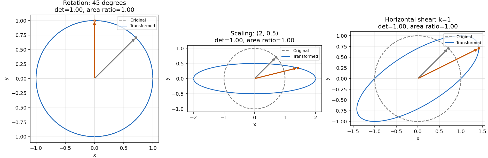
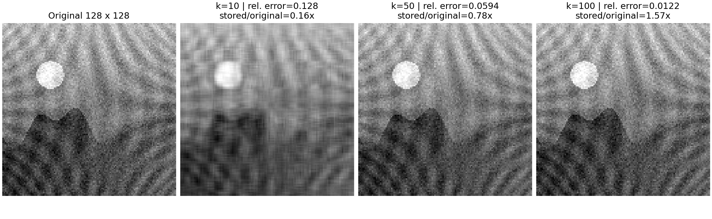

# Step 2 선형대수: 수식·API·실험 결과

작업: [이슈 #5](https://github.com/ntt65/A2_1/issues/5). 구현: [src/linear_algebra.py](../src/linear_algebra.py).
전체 실행 이력과 보완 사항은 [Step 2 작업 기록](worklogs/step-2.md)에 있다.

## 재현

저장소 루트에서 Python 3.11 가상환경으로 실행한다.

```powershell
.\.venv\Scripts\python.exe -m scripts.run_linear_algebra
.\.venv\Scripts\python.exe -m scripts.run_linear_algebra --no-cache
.\.venv\Scripts\python.exe -m scripts.verify_power_iteration
.\.venv\Scripts\python.exe -m unittest discover -s tests -v
.\.venv\Scripts\python.exe scripts/update_registry.py --check
```

Linux에서는 실행 파일을 `.venv/bin/python`으로 바꾼다. `--output-dir <경로>`로 출력 위치를 변경할 수 있다.
실행 진입점에서 `set_seed(42)`를 한 번 호출한다. 이미지 입력은 NumPy로 만든 합성 grayscale 장면이며 외부 파일을 사용하지 않는다.
분해 결과는 `.cache/linear_algebra/`에서 재사용하고, PNG와 측정값 JSON은 `outputs/`에 기록한다.

## 행렬 변환과 면적

점은 열벡터 묶음 `P: (2,n)`이고 변환은 `A: (2,2)`, `P_new=A@P: (2,n)`이다.

| API | 식·계약 |
|---|---|
| `rotation_matrix(theta)` | `[[cos(theta),-sin(theta)],[sin(theta),cos(theta)]]`; theta는 라디안 |
| `scaling_matrix(sx,sy)` | `diag(sx,sy)`; 음수는 반사, 0은 축 축소 |
| `shear_matrix(k)` | `[[1,k],[0,1]]`; 수평 전단 |
| `unit_circle(n=400)` | 순서 있는 원 위 표본 `(2,n)`, n≥3 |
| `transform_points(A,P)` | 유한한 실수 좌표만 받고 입력을 변경하지 않음 |
| `polygon_area(P)` | 순서 있는 단순 다각형의 shoelace 면적; 시계/반시계 방향 모두 허용 |
| `determinant_area_check(A,points=None)` | 독립 면적비와 `abs(det(A))` 비교; 수치·오차 종류·허용오차·passed 반환 |
| `transformation_figure(n=400)` | 회전/스케일/전단 비교 Figure와 Axes 3개; 호출자가 저장·종료 |

다각형 면적은 `abs(sum(x_i*y_(i+1)-y_i*x_(i+1)))/2`다. 행렬식은 별도로 스케일을 조절한 `ad-bc`로 계산한다.
행렬식이 비영이면 상대오차 `<=0.01`, 영이면 면적비 절대오차 `<=1e-10`으로 판정한다.
표현할 수 없는 determinant의 underflow/overflow를 특이행렬 성공으로 처리하지 않고 예외를 낸다.
극도로 나쁜 조건의 행렬에 대한 임의 정밀도 계산은 제공하지 않는다.

단위 원은 회전해도 모양이 같으므로 같은 기준 방향의 원본 벡터(회색)와 변환 벡터(주황)를 함께 표시한다.



## Power Iteration

`power_iteration(A, initial=None, tol=1e-10, max_iter=1000)`은 다음 식을 직접 반복한다.

```text
v_next = A @ v / ||A @ v||₂
lambda = v.T @ A @ v / (v.T @ v)
relative_residual = ||A @ v - lambda*v||₂ / (||A||F * ||v||₂)
```

`A: (n,n)`, 초기/결과 벡터 `(n,)`, 고유값과 잔차는 스칼라다. 입력은 유한한 실수이며 초기 벡터는 영벡터가 아니어야 한다.
행렬과 norm을 스케일링하여 overflow/underflow를 줄인다. `np.linalg.eig`는 비교 테스트와 [전용 검증 스크립트](../scripts/verify_power_iteration.py)에서만 호출하며 알고리즘 본체에는 없다.
초기 벡터를 생략하면 외부 seed로 제어되는 NumPy 난수를 사용하며 함수 내부에서 다시 seed를 설정하지 않는다.

결과 `PowerIterationResult`에는 `eigenvalue`, `eigenvector`, `iterations`, `residual`, `converged`, `reason`이 있다.
iterations는 실제 정규화 업데이트 횟수이며 초기 벡터가 이미 기준을 충족하면 0이다.

| reason | 의미 |
|---|---|
| `residual_tolerance` | 상대 잔차가 tol 이하인 고유쌍 |
| `zero_matrix` | 영행렬의 정확한 영 고유값 |
| `nullspace_breakdown` | 비영행렬에서 반복 곱이 영벡터가 되어 진행 불가; converged=False |
| `max_iterations` | 반복 예산 소진; converged=False |

잔차가 작다는 것은 고유쌍의 정확도를 뜻한다. **임의의 초기 벡터에서 절댓값 최대 고유값을 찾았다는 보장은 아니다.**
지배 고유방향 성분이 없는 초기값은 비지배 고유쌍에 머물 수 있고, 절댓값 동률·복소 지배 모드는 수렴하지 않을 수 있다.
음의 지배 고유값은 부호를 유지한다.

기준 행렬 `[[4,1],[1,3]]`, 초기 `[1,1]`의 해석값은 `(7+sqrt(5))/2`다.

| 항목 | 로컬 측정값 |
|---|---:|
| 수동 Power Iteration 고유값 | 4.618033988749896 |
| `np.linalg.eig` 기준 고유값 | 4.618033988749895 |
| 고유벡터 | [0.8506508083, 0.5257311122] |
| 업데이트 횟수 | 32 |
| 상대 고유값 오차 | 1.9233e-16 ≤ 0.05 |
| 상대 잔차 | 6.3996e-11 ≤ 1e-6 |

[실행된 eig 비교 보고서](../outputs/power_iteration_eig_comparison.md)와 [전체 비교 JSON](../outputs/power_iteration_eig_comparison.json)에 두 방법의 고유값·고유벡터·허용오차·판정을 함께 기록한다. 상대오차는 `abs(lambda_manual-lambda_numpy)/abs(lambda_numpy)`다. NumPy 기준값은 절댓값이 가장 큰 고유값을 선택하고, 고유벡터는 부호를 정렬한 뒤 비교한다. 부호 정렬 후 벡터 L2 오차는 `1.4871e-10 ≤ 1e-8`이며, NumPy 결과도 독립 닫힌 해와 절대오차 `0 ≤ 1e-14`로 교차 검증했다.

`python -m scripts.verify_power_iteration`은 비교만 실행한다. 기본 실험 `python -m scripts.run_linear_algebra --no-cache`도 같은 검증을 수행하고 콘솔·통합 JSON·전용 JSON/Markdown을 생성한다. 검증이 실패하면 성공 보고서를 생성하지 않는다. [평가 보완 이슈 #23](https://github.com/ntt65/A2_1/issues/23)에서 기존 테스트의 비교 결과가 제출 출력에 드러나지 않았던 문제를 추적한다.

## SVD 근사와 저장량

`svd_decompose(image,cache=None)`는 허용된 `np.linalg.svd(...,full_matrices=False)`를 사용한다.
`image: (m,n)` → `U: (m,r)`, `s: (r,)`, `Vt: (r,n)`, `r=min(m,n)`이다.
`reconstruct_svd((U,s,Vt),k)`는 `U[:,:k] @ diag(s[:k]) @ Vt[:k,:]`를 `(m,n)`으로 반환한다.
`compress_image(image,k,cache=None)`는 같은 복원 배열을 반환하며, 이미지 파일 인코딩까지 수행하는 API는 아니다.

rank는 정수 `1..min(m,n)`이어야 한다. 잘못된 값을 조용히 자르지 않는다. 복원값도 잘라내지 않고 오차를 측정한다.
`svd_comparison_figure(image,ranks,cache=None)`는 원본과 각 근사의 Figure/1차원 Axes를 반환한다.
표시에만 공통 grayscale 변환을 적용하여 비교를 유지하고 큰 값의 색상 정규화 overflow를 피한다.
rank를 바꿔도 같은 이미지의 전체 분해는 공통 캐시에서 재사용한다.

원문 크기 조건과 k=100 요구가 충돌하므로 [D09 결정](DECISIONS.md)에 따라 두 실험을 구분한다.
합성 데이터는 질감과 난수를 포함해 각각 수치 rank 64/128임을 확인했다.

| 이미지 | k | 상대 Frobenius 오차 | 저장 원소 수 / 원본 원소 수 |
|---|---:|---:|---:|
| 64×64 본 실험 | 10 | 0.116078 | 0.314941 |
| 64×64 본 실험 | 50 | 0.013222 | 1.574707 |
| 64×64 본 실험 | 64 | 2.3605e-15 | 2.015625 |
| 128×128 보충 | 10 | 0.127518 | 0.156860 |
| 128×128 보충 | 50 | 0.059387 | 0.784302 |
| 128×128 보충 | 100 | 0.012183 | 1.568604 |

저장 원소비는 `k(m+n+1)/(mn)`이다. **1보다 크면 원소 수가 줄지 않는다.** 실제 인코딩된 파일 크기 비율과는 구분한다.
128×128의 완전 rank 복원 오차도 `1.1043e-15 <= 1e-10`으로 확인했다.




전체 원본 측정값은 [linear_algebra_metrics.json](../outputs/linear_algebra_metrics.json)에 있다.
