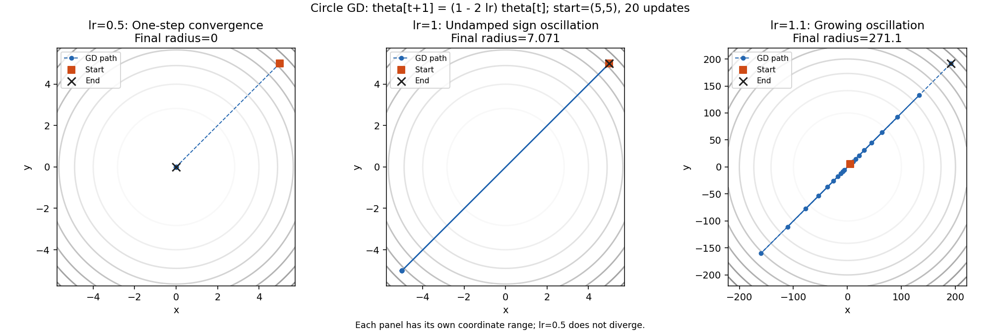
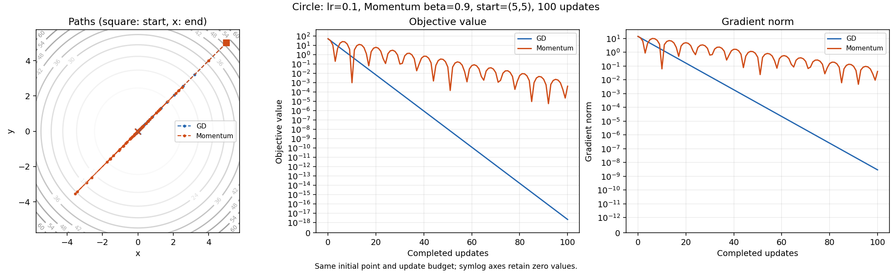
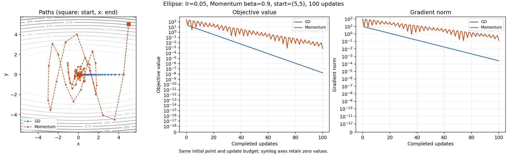

# Step 4 최적화: GD와 Momentum

후속 보너스의 Adam·Newton API와 비교 실험은 [BONUS.md](BONUS.md)에 있다. 아래 Step 4의 고정 조건과 역사적 실측은 유지하며, 공통 runner는 보너스에서 상태 복원 규약을 추가해 확장했다.

작업 [이슈 #7](https://github.com/ntt65/A2_1/issues/7), 구현 [optimizer.py](../src/optimizer.py).
GD/Momentum 비교는 동일한 초기점 `(5,5)`와100회 업데이트, 학습률 안정성 비교는20회를 사용한다. 아래 값과 비교는 지정 조건에 한정한다.

## 재현

저장소 루트의 Python3.11 가상환경에서 실행한다. Linux/macOS는 `.venv/bin/python`을 사용한다.

```powershell
.\.venv\Scripts\python.exe -m scripts.run_optimizer
.\.venv\Scripts\python.exe -m scripts.run_optimizer --no-cache
.\.venv\Scripts\python.exe -m unittest discover -s tests -v
.\.venv\Scripts\python.exe scripts/update_registry.py --check
```

실행 진입점에서 seed42를 설정하고 고정 표본을 사용한다. 궤적은 입력·목적함수/알고리즘 버전과 lr·beta·반복수를 반영한 키로 공통 캐시에 저장한다.
캐시는 결과를 바꾸지 않으며 `--no-cache`로 끌 수 있다. PNG와 원시 측정 JSON은 `outputs/`에 저장한다.

## 식과 API

- GD: `θ_(k+1)=θ_k−lr*g_k`, `g_k=∇f(θ_k)`.
- Momentum: `v_(k+1)=beta*v_k+g_k`, `θ_(k+1)=θ_k−lr*v_(k+1)`, `v_0=0`.
- `(1−beta)`를 gradient에 곱하는 다른 관례는 사용하지 않는다. 현재 비교는 `beta=.9`다.

`VanillaGD(lr)`와 `Momentum(lr,beta=.9)`의 `step(theta,gradient)`는 `(n,)` 두 벡터를 받아 새로운 `(n,)` 벡터를 반환한다.
`reset()`은 실험 시작 상태를 복원한다. Momentum의 velocity는 내부에 저장하며 외부 조회 값은 복사한다.

`run_optimization(objective,gradient,initial,optimizer,steps=100,gradient_tolerance=None)`는 초기점을 포함한 이력을 반환한다.
기본은 고정 반복 예산이므로 성공적인 100회 업데이트 후 path는 `(101,n)`, losses/gradient_norms는 `(101,)`다.
optional tolerance를 명시한 경우에만 gradient norm에 의한 조기 종료를 사용한다. 실행마다 optimizer 상태를 초기화한다.

| status | 의미 |
|---|---|
| `budget_exhausted` | 지정 업데이트 예산을 사용함; 수렴했다고 자동 판정하지 않음 |
| `gradient_tolerance` | 지정한 gradient norm 기준을 만족 |
| `nonfinite` | 후보 좌표·목적값·gradient·norm의 비유한 계산으로 중단; 마지막 유효 이력 유지 |

초기 입력/초기 평가가 잘못된 경우에는 명확한 예외를 발생시킨다. 잘못된 shape·자료형과 사용자 callback 예외를 발산 상태로 숨기지 않는다.
예를 들어 callback이 직접 ValueError를 던지면 그대로 전파한다. 비유한 값을 반환하거나 optimizer 자체 산술이 표현 범위를 넘을 때만 `nonfinite` 상태로 종료한다.
후속 비유한 후보는 이력에 넣지 않으며 Momentum 상태도 마지막 유효 상태를 유지한다.
lr은 양의 유한 scalar, `0≤beta<1`, 입력은 유한 실수의 비어 있지 않은 1차원 벡터다.

## 원형 함수의 학습률

`f=x²+y²`, `∇f=2θ`이므로 `θ_k=(1−2lr)^k θ_0`이다.
원점이 아닌 초기점에서 GD 수렴 조건은 `0<lr<1`이며 다음 세 경우는 서로 다르다.

| lr | 정확한 동작 |
|---:|---|
| .5 | 한 번에 원점에 도착 |
| 1 | 부호만 바뀌며 같은 크기로 진동 |
| 1.1 | 매회 norm이1.2배 증가하여 발산 |

원문의 “.5 이상 발산”을 그대로 재현하지 않고 위 닫힌 해와 [D10](DECISIONS.md)에 따른다.
발산 비교는 유한 반복 예산으로 제한하며 다른 패널의 경로가 큰 축 범위에 가려지지 않도록 따로 표시한다.



## 같은 예산의 비교와 해석

타원형 `f=x²+10y²`의 Hessian은 diag(2,20)이다. GD의 수렴 범위는 `0<lr<.1`이며 `.05`에서는 y가 한 번에0이 된다.
Momentum의 각 고유방향은 `r²−(1+beta−lr*lambda)r+beta=0`의 점화식으로 설명한다. 초기 접근과 이후 진동을 구분해야 한다.

| 함수/설정 | GD의100회 후 loss | Momentum의100회 후 loss |
|---|---:|---:|
| 원형,lr=.1 | 약2.0748e-18 | 약4.0653e-4 |
| 타원형,lr=.05 | 약1.7638e-8 | 약8.0511e-4 |

지정 조건에서는 최종 GD 오차가 더 작다. 원형에서 반경.1 안으로 최초 진입하는 횟수는 Momentum이 앞서지만 다시 밖으로 진동할 수 있다.
최초 진입과 기록된 남은 반복 동안 유지되는 최초 시점을 구분하며, 유한 예산 이후까지 유지된다고 주장하지 않는다.
Momentum이 모든 단계에서 항상 빠르다는 assertion이나 결론을 두지 않는다.
비교 Figure API는 이 문서의 비음수 이차 목적함수 실험에 사용하며, loss축 하한0으로 표시한다.





실측 원본·경로·종료 사유는 [optimizer_metrics.json](../outputs/optimizer_metrics.json), 검증 및 보완 이력은 [작업 기록](worklogs/step-4.md)에 있다.
