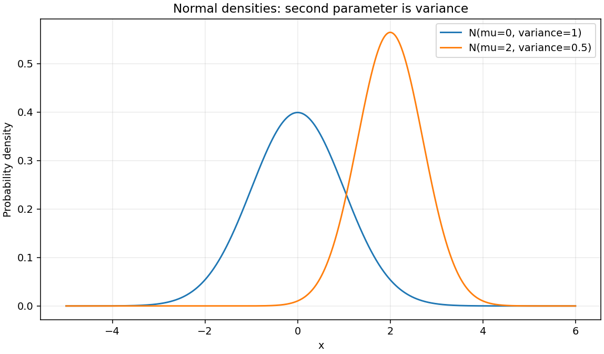
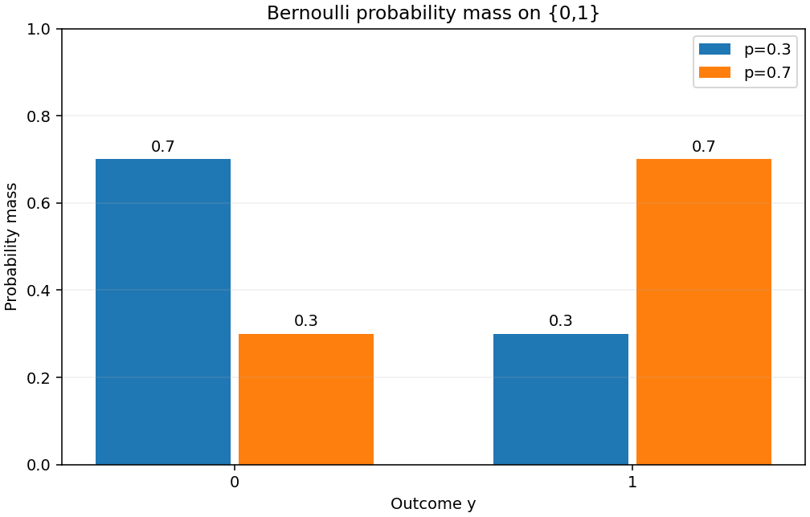

# Step 6 확률분포·손실·MLE

[실행된 노트북](../notebooks/probability_loss.ipynb)에 유도와 검증을 함께 기록한다. 작업 [이슈 #9](https://github.com/ntt65/A2_1/issues/9).

## 재현

저장소 루트의 Python3.11 가상환경에서 실행한다. Linux/macOS는 `.venv/bin/python`을 사용한다.

```powershell
.\.venv\Scripts\python.exe -m scripts.run_notebooks notebooks/probability_loss.ipynb
.\.venv\Scripts\python.exe -m unittest discover -s tests -q
.\.venv\Scripts\python.exe scripts/update_registry.py --check
```

기본 실행은 원본 노트북을 변경하지 않는다. `--write`는 성공한 실행 출력을 저장하므로 이후 색인을 갱신한다.
측정 JSON과 PNG는 기본 `outputs/`, 또는 `--output-dir`로 지정한 경로에 저장한다.

## 분포

정규분포의 두 번째 매개변수는 **분산**이다. `N(0,1)`의 표준편차는1, `N(2,.5)`는 `sqrt(.5)`다.

`PDF(x)=exp(−(x−mu)²/(2 variance))/sqrt(2π variance)`

각각 `mu±8sigma`를10001점으로 나누어 NumPy 사다리꼴 적분을 수행하며 질량의1 대비오차≤1e-4와 비음수성을 검사한다.
Bernoulli PMF는 support0/1에서 `(1−p,p)`다. p=.3/.7의 각질량과 합오차≤1e-12를 검사한다.





## Gaussian MLE와 MSE

독립 오차 `epsilon_i~N(0,sigma²)`, `y_i=f_theta(x_i)+epsilon_i`와 고정된 양의 공통분산을 가정한다.
우도는 각 정규밀도의 곱이고, 자연로그는 증가함수이므로 우도 최대화는 음의 로그우도 최소화와 같다.

`NLL = n/2 * log(2π sigma²) + Σ(y_i−f_theta(x_i))²/(2sigma²)`

`SSE=Σerror²`, `MSE=SSE/n`이므로 `NLL=constant+[n/(2sigma²)]*MSE`다.
상수와 양의 배율은 최적해를 바꾸지 않는다. **같은 최적해라는 의미이며 항상 같은 수치가 아니다.**
분산이 입력이나 theta에 따라 변하면 log분산과 가중오차 항을 그대로 고려해야 한다. 연속밀도는1보다 클 수 있으므로 Gaussian NLL은 음수일 수도 있다.

독립 수치 예제 `n=3,variance=.5,SSE=1.5,MSE=.5`의 NLL은 `3.21709482877410026`이다.

## Bernoulli와 Categorical

Bernoulli 우도는 `Π p_i^y_i (1−p_i)^(1−y_i)`이므로 음의로그는 BCE 합이다.

`BCE_sum = −Σ[y_i log(p_i)+(1−y_i)log(1−p_i)]`

Categorical의 one-hot 표적 t와 확률 p의 우도는 `Π_i Π_c p_ic^t_ic`이므로
`CE_sum=−Σ_i Σ_c t_ic log(p_ic)`다. 두 경우 모두 평균손실은 합을 표본수 n으로 나눈 값이다.
로그 밑은 자연로그다. 확률경계의 `0log0` 항은0으로 해석하지만 관측된 사건의 확률이0이면 손실은+inf이다. clipping으로 불가능사건을 숨기지 않는다.

독립 예제 `y=[0,1],p=[.3,.7]`의 BCE합은 `.71334988787746476`, categorical `p=[.2,.3,.5]`,정답2의 CE는 `log2=.69314718055994531`다.

## Logit 계산의 안정성

`p=sigmoid(z)`를 대입하면 `BCE=logaddexp(0,z)−y*z`, `dBCE/dz=sigmoid(z)−y`다.
이진표적에서는 동치식 `logaddexp(0,(1−2y)*z)`가 큰 양수의 뺄셈으로 작은 손실이 사라지는 현상을 줄일 수 있다.
일반적인 float64의 반올림·underflow 한계는 남으며, 다른 clipping 함수를 만든 뒤 원래 gradient를 붙이지 않는다.
Categorical logit은 최댓값을 뺀 뒤 log정규화를 계산한다. 공통 Softmax를 재사용하여 큰 logit에서도 축별합오차≤1e-6을 검사한다.

노트북은 확률식·logit식·독립 상수를 교차 검증한다. 실제 측정값은 [probability_metrics.json](../outputs/probability_metrics.json), 실행/보완 내역은 [작업 기록](worklogs/step-6.md)에 있다.
