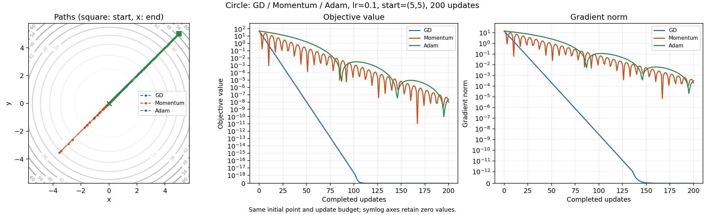
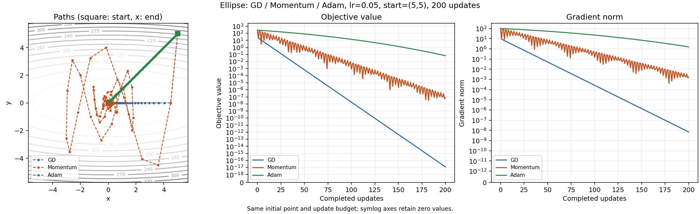
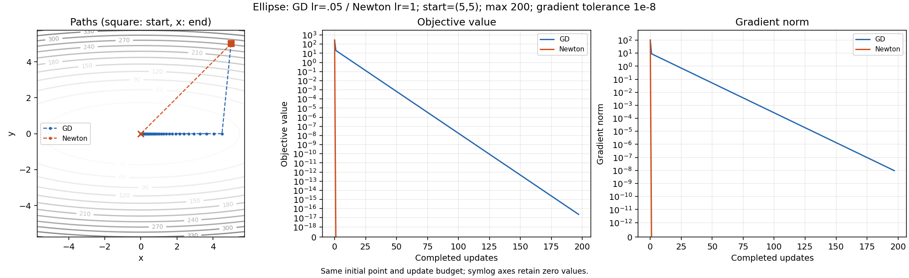

# Adam and Newton: executed comparison

Reproduce: `python -m scripts.run_bonus_optimizers --no-cache`.

float64; seed 42; start=(5,5). Adam: beta1=.9, beta2=.999, epsilon=1e-8; Momentum: beta=.9. Same rate within each three-method comparison; 200 updates.

| Objective | Method | lr | Updates | Final radius | Final loss | First <=.1 | Stay through budget |
|---|---|---:|---:|---:|---:|---:|---:|
| circle | GD | 0.1 | 200 | 2.934151e-19 | 8.609240e-38 | 20 | 20 |
| circle | Momentum | 0.1 | 200 | 9.489598e-05 | 9.005246e-09 | 10 | 77 |
| circle | Adam | 0.1 | 200 | 1.549128e-04 | 2.399799e-08 | 79 | 79 |
| ellipse | GD | 0.05 | 200 | 3.527540e-09 | 1.244354e-17 | 38 | 38 |
| ellipse | Momentum | 0.05 | 200 | 8.684780e-05 | 7.498763e-08 | 65 | 80 |
| ellipse | Adam | 0.05 | 200 | 1.101141e-01 | 6.668812e-02 | None | None |

None means the criterion was not achieved; a first crossing can be followed by an exit. A finite-horizon stay is not an asymptotic guarantee. These fixed settings do not establish that one method is universally faster; equal rates have different meanings for normalized Adam updates.

## Newton versus GD

Ellipse x^2+10y^2, same initial point, maximum 200 updates, same stopping criterion ||gradient|| <= 1e-8. GD lr=.05; pure Newton lr=1.

| Method | Accepted updates | Final gradient norm | Final loss | Stop |
|---|---:|---:|---:|---|
| GD | 197 | 9.677749e-09 | 2.341471e-17 | gradient_tolerance |
| Newton | 1 | 0.000000e+00 | 0.000000e+00 | gradient_tolerance |

Newton solves H*d=g with H=diag(2,20), hence it reaches this quadratic's minimizer in one update. It also requires Hessian construction and a dense linear solve per update (generally O(n^2) storage and O(n^3) solve work). Update counts are not runtime comparisons. The implementation requires a finite symmetric positive-definite Hessian and rejects singular/indefinite inputs. Fixed damping does not guarantee global convergence on arbitrary nonlinear objectives.

