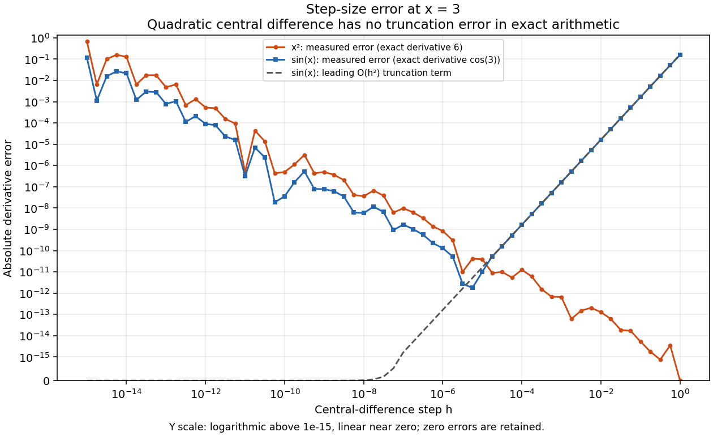
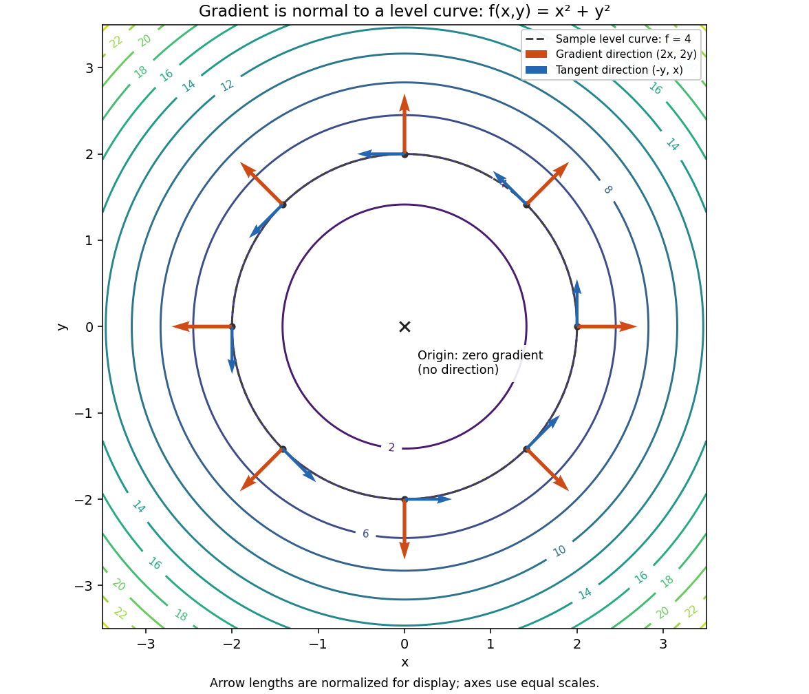

# 미적분 실행 결과

실행 환경: Python 3.11.4, NumPy 2.2.6, Matplotlib 3.10.3; float64, 독립 실험 시작 시 seed42.

실행 원본: `scripts/run_calculus.py`; source SHA-256 `e63347572c173104fdb76543a5754b925432b38d048732c96d4195234df9250c`.

이번 실행 JSON SHA-256 `3c1da3ca1abe047c8bc2b39c3776cfe91829e4c4fd680382fa4ed354761d2fa2`. 기존 제출 JSON과 구조·값 재현 비교 통과(atol=rtol=1e-12). 각 실험의 수학 수용 기준 검증도 별도로 실행했습니다. PNG와 노트북 원본은 수정하지 않았습니다.

원본: [calculus_metrics.json](calculus_metrics.json); seed=42, dtype=float64.
전체 재현: `python -m scripts.run_submission_reports`.
개별 실험: `python -m scripts.run_calculus`. 아래 판정은 저장 수치와 고정 허용치를 대조한 결과다.

**미션 연결: #5~#6 — 중심차분과 Gradient 기하.** 미분은 입력을 조금 바꿀 때 함수가 얼마나 변하는지 알려 준다. 중심차분은 양쪽 함수값으로 이 변화율을 근사하므로 손으로 구한 미분과 이후 역전파를 독립적으로 확인하는 도구가 된다. 여기서는 근사의 오차를 먼저 측정하고, 여러 변수에서 기울기가 가리키는 방향을 등고선과 연결한다.

## 중심차분과 h 탐색

f(x)=x², x=3, h=1e-5; (f(x+h)−f(x−h))/(2h), 해석값 f′(3)=6.

| 검사 | 측정 | 독립 기대값 | 절대오차 | 허용치 | 판정 |
|---|---:|---:|---:|---:|---|
| 고정 중심차분 | 6.000000000039306 | 6 | 3.930633596382904e-11 | 0.0001 | PASS |

x² 탐색: h=1e-15~1, 61개 표본. 절대오차 ≤ 1e-4: PASS 46/61, FAIL 15/61 (고정 h 검증과 별개).
통과한 인접 표본 묶음: 5.6234132519034904e-12~1 (46표본). 실수 연속 구간 전체의 통과를 보장하지 않는다.
최소 관측오차=0, 해당 표본 h=1; 전체 최대오차=0.6709294817992486.
sin(x), x=3 비교: 최소 관측오차=1.769584478950037e-12, 전체 최대오차=0.15694253553364046.
x²의 중심차분은 정확 연산에서 절단오차가 0이다. sin(x)는 O(h²) 절단오차가 있고 작은 h에서는 반올림 오차가 커질 수 있다. 최소오차를 보인 표본 h를 보편적인 최적 간격으로 일반화하지 않는다.
[h별 오차 PNG](derivative_error.png)

그림의 가로축은 간격 h, 세로축은 해석값 대비 절대오차다. 두 실선은 x²와 sin(x)의 실제 오차이고 점선은 sin(x)의 2차 절단오차 주도항이다. 큰 h의 근사 오차와 작은 h의 뺄셈·반올림 영향을 구분해 읽는다. x²는 중심차분의 절단오차가 사라지는 특별한 예제이므로 일반 함수의 권장 h를 정하는 근거로 사용하지 않는다. 세로축은 원점 부근을 선형으로 표시해 오차 0도 그대로 보존한다.

## Gradient와 등고선 접선

f(x,y)=x²+y², ∇f=(2x,2y), 접선=(-y,x). 반경 2의 8점과 원점; 측정 gradient shape=(9,2), 중심차분 h=1e-5.

| 검사 | 측정 오차 | 허용치 | 판정 |
|---|---:|---:|---|
| 수치/해석 gradient 최대 절대오차 | 3.29634097795406e-11 | 1e-8 | PASS |
| 원점 제외 정규화 내적 최대 절댓값 | 0 | 1e-12 | PASS |
| 원점 수치 gradient [0,0] 일치 | 0 | 0 | PASS |

원점의 해석 gradient=[0,0], 방향 없음(null); 수직성 검사에서 제외한다. 그림의 화살표 길이 정규화와 위 수치의 원래 크기는 구분한다.
[Gradient/등고선 PNG](gradient_geometry.png)

등고선을 따라 움직이면 함수값이 변하지 않아 그 방향의 변화율은 0이다. 반경 2의 여덟 점에서 주황색 화살표는 가장 빠르게 증가하는 기울기 방향, 파란색은 등고선의 접선 방향을 나타낸다. 둘이 수직이므로 경사하강법은 주황색 화살표의 반대쪽으로 이동한다. 화살표는 방향을 읽기 쉽도록 길이를 각각 일정하게 표시했으며 실제 기울기 크기를 비교하는 그림은 아니다. 표의 내적 검증은 눈으로 본 수직 관계를 수치로 확인한다.

