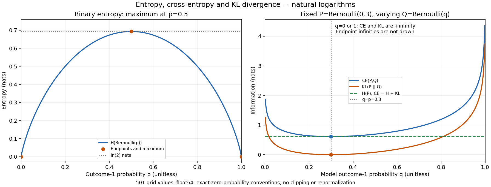

# Information theory bonus: executed evidence

Reproduce: `python -m scripts.run_information_theory`.

NumPy float64; seed 42 set once at the experiment entry; natural logs, units nats.

## Formulas and shape contract

- `H(p) = -sum_i p_i ln(p_i)`.
- `CE(p,q) = -sum_i p_i ln(q_i)`.
- `KL(p||q) = sum_i p_i (ln(p_i)-ln(q_i))`; subtract logs instead of forming a ratio.

The selected class axis is removed. Input `(n,)` returns a scalar; `(batch,n)` on axis=-1 returns `(batch,)`.
Every probability is finite and in [0,1], and each class sum must equal 1 within atol=1e-12, rtol=0.
p/q shapes must match exactly. No broadcasting, clipping, renormalization, or function-level reseeding occurs.
A zero target term is zero, including 0*ln(0). Positive p with q=0 yields +inf.
The JSON string `"+inf"` encodes this mathematical infinity; it is not a finite cap. NaN is never serialized.

## Independent examples

| Example | H(p), nats | CE(p,q), nats | KL(p||q), nats | Result |
|---|---:|---:|---:|---|
| uniform_four | 1.3862943611198906 | 1.3862943611198906 | 0.0 | PASS |
| point_mass | 0.0 | 0.0 | 0.0 | PASS |
| rational_forward | 0.5623351446188083 | 0.6931471805599453 | 0.13081203594113697 | PASS |
| rational_reverse | 0.6931471805599453 | 0.8369882167858358 | 0.14384103622589045 | PASS |
| support_mismatch | 0.0 | +inf | +inf | PASS |
| smallest_positive_q | 0.0 | 744.4400719213812 | 744.4400719213812 | PASS |

Rational reference: p=(1/4,3/4), q=(1/2,1/2). Reversing KL changes its value.
For the smallest positive float64 q, -ln(q)=1074 ln(2); CE/KL remain finite without overflow.

## Bernoulli curves

The first curve uses 501 values p in [0,1]. The second fixes P=(0.7,0.3) and uses the same q grid for Q=(1-q,q).
- Maximum binary entropy: 0.693147180559945 nats at p=0.5.
- Minimum finite KL: 0.000000e+00 at q=0.3.
- Maximum finite-support CE-(H+KL) absolute error: 6.661338e-16 <= 1e-12.
- Maximum H(p)-H(1-p) absolute error: 2.775558e-16 <= 1e-14.
- q=0 and q=1 produce +inf for both CE and KL; finite line segments exclude these endpoints.

CE = H + KL follows by separating sum p ln(p) and -sum p ln(q). Gibbs' inequality gives KL>=0 for normalized distributions, with equality when p=q on support.
Thus, for fixed P, minimizing cross-entropy over Q also minimizes KL. KL is not symmetric and is not a distance metric.
The 1e-12 input sum tolerance permits floating-point roundoff, not arbitrary unnormalized weights. No universal continuous-distribution or sample-estimation claims are made.
