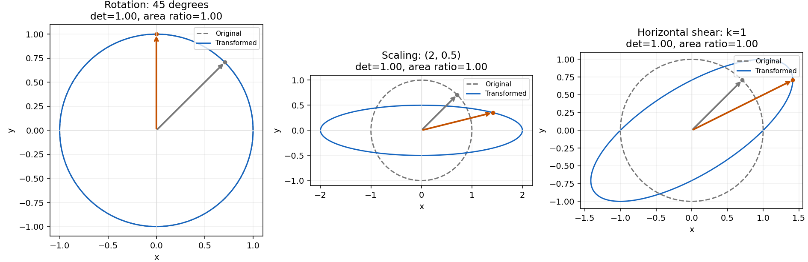
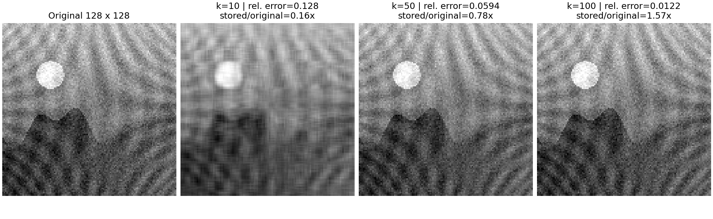

# 선형대수 실행 결과

실행 환경: Python 3.11.4, NumPy 2.2.6, Matplotlib 3.10.3; float64, 독립 실험 시작 시 seed42.

실행 원본: `scripts/run_linear_algebra.py`; source SHA-256 `4579ecaafbd471fc0830cc2d989341922e75739db17c999aa702bbc501f11f62`.

이번 실행 JSON SHA-256 `79d61a1361ab4d3e1142f3bffea7575980f63948fb7ef94f9f4836187ab76d42`. 기존 제출 JSON과 구조·값 재현 비교 통과(atol=rtol=1e-12). 각 실험의 수학 수용 기준 검증도 별도로 실행했습니다. PNG와 노트북 원본은 수정하지 않았습니다.

원본: [linear_algebra_metrics.json](linear_algebra_metrics.json); seed=42, dtype=float64.
전체 재현: `python -m scripts.run_submission_reports`.
개별 실험: `python -m scripts.run_linear_algebra`. 아래 판정은 저장 수치와 고정 허용치를 대조한 결과다.

**미션 연결: #1~#4 — 행렬 변환·면적·고유값·SVD.** 신경망의 선형층은 입력 좌표를 섞고 늘리는 행렬 연산이다. 이 실험은 그 연산이 공간의 모양과 면적을 어떻게 바꾸는지 확인한 뒤, 변환을 대표하는 방향과 이미지 복원에 필요한 성분을 살펴본다. 수치표는 계산의 정확도를, 그림은 변환과 근사의 기하학적 의미를 보여 준다.

## 행렬 변환과 면적

고정 입력은 `scripts/run_linear_algebra.py:run_experiment`의 설정이다(JSON에는 변환 행렬 미저장). c=cos(π/4), s=sin(π/4); 단위 원 400점 P:(2,400)에 A:(2,2) @ P를 적용한다.

| 변환 | A | det(A) | 면적 전 → 후 | 면적비 | 오차 종류·값 | 허용치 | 판정 |
|---|---|---:|---|---:|---|---:|---|
| rotation | `[[c,-s],[s,c]]` | 1.0000000000000002 | 3.141463462364136 → 3.1414634623641358 | 0.9999999999999999 | relative: 3.330669073875469e-16 | 0.01 | PASS |
| scaling | `[[2,0],[0,0.5]]` | 1 | 3.141463462364136 → 3.141463462364136 | 1 | relative: 0 | 0.01 | PASS |
| shear | `[[1,1],[0,1]]` | 1 | 3.141463462364136 → 3.1414634623641344 | 0.9999999999999994 | relative: 5.551115123125783e-16 | 0.01 | PASS |
| reflection | `[[-2,0],[0,3]]` | -6 | 3.141463462364136 → 18.84878077418481 | 5.999999999999997 | relative: 4.440892098500626e-16 | 0.01 | PASS |
| singular | `[[2,0],[0,0]]` | 0 | 3.141463462364136 → 0 | 0 | absolute: 0 | 1e-10 | PASS |

상대오차 = abs(면적비−abs(det))/abs(det); 특이 행렬은 면적비 절대오차를 사용한다.
[변환 PNG](linear_transforms.png)

세 패널의 회색 점선은 원본 단위 원, 파란 실선은 변환 결과다. 화살표는 같은 기준점의 이동을 보여 준다. 원은 회전해도 윤곽이 겹치므로 회전 여부는 화살표를 함께 읽어야 한다. 스케일링은 가로를 늘리고 세로를 줄여 타원을 만들지만 배율의 곱이 1이어서 면적은 유지된다. 전단도 이 예제에서는 면적을 보존한다. 표의 음의 행렬식은 방향 반전을 뜻하며 면적 크기는 절댓값과 비교한다.

## Power Iteration과 eig

Power Iteration은 변환을 반복할 때 상대적으로 가장 강하게 남는 방향을 찾는다. 매번 벡터를 정규화해 크기를 제어하고 방향의 변화를 관찰한다. 이 예제는 두 고유값의 절댓값이 분리되고 초기 벡터가 지배 방향의 성분을 가져 수렴한다. 고유값 오차는 기준값과의 일치, 잔차는 Av≈λv의 일치를 점검한다.

반복식은 w=A v_t, v_(t+1)=w/||w||₂이고, 고유값은 Rayleigh quotient λ=(vᵀAv)/(vᵀv)로 추정한다. 고유기저에서 v₀=Σ c_i u_i이면 A^t v₀=Σ c_i λ_i^t u_i이므로 유일하게 절댓값이 큰 고유값과 그 방향의 0이 아닌 초기 성분이 있을 때 다른 성분의 상대 비중이 줄어든다. 일반 행렬에서 이러한 조건 없이 지배값 수렴을 보장하지 않으며, 여기의 양의 대칭 행렬에서는 최대 절댓값과 최대 고유값이 같다. 초기 영벡터는 정규화할 수 없어 거부한다. Av=0이면 길이로 나누지 않고 영 곱 종료를 보고한다.

A=[[4,1],[1,3]], 초기 v=[1,1]; 기준 λ=(7+sqrt(5))/2. 수동 반복에는 eig를 호출하지 않는다.
정규화 고유벡터 v=[0.8506508082738572, 0.5257311122456358], shape=(2,).
λ_power=4.618033988749896, λ_eig=4.618033988749895; 상대오차=1.923282552410481e-16 ≤ 0.05: PASS.
상대 잔차 ||Av−λv||₂/(||A||F·||v||₂)=6.399563856969149e-11 ≤ 1e-6: PASS; 반복=32, converged=True, 종료=residual_tolerance.
작은 잔차만으로 임의 입력의 지배 고유값 도달을 보장하지 않는다. [eig 상세 보고서](power_iteration_eig_comparison.md)

## SVD 복원

SVD는 입력과 출력의 직교 기저 사이에서 행렬을 특잇값 성분으로 나누고, 큰 성분부터 남겨 이미지를 근사한다. 정방행렬의 Av=λv를 찾는 고유값 문제와 구분되며 직사각형 행렬에도 적용할 수 있다. rank를 늘릴 때 복원 오차가 얼마나 줄고 저장할 원소가 얼마나 늘어나는지를 함께 비교한다.

A_k=U[:,:k] diag(s[:k]) Vt[:k,:]; 오차=||A−A_k||F/||A||F (표시용 clipping 전). 저장 비율=k(m+n+1)/(mn), 원소 수 기준이며 1보다 크면 저장량 절감이 아니다.

| 원본 shape | k | 상대 Frobenius 오차 | 저장/원본 원소 비율 |
|---|---:|---:|---:|
| 64×64 | 10 | 0.11607845060286695 | 0.31494140625 |
| 64×64 | 50 | 0.013222144059052797 | 1.57470703125 |
| 64×64 | 64 | 2.3605124574215274e-15 | 2.015625 |
| 128×128 | 10 | 0.1275184713562091 | 0.1568603515625 |
| 128×128 | 50 | 0.05938687046053636 | 0.7843017578125 |
| 128×128 | 100 | 0.01218300917179587 | 1.568603515625 |

64×64: 완전 rank 오차=2.3605124574215274e-15 ≤ 1e-10: PASS; k 증가 시 오차 비증가(atol=1e-12): PASS.
128×128: 완전 rank 오차=1.1042954043230347e-15 ≤ 1e-10: PASS; k 증가 시 오차 비증가(atol=1e-12): PASS.
64×64 입력에서 rank 100은 불가능하므로 본 실험은 10/50/64, 별도 128×128 실험은 10/50/100을 사용한다. 배열 크기이며 전체 PNG 크기가 아니다.
[64×64 PNG](svd_64.png) · [128×128 PNG](svd_128.png)

각 그림의 왼쪽은 원본, 오른쪽은 세 rank 복원이며 한 그림 안에서는 같은 밝기 기준을 사용한다. 고정 시드로 만든 합성 풍경·원판·질감의 세부가 얼마나 복원되는지와 저장 비율을 함께 읽는다. 가장 선명한 결과가 가장 효율적인 압축이라는 결론은 나오지 않는다. 두 크기는 서로 다른 입력 실험이므로 그림 사이의 차이를 rank 효과 하나로 설명하지 않는다.

