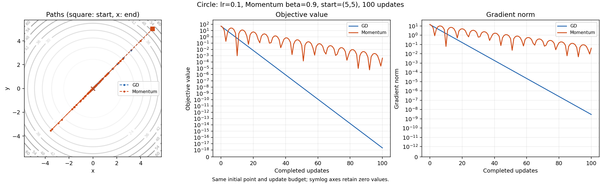
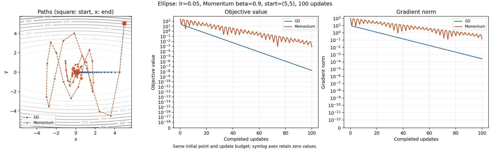
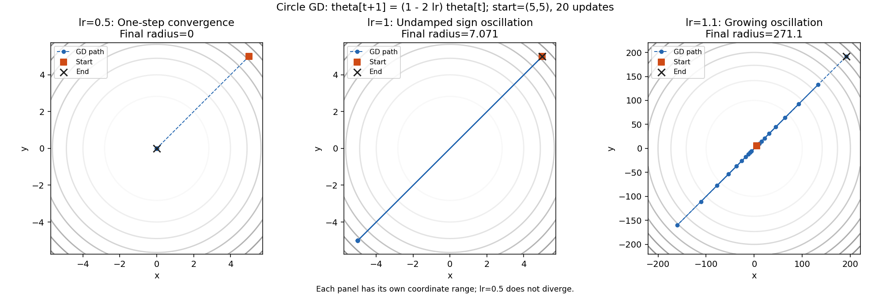

# 기본 최적화 실험 결과

실행 환경: Python 3.11.4, NumPy 2.2.6, Matplotlib 3.10.3; float64, 독립 실험 시작 시 seed42.

실행 원본: `scripts/run_optimizer.py`; source SHA-256 `4b309b3725f34d7224e1c9a987bdb1324ddc97ae04ff29006d1b15a8e441c311`.

이번 실행 JSON SHA-256 `aadc65a63689cfaaec4f5d829e8f3f5ad84ee7e373ec087519fe8d35e6b83562`. 기존 제출 JSON과 구조·입력·직접 계산값 재현 비교 통과(atol=rtol=1e-12). 중심차분의 플랫폼별 반올림 차이는 저장값의 끝자리 일치 대신 기존 해석값·오차 기준으로 검증했습니다. 각 실험의 수학 수용 기준은 변경하지 않았습니다. PNG와 노트북 원본은 수정하지 않았습니다.

**미션 연결: #9~#12 — GD 수렴·학습률·Momentum·타원형 비교.** 최적화는 앞에서 구한 기울기를 매개변수의 이동으로 바꾸는 과정이다. 원형 함수는 모든 방향의 곡률이 같고 타원형 함수는 y 방향의 곡률이 x 방향보다 열 배 크므로 같은 학습률에도 방향별 이동이 달라진다. 경로·손실·기울기를 함께 관찰하며 함수의 곡률, 학습률, 이전 상태의 누적이 수렴 양상을 어떻게 바꾸는지 확인한다.

원시 수치: [optimizer_metrics.json](optimizer_metrics.json). seed=42, dtype=float64; 초기점=(5,5).
수치·그림 재생성: `python -m scripts.run_optimizer --no-cache`; 보고서 생성: `python -m scripts.run_submission_reports`.
원형은 f=x²+y², 타원형은 f=x²+10y². GD: θ←θ−lr·g; Momentum: v←0.9v+g, θ←θ−lr·v, v₀=0.

## GD·Momentum: 같은 초기점과 100회 업데이트

각 경로 shape=(101,2), 손실·gradient norm shape=(101,). 초기점은 0회이며 표의 최종값은 100회다.
반경은 ||θ||₂. 최초 진입은 반경≤0.1인 첫 시점, 유지 시작은 그 뒤 **100회까지** 계속 만족한 첫 시점이다. 무한히 유지한다는 보장은 아니다.

| 함수·방법 | lr | 최종 좌표 | 최종 손실 | 최종 반경 | 최종 gradient norm | 최초 진입 | 유지 시작 |
|---|---:|---|---:|---:|---:|---:|---:|
| 원형 GD | 0.1 | (1.018518e-09, 1.018518e-09) | 2.074758e-18 | 1.440402e-09 | 2.880804e-09 | 20 | 20 |
| 원형 Momentum | 0.1 | (-1.425706e-02, -1.425706e-02) | 4.065273e-04 | 2.016252e-02 | 4.032504e-02 | 10 | 77 |
| 타원형 GD | 0.05 | (1.328070e-04, 0.000000e+00) | 1.763770e-08 | 1.328070e-04 | 2.656140e-04 | 38 | 38 |
| 타원형 Momentum | 0.05 | (1.869367e-02, 6.750231e-03) | 8.051093e-04 | 1.987508e-02 | 1.400859e-01 | 65 | 80 |

원형 GD의 최종 반경 1.440402e-09은 기준 0.1 이내다. 최초 진입이 빠르더라도 이후 진동으로 다시 벗어날 수 있으므로 유지 시작과 함께 비교한다. 결과는 표시한 설정의 관측값이며 Momentum의 보편적인 우월성을 의미하지 않는다.

Momentum은 이전 기울기의 영향을 누적해 한 방향의 이동을 가속할 수 있지만 최소점을 지나친 뒤에도 관성이 남아 진동할 수 있다. 위 원형 실험에서는 최초 진입은 Momentum이 빠르고, 기록된 100회까지 계속 반경 안에 머무는 시점은 GD가 빠르다. 타원형의 이 설정에서도 GD의 최초 진입이 더 빠르다. 따라서 어느 수렴 지표를 비교하는지 먼저 정해야 결과를 올바르게 해석할 수 있다.

### 대표 경로 수치

| 함수·방법 | 업데이트 | 좌표 (x,y) | 손실 | 반경 |
|---|---:|---|---:|---:|
| 원형 GD | 0 | (5.000000e+00, 5.000000e+00) | 5.000000e+01 | 7.071068e+00 |
| 원형 GD | 1 | (4.000000e+00, 4.000000e+00) | 3.200000e+01 | 5.656854e+00 |
| 원형 GD | 2 | (3.200000e+00, 3.200000e+00) | 2.048000e+01 | 4.525483e+00 |
| 원형 GD | 5 | (1.638400e+00, 1.638400e+00) | 5.368709e+00 | 2.317048e+00 |
| 원형 GD | 10 | (5.368709e-01, 5.368709e-01) | 5.764608e-01 | 7.592501e-01 |
| 원형 GD | 20 | (5.764608e-02, 5.764608e-02) | 6.646140e-03 | 8.152386e-02 |
| 원형 GD | 50 | (7.136238e-05, 7.136238e-05) | 1.018518e-08 | 1.009217e-04 |
| 원형 GD | 100 | (1.018518e-09, 1.018518e-09) | 2.074758e-18 | 1.440402e-09 |
| 원형 Momentum | 0 | (5.000000e+00, 5.000000e+00) | 5.000000e+01 | 7.071068e+00 |
| 원형 Momentum | 1 | (4.000000e+00, 4.000000e+00) | 3.200000e+01 | 5.656854e+00 |
| 원형 Momentum | 2 | (2.300000e+00, 2.300000e+00) | 1.058000e+01 | 3.252691e+00 |
| 원형 Momentum | 5 | (-2.902100e+00, -2.902100e+00) | 1.684437e+01 | 4.104189e+00 |
| 원형 Momentum | 10 | (2.199935e-02, 2.199935e-02) | 9.679431e-04 | 3.111178e-02 |
| 원형 Momentum | 20 | (-1.746263e+00, -1.746263e+00) | 6.098870e+00 | 2.469589e+00 |
| 원형 Momentum | 50 | (-1.524921e-01, -1.524921e-01) | 4.650771e-02 | 2.156565e-01 |
| 원형 Momentum | 100 | (-1.425706e-02, -1.425706e-02) | 4.065273e-04 | 2.016252e-02 |
| 타원형 GD | 0 | (5.000000e+00, 5.000000e+00) | 2.750000e+02 | 7.071068e+00 |
| 타원형 GD | 1 | (4.500000e+00, 0.000000e+00) | 2.025000e+01 | 4.500000e+00 |
| 타원형 GD | 2 | (4.050000e+00, 0.000000e+00) | 1.640250e+01 | 4.050000e+00 |
| 타원형 GD | 5 | (2.952450e+00, 0.000000e+00) | 8.716961e+00 | 2.952450e+00 |
| 타원형 GD | 10 | (1.743392e+00, 0.000000e+00) | 3.039416e+00 | 1.743392e+00 |
| 타원형 GD | 20 | (6.078833e-01, 0.000000e+00) | 3.695221e-01 | 6.078833e-01 |
| 타원형 GD | 50 | (2.576888e-02, 0.000000e+00) | 6.640350e-04 | 2.576888e-02 |
| 타원형 GD | 100 | (1.328070e-04, 0.000000e+00) | 1.763770e-08 | 1.328070e-04 |
| 타원형 Momentum | 0 | (5.000000e+00, 5.000000e+00) | 2.750000e+02 | 7.071068e+00 |
| 타원형 Momentum | 1 | (4.500000e+00, 0.000000e+00) | 2.025000e+01 | 4.500000e+00 |
| 타원형 Momentum | 2 | (3.600000e+00, -4.500000e+00) | 2.154600e+02 | 5.762812e+00 |
| 타원형 Momentum | 5 | (-1.458000e-01, 4.009500e+00) | 1.607822e+02 | 4.012150e+00 |
| 타원형 Momentum | 10 | (-2.943947e+00, 8.765824e-01) | 1.635079e+01 | 3.071680e+00 |
| 타원형 Momentum | 20 | (1.723337e+00, -1.979170e+00) | 4.214104e+01 | 2.624311e+00 |
| 타원형 Momentum | 50 | (-3.334012e-01, -2.482618e-01) | 7.274954e-01 | 4.156805e-01 |
| 타원형 Momentum | 100 | (1.869367e-02, 6.750231e-03) | 8.051093e-04 | 1.987508e-02 |

## 학습률 0.5·1.0·1.1: 20회 관측

원형 GD는 θₜ=(1−2lr)ᵗθ₀이고 손실 배율은 (1−2lr)²다. 0<lr<1에서 수렴, lr=0.5는 1회 만에 원점, lr=1은 진동, lr>1은 비영 초기점에서 발산한다.
각 경로 shape=(21,2), 손실·gradient norm shape=(21,). 유한한 20회 관측과 이론적 분류를 구분한다.

| lr | 좌표 배율 | 손실 배율 | 최종 좌표 | 최종 손실 | 최종 반경 | 해석 |
|---:|---:|---:|---|---:|---:|---|
| 0.5 | 0 | 0 | (0.000000e+00, 0.000000e+00) | 0.000000e+00 | 0.000000e+00 | 1회 만에 원점 |
| 1 | -1 | 1 | (5.000000e+00, 5.000000e+00) | 5.000000e+01 | 7.071068e+00 | 반경 일정·부호 진동 |
| 1.1 | -1.2 | 1.44 | (1.916880e+02, 1.916880e+02) | 7.348858e+04 | 2.710878e+02 | 반경·손실 증가 |

| lr | 업데이트 | 좌표 (x,y) | 손실 | 반경 |
|---:|---:|---|---:|---:|
| 0.5 | 0 | (5.000000e+00, 5.000000e+00) | 5.000000e+01 | 7.071068e+00 |
| 0.5 | 1 | (0.000000e+00, 0.000000e+00) | 0.000000e+00 | 0.000000e+00 |
| 0.5 | 5 | (0.000000e+00, 0.000000e+00) | 0.000000e+00 | 0.000000e+00 |
| 0.5 | 10 | (0.000000e+00, 0.000000e+00) | 0.000000e+00 | 0.000000e+00 |
| 0.5 | 20 | (0.000000e+00, 0.000000e+00) | 0.000000e+00 | 0.000000e+00 |
| 1 | 0 | (5.000000e+00, 5.000000e+00) | 5.000000e+01 | 7.071068e+00 |
| 1 | 1 | (-5.000000e+00, -5.000000e+00) | 5.000000e+01 | 7.071068e+00 |
| 1 | 5 | (-5.000000e+00, -5.000000e+00) | 5.000000e+01 | 7.071068e+00 |
| 1 | 10 | (5.000000e+00, 5.000000e+00) | 5.000000e+01 | 7.071068e+00 |
| 1 | 20 | (5.000000e+00, 5.000000e+00) | 5.000000e+01 | 7.071068e+00 |
| 1.1 | 0 | (5.000000e+00, 5.000000e+00) | 5.000000e+01 | 7.071068e+00 |
| 1.1 | 1 | (-6.000000e+00, -6.000000e+00) | 7.200000e+01 | 8.485281e+00 |
| 1.1 | 5 | (-1.244160e+01, -1.244160e+01) | 3.095868e+02 | 1.759508e+01 |
| 1.1 | 10 | (3.095868e+01, 3.095868e+01) | 1.916880e+03 | 4.378219e+01 |
| 1.1 | 20 | (1.916880e+02, 1.916880e+02) | 7.348858e+04 | 2.710878e+02 |

기존 그림: [원형 경로·손실·gradient](optimizer_circle.png) · [타원형 경로·손실·gradient](optimizer_ellipse.png) · [학습률별 경로](optimizer_learning_rates.png).

원형 비교 그림은 왼쪽에서 등고선 위 경로, 가운데에서 손실, 오른쪽에서 기울기 norm을 보여 준다. 사각형은 시작점, x 표시는 마지막 점이며 점선으로 연결한 점은 각 업데이트다. 경로가 원점을 지나갔다는 사실만으로 안정적으로 수렴했다고 볼 수 없어 손실과 기울기 그래프를 함께 읽는다. 두 세로축은 0 근처를 선형으로 표시해 정확한 0도 보존한다.

타원형 그림도 같은 세 패널로 두 방법을 비교한다. 지정한 lr=0.05에서는 GD의 y 성분이 첫 갱신에 0이 되어 이후 x축을 따라 이동한다. 이 조건에서 지속적인 지그재그를 기대하거나 그림을 근거로 Momentum이 언제나 더 부드럽다고 해석하지 않는다.

학습률 그림은 한 번에 도착·크기가 일정한 진동·커지는 진동을 분리해 보여 준다. 각 패널이 자기 좌표 범위를 사용하므로 화면의 선 길이만 비교하지 말고 축 눈금과 최종 반경을 읽어야 한다. 유한한 20회 관측은 위 점화식의 수렴·진동·발산 분류와 함께 해석한다.

