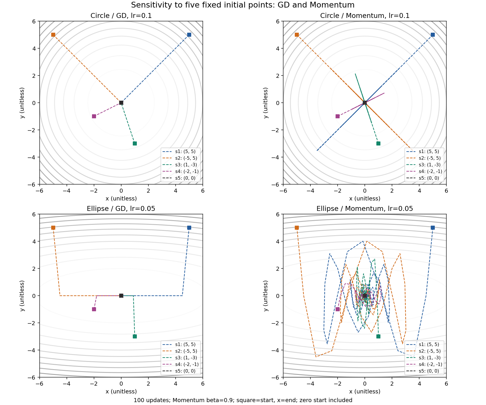

# Optimizer sensitivity and stability evidence

Reproduce: `python -m scripts.run_optimizer_sensitivity --no-cache`.

Five declared starts: (5,5), (-5,5), (1,-3), (-2,-1), (0,0). float64; seed 42; 100 updates; Momentum beta=0.9; radius threshold=0.1.

This is a deterministic sensitivity set, not repeated random trials. The optimum start is deliberately included. Statistics use population variance (ddof=0). Missing hits remain null; first crossing does not imply staying inside. A stay is measured only through the recorded budget.

| Objective | Method | Start | lr | Updates | Final radius | First <=0.1 | Stay through budget |
|---|---|---|---:|---:|---:|---:|---:|
| circle | GD | [5.0, 5.0] | 0.1 | 100 | 1.440402e-09 | 20 | 20 |
| circle | GD | [-5.0, 5.0] | 0.1 | 100 | 1.440402e-09 | 20 | 20 |
| circle | GD | [1.0, -3.0] | 0.1 | 100 | 6.441673e-10 | 16 | 16 |
| circle | GD | [-2.0, -1.0] | 0.1 | 100 | 4.554951e-10 | 14 | 14 |
| circle | GD | [0.0, 0.0] | 0.1 | 100 | 0.000000e+00 | 0 | 0 |
| circle | Momentum | [5.0, 5.0] | 0.1 | 100 | 2.016252e-02 | 10 | 77 |
| circle | Momentum | [-5.0, 5.0] | 0.1 | 100 | 2.016252e-02 | 10 | 77 |
| circle | Momentum | [1.0, -3.0] | 0.1 | 100 | 9.016954e-03 | 10 | 63 |
| circle | Momentum | [-2.0, -1.0] | 0.1 | 100 | 6.375949e-03 | 10 | 56 |
| circle | Momentum | [0.0, 0.0] | 0.1 | 100 | 0.000000e+00 | 0 | 0 |
| ellipse | GD | [5.0, 5.0] | 0.05 | 100 | 1.328070e-04 | 38 | 38 |
| ellipse | GD | [-5.0, 5.0] | 0.05 | 100 | 1.328070e-04 | 38 | 38 |
| ellipse | GD | [1.0, -3.0] | 0.05 | 100 | 2.656140e-05 | 22 | 22 |
| ellipse | GD | [-2.0, -1.0] | 0.05 | 100 | 5.312280e-05 | 29 | 29 |
| ellipse | GD | [0.0, 0.0] | 0.05 | 100 | 0.000000e+00 | 0 | 0 |
| ellipse | Momentum | [5.0, 5.0] | 0.05 | 100 | 1.987508e-02 | 65 | 80 |
| ellipse | Momentum | [-5.0, 5.0] | 0.05 | 100 | 1.987508e-02 | 65 | 80 |
| ellipse | Momentum | [1.0, -3.0] | 0.05 | 100 | 5.511964e-03 | 33 | 65 |
| ellipse | Momentum | [-2.0, -1.0] | 0.05 | 100 | 7.598364e-03 | 44 | 59 |
| ellipse | Momentum | [0.0, 0.0] | 0.05 | 100 | 0.000000e+00 | 0 | 0 |

## Conditional success statistics

Means/variances below include only starts meeting the corresponding criterion. The JSON additionally includes all-start final-radius statistics and every raw trajectory.

| Objective | Method | Metric | Success / all | Mean updates | Variance updates² |
|---|---|---|---:|---:|---:|
| circle | GD | first crossing | 5 / 5 | 14.0 | 54.4 |
| circle | GD | stay through budget | 5 / 5 | 14.0 | 54.4 |
| circle | Momentum | first crossing | 5 / 5 | 8.0 | 16.0 |
| circle | Momentum | stay through budget | 5 / 5 | 54.6 | 811.44 |
| ellipse | GD | first crossing | 5 / 5 | 25.4 | 197.44 |
| ellipse | GD | stay through budget | 5 / 5 | 25.4 | 197.44 |
| ellipse | Momentum | first crossing | 5 / 5 | 41.4 | 581.04 |
| ellipse | Momentum | stay through budget | 5 / 5 | 56.8 | 874.96 |

## Circle GD stability

For a nonzero start, theta[t]=(1-2lr)^t theta[0]; loss multiplies by (1-2lr)^2. Classification follows this exact quadratic recurrence, not an arbitrary divergence threshold.

| lr | Coordinate factor | Loss factor | Observed ratio range | Classification |
|---:|---:|---:|---|---|
| 0.5 | 0 | 0 | [0, 0] | one_step_convergence |
| 1.0 | -1 | 1 | [1, 1] | constant_radius_sign_oscillation |
| 1.1 | -1.2 | 1.44 | [1.44, 1.44] | divergence_for_nonzero_initial |

Ratios with zero denominators are excluded; lr=0.5 has only the first ratio (0). All 20 observed updates are finite. Newton/Adam and claims of universal superiority are outside this report.

