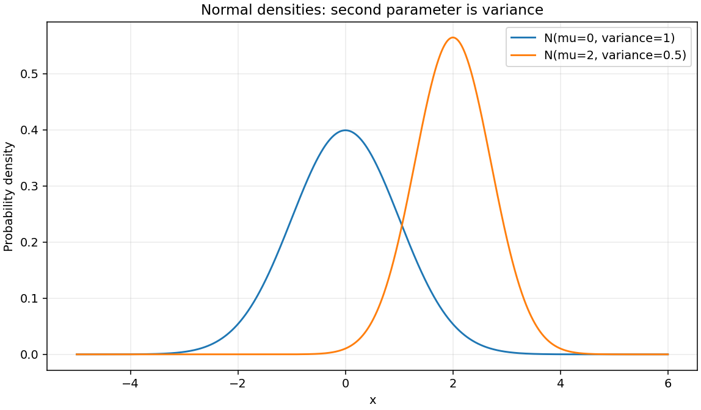
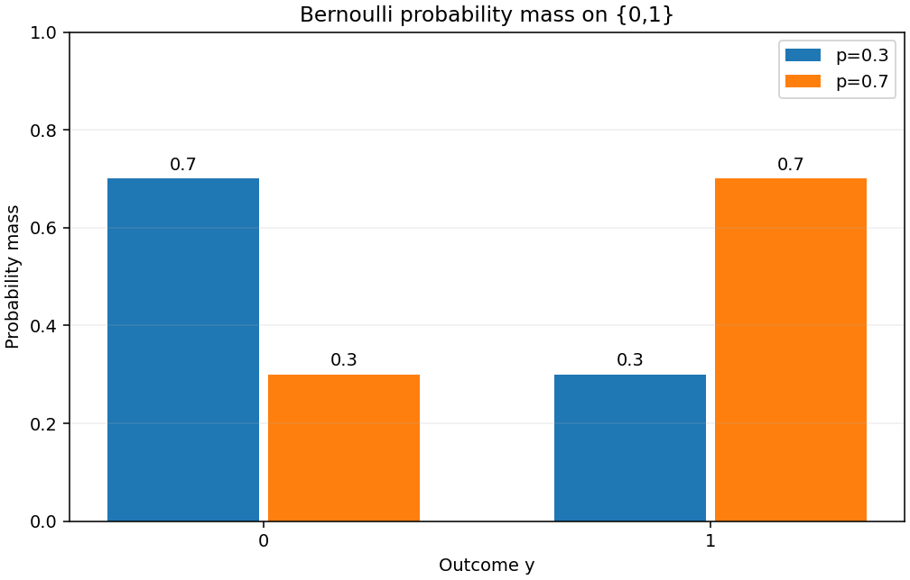

# 확률·손실: 실행된 분포와 MLE 유도

실행 환경: Python 3.11.4, NumPy 2.2.6, Matplotlib 3.10.3; float64, 독립 실험 시작 시 seed42.

실행 원본: `notebooks/probability_loss.ipynb`; source SHA-256 `b31883f9b1e3fed3c71be84e068d03e5db6f3a205ed567533f2c60d9fc968d8e`.

이번 실행 JSON SHA-256 `d37506805875734180601ff6522d417e42e233589c182c5628161b125d012f5b`. 기존 제출 JSON과 구조·값 재현 비교 통과(atol=rtol=1e-12). 각 실험의 수학 수용 기준 검증도 별도로 실행했습니다. PNG와 노트북 원본은 수정하지 않았습니다.

**미션 연결: #13~#15 — 확률 분포·Softmax·MLE와 손실.** 손실 함수는 관측이 어떤 확률 모형에서 나왔다고 가정하는지와 연결된다. Gaussian 오차를 가정한 연속값 예측, Bernoulli를 가정한 이진 관측, categorical을 가정한 여러 클래스 중 하나의 관측을 구분하고, 데이터를 더 그럴듯하게 만드는 최대우도가 각각 어떤 손실의 최소화가 되는지 확인한다.

seed 42 · float64 · NumPy 2.2.6; 코드 9셀을 순서대로 실행했고 오류 출력은 0개다.
재현: `python -m scripts.run_submission_reports`; 개별 실행: `python -m scripts.run_notebooks notebooks/probability_loss.ipynb`.
원시 데이터: [probability_metrics.json](probability_metrics.json). 원본: [probability_loss.ipynb](../notebooks/probability_loss.ipynb).

## 1. 정규 PDF와 Bernoulli PMF

정규분포는 유한한 mu와 variance>0에서 N(mu,variance), PDF=exp(-(x-mu)²/(2*variance))/sqrt(2*pi*variance)다. 각 mu±8*sigma 구간의 10,001점에서 적분한다.
Bernoulli는 0≤p≤1, k∈{0,1}에서 PMF(0)=1-p, PMF(1)=p이며 지지집합 밖은 0이다.

| 분포 | 매개변수 | 실측값 | 오차·기준 |
|---|---|---|---|
| Normal | mu=0, variance=1, sigma=1 | integral=0.9999999999999989, peak=0.398942280401 | 1.110e-15 ≤ 1e-4 |
| Normal | mu=2, variance=0.5, sigma=0.707106781187 | integral=0.999999999999999, peak=0.564189583548 | 9.992e-16 ≤ 1e-4 |
| Bernoulli | p=0.3, support=[0,1] | PMF=`[0.7, 0.3]` | sum error=0.000e+00 ≤ 1e-12 |
| Bernoulli | p=0.7, support=[0,1] | PMF=`[0.3, 0.7]` | sum error=0.000e+00 ≤ 1e-12 |

정규 PDF 그림에서 평균은 곡선의 중심을 옮기고 분산은 퍼짐을 바꾼다. 분산 0.5인 곡선은 더 좁고 높지만 전체 면적은 여전히 1이다. PDF 높이 자체는 한 점의 확률이 아니며 구간 확률은 면적으로 읽는다.



Bernoulli 그림의 막대 높이는 0과 1이라는 각 결과의 확률이다. 같은 p에 속한 두 막대의 높이를 더하면 1이 되며, p=0.3과 0.7에서는 두 결과의 확률이 서로 바뀐다. 연속 분포의 밀도와 이산 분포의 질량을 구분해 읽어야 한다.



## 2. Softmax의 실제 합 검증

유한한 logits에서 선택 축의 최댓값 m을 빼고 p_j=exp(z_j-m)/sum_k exp(z_k-m)로 계산한다. 확률은 비음수이고 선택 축을 따라 합이 1이다.
logits=`[[1000, 1001, 1002],  [-1000, 0, 1000]]`, shape `(2,3)`, axis=-1. 확률=`[[0.0900305731704, 0.244728471055, 0.665240955775],  [0, 0, 1]]`.
행 합=`[0.9999999999999999, 1.0]`, 최대 합 오차 **1.110223024625157e-16 ≤ 1e-6**. axis=0 재검증의 열 합 오차도 **1.110223024625157e-16 ≤ 1e-6**: PASS.

Softmax는 여러 logit을 한 분포로 묶으므로 클래스 축을 어디로 선택했는지가 중요하다. 같은 최댓값을 빼는 계산은 확률을 바꾸지 않고 overflow를 피한다. 극단 logit의 작은 확률은 float64에서 0으로 표시될 수 있어, 아래 손실 검증은 확률의 로그를 우회 계산하는 대신 안정적인 logit 식도 함께 확인한다.

## 3. 손실의 독립 수치 검증

Gaussian NLL과 MSE는 아래 표에서 값이 다르지만 매개변수에 무관한 상수와 양의 배율 차이여서 같은 최소점을 갖는다. 이 연결에는 독립 관측과 고정 공통 분산 가정이 필요하다. 분산까지 학습하거나 관측마다 다른 분산을 사용하면 이 단순한 관계를 그대로 적용할 수 없다.

| 예제 | 입력·조건 | 실측 결과 | 오차·기준 |
|---|---|---|---|
| Gaussian | observed=[0,1,2], predicted=[1,.5,1.5], n=3, variance=.5 | SSE=1.5, MSE=0.5, NLL=3.2170948287741, mean NLL=1.0723649429247 | density/NLL identity error=4.441e-16 ≤ 1e-14 |
| Bernoulli BCE | y=[0,1], p=[.3,.7] | sum=0.7133498878774649, mean=0.3566749439387324, logit sum=0.7133498878774649 | gradient max error=8.627e-12 ≤ 1e-8 |
| Categorical CE | p=[.2,.3,.5], target index=2 (third class) | probability CE=0.6931471805599453, logit CE=0.6931471805599453 | agreement ≤ 1e-15 |

## 4. Gaussian MLE가 MSE 최소화와 연결되는 조건

관측 $y_i=f_\theta(x_i)+\epsilon_i$에서 오차는 서로 독립이며 $\epsilon_i\sim N(0,\sigma^2)$라고 가정한다.
모든 표본에 같은 양의 분산 $\sigma^2$를 사용하며, 여기서는 그 분산을 **알려진 상수**로 고정한다.

$$\mathcal L(\theta)=\prod_{i=1}^n\frac{1}{\sqrt{2\pi\sigma^2}}
\exp\!\left[-\frac{(y_i-f_\theta(x_i))^2}{2\sigma^2}\right].$$

곱의 자연로그를 합으로 바꾸고 부호를 반전하면

$$\operatorname{NLL}(\theta)
=\frac n2\ln(2\pi\sigma^2)+\frac{1}{2\sigma^2}\sum_{i=1}^n(y_i-f_\theta(x_i))^2
=\frac n2\ln(2\pi\sigma^2)+\frac{n}{2\sigma^2}\operatorname{MSE}(\theta).$$

첫 항은 $\theta$와 무관하고 MSE의 계수는 양수이므로 같은 허용 매개변수 집합에서 MLE, SSE 최소화, MSE 최소화가 **같은 최적해 집합**을 갖는다.
NLL과 MSE가 항상 같은 숫자라는 뜻은 아니다. 평균 NLL은 위 식을 n으로 나눈 값이며, 양의 상수 배율은 최적해를 바꾸지 않는다.

분산이 입력 또는 $\theta$에 따라 달라지면 로그 분산 항과 오차별 가중치를 버릴 수 없다. 분산까지 추정하는 문제는 위 고정분산 유도와 구분해야 한다.
연속 확률의 밀도는1보다 클 수 있으므로 Gaussian NLL이 음수일 수도 있다. 일반적인 비음수 assertion을 두지 않는다.

## 5. Bernoulli likelihood에서 BCE 유도

$y_i\in\{0,1\}$, $p_i=\sigma(z_i)$인 독립 표본의 likelihood는
$$\mathcal L=\prod_i p_i^{y_i}(1-p_i)^{1-y_i}.$$
따라서 음의 로그우도는
$$L_{\mathrm{sum}}=-\sum_i\left[y_i\ln p_i+(1-y_i)\ln(1-p_i)\right],\qquad
L_{\mathrm{mean}}=L_{\mathrm{sum}}/n.$$

한 표본에서 $p=\sigma(z)$를 대입하면
$$\ell(z,y)=\log(1+e^z)-yz=\operatorname{logaddexp}(0,z)-yz,\qquad
\frac{\partial\ell}{\partial z}=\sigma(z)-y.$$
sum 손실의 각 logit 미분은 위 식이고 mean 손실의 각 미분은 n으로 나눈다. 앞 역전파 노트북은 단일 표본이어서 평균 계수가 없었다.

`logaddexp`는 exp의 overflow를 피하지만 큰 양수 z와 y=1에서는 마지막 뺄셈이 작은 양의 손실을0으로 상쇄할 수 있다.
아래 binary-label 계산은 수학적으로 같은 $\operatorname{logaddexp}(0,(1-2y)z)$를 사용해 그 작은 값을 보존한다.
미분식도 float64에서 sigmoid가 포화되면 작은 꼬리값을 표현하지 못할 수 있으므로, 충분히 중간인 logit에서 중심차분과 비교한다.

**경계 확률:** $0\log0=0$은 해당 항의 연속 극한이다. p=0,y=0 또는 p=1,y=1의 손실은0이다.
불가능한 사건(p=0,y=1 또는 p=1,y=0)은 손실 $+\infty$다. `0*log(0)`으로 NaN을 만든 뒤 숨기거나 임의 clipping으로 다른 손실을 만들지 않는다.

## 6. 다중 클래스 likelihood에서 Cross-Entropy 유도

각 표본의 one-hot 벡터 $y_{ij}$는 실제 클래스 하나에서만1이며 $\sum_j y_{ij}=1$이다.
$p_{ij}=\operatorname{softmax}(z_i)_j$이면 독립 표본 likelihood와 음의 로그는

$$\mathcal L=\prod_i\prod_j p_{ij}^{y_{ij}},\qquad
L_{\mathrm{sum}}=-\sum_i\sum_j y_{ij}\ln p_{ij}=-\sum_i\ln p_{i,c_i}.$$

이는 categorical Cross-Entropy이고, 표본 평균은 n으로 나눈다. 이진 Bernoulli의 두 결과 항에서 나온 BCE와 유도 출발점을 구분한다.
target가0인 클래스의 $0\log0$ 항은0이고 실제 클래스의 확률이0이면 손실은 $+\infty$다.

logit에서 직접 계산할 때 $s=z-\max(z)$로 이동시켜
$$\ell(z,c)=\ln\sum_j e^{s_j}-s_c$$
를 사용한다. 큰 공통 offset을 더한 logsumexp와 target logit을 마지막에 빼는 취소 오차도 줄인다.
한 표본의 logit 미분은 $p-y_{\mathrm{onehot}}$이며, 평균 손실이면 n으로 나눈다.

## 7. 경계·수치 안정성의 실행 결과

BCE의 (y,p)=(0,0)/(1,1)은 0, (1,0)/(0,1)은 +inf임을 검증했다. 극단 logit [-1000,1000,-1000,1000]의 손실은 `[0, 0, 1000, 1000]`이며 모두 유한하다.
z=40,y=1의 안정식 손실은 4.248354255291589e-18>0이고 subtractive logaddexp(0,z)-z는 0으로 상쇄된다.
Categorical에서 p=[0,0,1]의 정답 index=2는 0, index=0은 +inf다. logits=[-1000,0,1000], target=0의 CE는 2000다. 불가능 사건을 clipping하지 않으며 JSON에는 경계 검증 여부를 기록한다.
유한 logit에서 극소확률이 0으로 표시되는 표현 한계와, 확률 모형이 불가능 사건에 0을 직접 부여한 경우의 무한 손실은 구분한다.
분포·합/평균·독립 손실값·수치 gradient·경계 assertion: **PASS**. 이는 명시한 고정 예제의 결과이며 모든 모델의 통계 가정을 보장하지 않는다.

## 실제 실행 출력

아래는 실행된 노트북의 필수 검증 셀에서 저장한 stdout 원문이다. 선택한 셀의 출력은 생략하지 않았으며 환경 소개·중간 확인·파일 저장 등 다른 셀의 출력은 제외했다. 위 표는 JSON 수치를 정리한 결과이고, 아래 블록은 재구성한 예시가 아닌 실제 출력이다.

### `normal-density-check`

```text
{'mu': 0.0, 'variance': 1.0, 'sigma': 1.0, 'grid_points': 10001, 'integral': 0.9999999999999989, 'integral_absolute_error': 1.1102230246251565e-15, 'peak': 0.3989422804014327, 'minimum_pdf': 5.052271083536893e-15}
{'mu': 2.0, 'variance': 0.5, 'sigma': 0.7071067811865476, 'grid_points': 10001, 'integral': 0.999999999999999, 'integral_absolute_error': 9.992007221626409e-16, 'peak': 0.5641895835477563, 'minimum_pdf': 7.144990287123286e-15}
```

### `bernoulli-check`

```text
[{'p': 0.3, 'support': [0, 1], 'pmf': [0.7, 0.3], 'mass_error': 0.0}, {'p': 0.7, 'support': [0, 1], 'pmf': [0.30000000000000004, 0.7], 'mass_error': 0.0}]
```

### `softmax-check`

```text
{'logits': [[1000.0, 1001.0, 1002.0], [-1000.0, 0.0, 1000.0]], 'probabilities': [[0.09003057317038046, 0.24472847105479764, 0.6652409557748218], [0.0, 0.0, 1.0]], 'axis': -1, 'row_sums': [0.9999999999999999, 1.0], 'max_sum_error': 1.1102230246251565e-16, 'column_sum_error': 1.1102230246251565e-16}
```

### `gaussian-mle-check`

```text
{'n': 3, 'variance': 0.5, 'sse': 1.5, 'mse': 0.5, 'nll': 3.2170948287741004, 'independent_reference': 3.2170948287741004, 'identity_error': 4.440892098500626e-16, 'mean_nll': 1.0723649429247002}
```

### `bce-check`

```text
{'y': [0.0, 1.0], 'probabilities': [0.3, 0.7], 'sum_loss': 0.7133498878774649, 'mean_loss': 0.35667494393873245, 'logits': [-0.8472978603872036, 0.8472978603872034], 'logit_sum_loss': 0.7133498878774649, 'max_gradient_error': 8.626654945942391e-12, 'analytic_sum_gradient': [0.3, -0.30000000000000004], 'numerical_sum_gradient': [0.3000000000030756, -0.3000000000086267], 'extreme_losses': [0.0, 0.0, 1000.0, 1000.0], 'positive_tail_at_40': 4.248354255291589e-18, 'subtractive_formula_at_40': 0.0, 'boundary_policy_verified': True}
```

### `categorical-check`

```text
{'probabilities': [0.2, 0.3, 0.5], 'target': 2, 'probability_ce': 0.6931471805599453, 'logit_ce': 0.6931471805599453, 'extreme_ce': 2000.0, 'boundary_policy_verified': True}
```
